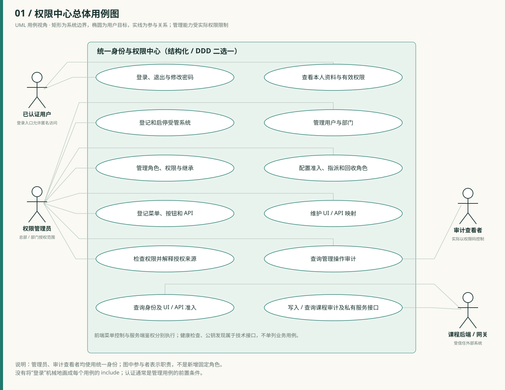

# 总体用例图

> 阅读基线：2026-11-19；Git HEAD：`57deb4a1cf91da197f3f30687839afca8bf7b815`。本文来自当前源码、固定教师 API 和数据库迁移的静态分析。本次未运行业务测试或部署，接口存在不等于本轮验收通过。

## 系统边界

权限中心管理统一身份、受管系统、用户、部门、角色继承、UI/API 资源和集中审计。课程中心负责课程、班级、小组、里程碑、提交和成绩。外部课程后端/网关是权限中心的系统参与者。

管理员和审计查看者是参与职责，不是新增的固定数据库角色；实际可执行操作由 API 权限、组织管理范围和授权上界决定。学生组长/任课教师/课程组长还受课程对象关系约束。

图中用例为高层分组，不等于每个参与者都可以执行分组内所有动作。登录是受保护用例的常见前置条件，未机械地添加 include；健康检查不作为业务用例。

## 来源与可编辑文件

- [rbac-contract/src/main/resources/openapi/rbac-api.yaml](../../rbac-contract/src/main/resources/openapi/rbac-api.yaml)
- [rbac-contract/src/main/resources/catalog/course-openapi.source.yaml](../../rbac-contract/src/main/resources/catalog/course-openapi.source.yaml)
- [rbac-web/src/router/routes.ts](../../rbac-web/src/router/routes.ts)
- [权限中心 PlantUML](src/usecase-center.puml)
- [课程协作 PlantUML](src/usecase-course.puml)
