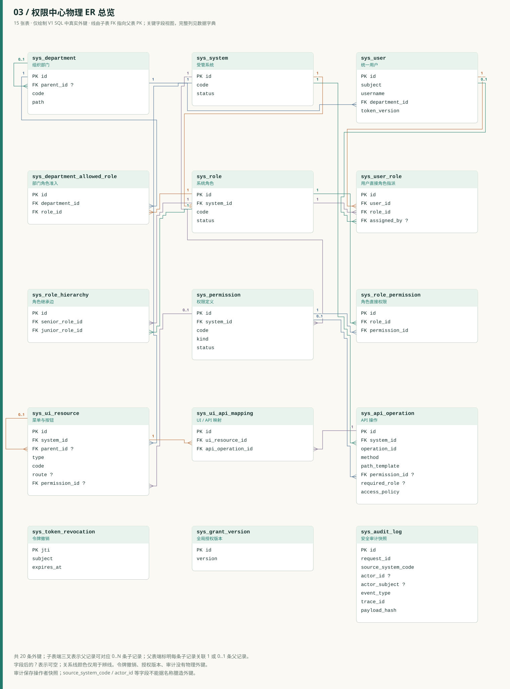

# ER 图与数据字典

> 阅读基线：2026-11-19；Git HEAD：`57deb4a1cf91da197f3f30687839afca8bf7b815`。本文来自当前源码、固定教师 API 和数据库迁移的静态分析。本次未运行业务测试或部署，接口存在不等于本轮验收通过。

## 读图说明

图展示十五表与全部实际外键，仅列关键字段；下方字典保留所有列。子表端三叉表示父记录可被多条子记录引用；父表端 1/0..1 表示一条子记录的父记录基数。可空 FK 对应可选父关系。

- 核心授权链：User → UserRole → Role → RolePermission → Permission；继承边沿 senior → junior，senior 获得 junior 的有效权限。
- RoleHierarchy 允许多父与传递继承；同系统检查、自环和长环检查由持锁业务事务及领域对象完成，SQL CHECK 只覆盖部分条件。
- 部门树负责组织管理与角色准入；准入表示“允许指派”，不表示用户自动获得角色。
- 菜单按钮是树；角色继承是 DAG；两者不是同一个模型。
- Permission.kind 区分 UI 与 API；UI/API 映射只有追踪关系，不能隐式赋权。
- sys_token_revocation、sys_grant_version、sys_audit_log 没有外键；撤销按 subject/jti 查询，审计保存历史快照，授权版本是固定全局行。
- 同一系统限制、父节点类型约束、DAG 无环、授权上界及最后有效超级管理员保护并非都由外键或 CHECK 实现。
- 中心十五表不是课程库 ER。当前仓库通过固定上游准备课程数据库；不把课程表或课程数据复制进中心。
- V1/V2 仅用于新空开发/测试库，不是一期已有数据库的直接升级脚本。

## sys_system · 受管系统

| 字段 | 类型 | 可空 | 键/关系 | 完整定义 |
| --- | --- | --- | --- | --- |
| id | BIGINT | 否 | PK | `id BIGINT AUTO_INCREMENT PRIMARY KEY` |
| code | VARCHAR(64) | 否 | — | `code VARCHAR(64) NOT NULL UNIQUE` |
| name | VARCHAR(128) | 否 | — | `name VARCHAR(128) NOT NULL` |
| status | VARCHAR(16) | 否 | — | `status VARCHAR(16) NOT NULL` |
| version | BIGINT | 否 | — | `version BIGINT NOT NULL DEFAULT 0` |

- `CHECK(status IN ('ENABLED','DISABLED'))`

## sys_department · 组织部门

| 字段 | 类型 | 可空 | 键/关系 | 完整定义 |
| --- | --- | --- | --- | --- |
| id | BIGINT | 否 | PK | `id BIGINT AUTO_INCREMENT PRIMARY KEY` |
| parent_id | BIGINT | 是 | FK → sys_department.id | `parent_id BIGINT NULL` |
| code | VARCHAR(64) | 否 | — | `code VARCHAR(64) NOT NULL UNIQUE` |
| name | VARCHAR(128) | 否 | — | `name VARCHAR(128) NOT NULL` |
| path | VARCHAR(1024) | 否 | — | `path VARCHAR(1024) NOT NULL` |
| status | VARCHAR(16) | 否 | — | `status VARCHAR(16) NOT NULL` |
| version | BIGINT | 否 | — | `version BIGINT NOT NULL DEFAULT 0` |

- `CHECK(status IN ('ENABLED','DISABLED'))`

## sys_user · 统一用户

| 字段 | 类型 | 可空 | 键/关系 | 完整定义 |
| --- | --- | --- | --- | --- |
| id | BIGINT | 否 | PK | `id BIGINT AUTO_INCREMENT PRIMARY KEY` |
| subject | VARCHAR(128) | 否 | — | `subject VARCHAR(128) NOT NULL UNIQUE` |
| username | VARCHAR(128) | 否 | — | `username VARCHAR(128) NOT NULL UNIQUE` |
| password_hash | VARCHAR(100) | 否 | — | `password_hash VARCHAR(100) NOT NULL` |
| name | VARCHAR(128) | 否 | — | `name VARCHAR(128) NOT NULL` |
| no | VARCHAR(64) | 是 | — | `no VARCHAR(64) NULL` |
| phone | VARCHAR(32) | 是 | — | `phone VARCHAR(32) NULL` |
| department_id | BIGINT | 否 | FK → sys_department.id | `department_id BIGINT NOT NULL` |
| status | VARCHAR(16) | 否 | — | `status VARCHAR(16) NOT NULL` |
| token_version | BIGINT | 否 | — | `token_version BIGINT NOT NULL DEFAULT 0` |
| must_change_password | BOOLEAN | 否 | — | `must_change_password BOOLEAN NOT NULL DEFAULT true` |
| failed_login_count | INT | 否 | — | `failed_login_count INT NOT NULL DEFAULT 0` |
| locked_until | TIMESTAMP(3) | 是 | — | `locked_until TIMESTAMP(3) NULL` |
| version | BIGINT | 否 | — | `version BIGINT NOT NULL DEFAULT 0` |
| created_at | TIMESTAMP(3) | 否 | — | `created_at TIMESTAMP(3) NOT NULL DEFAULT CURRENT_TIMESTAMP(3)` |

- `CHECK(status IN ('ACTIVE','DISABLED','DELETED'))`
- `CHECK(token_version>=0 AND failed_login_count>=0 AND version>=0)`
- `INDEX ix_user_department_status(department_id,status,id)`
- `INDEX ix_user_name(name)`

## sys_role · 系统角色

| 字段 | 类型 | 可空 | 键/关系 | 完整定义 |
| --- | --- | --- | --- | --- |
| id | BIGINT | 否 | PK | `id BIGINT AUTO_INCREMENT PRIMARY KEY` |
| system_id | BIGINT | 否 | FK → sys_system.id | `system_id BIGINT NOT NULL` |
| code | VARCHAR(64) | 否 | — | `code VARCHAR(64) NOT NULL` |
| name | VARCHAR(128) | 否 | — | `name VARCHAR(128) NOT NULL` |
| description | VARCHAR(500) | 是 | — | `description VARCHAR(500) NULL` |
| status | VARCHAR(16) | 否 | — | `status VARCHAR(16) NOT NULL` |
| builtin | BOOLEAN | 否 | — | `builtin BOOLEAN NOT NULL DEFAULT false` |
| version | BIGINT | 否 | — | `version BIGINT NOT NULL DEFAULT 0` |

- `UNIQUE(system_id,code)`
- `CHECK(status IN ('ENABLED','DISABLED'))`

## sys_permission · 权限定义

| 字段 | 类型 | 可空 | 键/关系 | 完整定义 |
| --- | --- | --- | --- | --- |
| id | BIGINT | 否 | PK | `id BIGINT AUTO_INCREMENT PRIMARY KEY` |
| system_id | BIGINT | 否 | FK → sys_system.id | `system_id BIGINT NOT NULL` |
| code | VARCHAR(128) | 否 | — | `code VARCHAR(128) NOT NULL` |
| name | VARCHAR(128) | 否 | — | `name VARCHAR(128) NOT NULL` |
| kind | VARCHAR(8) | 否 | — | `kind VARCHAR(8) NOT NULL` |
| status | VARCHAR(16) | 否 | — | `status VARCHAR(16) NOT NULL` |
| version | BIGINT | 否 | — | `version BIGINT NOT NULL DEFAULT 0` |

- `UNIQUE(system_id,kind,code)`
- `CHECK(kind IN ('UI','API'))`
- `CHECK(status IN ('ENABLED','DISABLED'))`

## sys_role_permission · 角色直接权限

| 字段 | 类型 | 可空 | 键/关系 | 完整定义 |
| --- | --- | --- | --- | --- |
| id | BIGINT | 否 | PK | `id BIGINT AUTO_INCREMENT PRIMARY KEY` |
| role_id | BIGINT | 否 | FK → sys_role.id | `role_id BIGINT NOT NULL` |
| permission_id | BIGINT | 否 | FK → sys_permission.id | `permission_id BIGINT NOT NULL` |

- `UNIQUE(role_id,permission_id)`

## sys_user_role · 用户直接角色指派

| 字段 | 类型 | 可空 | 键/关系 | 完整定义 |
| --- | --- | --- | --- | --- |
| id | BIGINT | 否 | PK | `id BIGINT AUTO_INCREMENT PRIMARY KEY` |
| user_id | BIGINT | 否 | FK → sys_user.id | `user_id BIGINT NOT NULL` |
| role_id | BIGINT | 否 | FK → sys_role.id | `role_id BIGINT NOT NULL` |
| assigned_by | BIGINT | 是 | FK → sys_user.id | `assigned_by BIGINT NULL` |
| assigned_at | TIMESTAMP(3) | 否 | — | `assigned_at TIMESTAMP(3) NOT NULL DEFAULT CURRENT_TIMESTAMP(3)` |

- `UNIQUE(user_id,role_id)`

## sys_department_allowed_role · 部门角色准入

| 字段 | 类型 | 可空 | 键/关系 | 完整定义 |
| --- | --- | --- | --- | --- |
| id | BIGINT | 否 | PK | `id BIGINT AUTO_INCREMENT PRIMARY KEY` |
| department_id | BIGINT | 否 | FK → sys_department.id | `department_id BIGINT NOT NULL` |
| role_id | BIGINT | 否 | FK → sys_role.id | `role_id BIGINT NOT NULL` |

- `UNIQUE(department_id,role_id)`

## sys_role_hierarchy · 角色继承边

| 字段 | 类型 | 可空 | 键/关系 | 完整定义 |
| --- | --- | --- | --- | --- |
| id | BIGINT | 否 | PK | `id BIGINT AUTO_INCREMENT PRIMARY KEY` |
| senior_role_id | BIGINT | 否 | FK → sys_role.id | `senior_role_id BIGINT NOT NULL` |
| junior_role_id | BIGINT | 否 | FK → sys_role.id | `junior_role_id BIGINT NOT NULL` |

- `UNIQUE(senior_role_id,junior_role_id)`
- `CHECK(senior_role_id<>junior_role_id)`

## sys_ui_resource · 菜单与按钮

| 字段 | 类型 | 可空 | 键/关系 | 完整定义 |
| --- | --- | --- | --- | --- |
| id | BIGINT | 否 | PK | `id BIGINT AUTO_INCREMENT PRIMARY KEY` |
| system_id | BIGINT | 否 | FK → sys_system.id | `system_id BIGINT NOT NULL` |
| parent_id | BIGINT | 是 | FK → sys_ui_resource.id | `parent_id BIGINT NULL` |
| type | VARCHAR(16) | 否 | — | `type VARCHAR(16) NOT NULL` |
| code | VARCHAR(128) | 否 | — | `code VARCHAR(128) NOT NULL` |
| name | VARCHAR(128) | 否 | — | `name VARCHAR(128) NOT NULL` |
| route | VARCHAR(255) | 是 | — | `route VARCHAR(255) NULL` |
| component | VARCHAR(64) | 是 | — | `component VARCHAR(64) NULL` |
| sort_order | INT | 否 | — | `sort_order INT NOT NULL DEFAULT 0` |
| status | VARCHAR(16) | 否 | — | `status VARCHAR(16) NOT NULL` |
| permission_id | BIGINT | 是 | FK → sys_permission.id | `permission_id BIGINT NULL` |
| version | BIGINT | 否 | — | `version BIGINT NOT NULL DEFAULT 0` |

- `UNIQUE(system_id,code)`
- `CHECK(type IN ('MENU','BUTTON'))`
- `CHECK(status IN ('ENABLED','DISABLED'))`
- `INDEX ix_ui_tree(system_id,parent_id,sort_order,id)`

## sys_api_operation · API 操作

| 字段 | 类型 | 可空 | 键/关系 | 完整定义 |
| --- | --- | --- | --- | --- |
| id | BIGINT | 否 | PK | `id BIGINT AUTO_INCREMENT PRIMARY KEY` |
| system_id | BIGINT | 否 | FK → sys_system.id | `system_id BIGINT NOT NULL` |
| operation_id | VARCHAR(128) | 否 | — | `operation_id VARCHAR(128) NOT NULL` |
| method | VARCHAR(16) | 否 | — | `method VARCHAR(16) NOT NULL` |
| path_template | VARCHAR(500) | 否 | — | `path_template VARCHAR(500) NOT NULL` |
| permission_id | BIGINT | 是 | FK → sys_permission.id | `permission_id BIGINT NULL` |
| required_role | VARCHAR(64) | 是 | — | `required_role VARCHAR(64) NULL` |
| access_policy | VARCHAR(32) | 否 | — | `access_policy VARCHAR(32) NOT NULL` |
| enabled | BOOLEAN | 否 | — | `enabled BOOLEAN NOT NULL DEFAULT true` |
| version | BIGINT | 否 | — | `version BIGINT NOT NULL DEFAULT 0` |

- `UNIQUE(system_id,operation_id)`
- `UNIQUE(system_id,method,path_template)`
- `CHECK(access_policy IN ('PUBLIC','AUTHENTICATED','PROTECTED'))`
- `CHECK(method IN ('GET','POST','PUT','PATCH','DELETE','HEAD','OPTIONS'))`
- `CHECK(access_policy<>'PROTECTED' OR permission_id IS NOT NULL OR required_role IS NOT NULL)`

## sys_ui_api_mapping · UI / API 映射

| 字段 | 类型 | 可空 | 键/关系 | 完整定义 |
| --- | --- | --- | --- | --- |
| id | BIGINT | 否 | PK | `id BIGINT AUTO_INCREMENT PRIMARY KEY` |
| ui_resource_id | BIGINT | 否 | FK → sys_ui_resource.id | `ui_resource_id BIGINT NOT NULL` |
| api_operation_id | BIGINT | 否 | FK → sys_api_operation.id | `api_operation_id BIGINT NOT NULL` |

- `UNIQUE(ui_resource_id,api_operation_id)`

## sys_token_revocation · 令牌撤销

| 字段 | 类型 | 可空 | 键/关系 | 完整定义 |
| --- | --- | --- | --- | --- |
| jti | VARCHAR(128) | 否 | PK | `jti VARCHAR(128) PRIMARY KEY` |
| subject | VARCHAR(128) | 否 | — | `subject VARCHAR(128) NOT NULL` |
| expires_at | TIMESTAMP(3) | 否 | — | `expires_at TIMESTAMP(3) NOT NULL` |
| created_at | TIMESTAMP(3) | 否 | — | `created_at TIMESTAMP(3) NOT NULL DEFAULT CURRENT_TIMESTAMP(3)` |

- `INDEX ix_revocation_expiry(expires_at)`
- `INDEX ix_revocation_subject(subject)`

## sys_grant_version · 全局授权版本

| 字段 | 类型 | 可空 | 键/关系 | 完整定义 |
| --- | --- | --- | --- | --- |
| id | TINYINT | 否 | PK | `id TINYINT PRIMARY KEY` |
| version | BIGINT | 否 | — | `version BIGINT NOT NULL DEFAULT 0` |

- `CHECK(id=1)`
- `CHECK(version>=0)`

## sys_audit_log · 安全审计快照

| 字段 | 类型 | 可空 | 键/关系 | 完整定义 |
| --- | --- | --- | --- | --- |
| id | BIGINT | 否 | PK | `id BIGINT AUTO_INCREMENT PRIMARY KEY` |
| request_id | CHAR(36) | 否 | — | `request_id CHAR(36) NOT NULL UNIQUE` |
| source_system_code | VARCHAR(64) | 否 | — | `source_system_code VARCHAR(64) NOT NULL` |
| origin | VARCHAR(16) | 否 | — | `origin VARCHAR(16) NOT NULL` |
| actor_id | BIGINT | 是 | — | `actor_id BIGINT NULL` |
| actor_subject | VARCHAR(128) | 是 | — | `actor_subject VARCHAR(128) NULL` |
| actor_name | VARCHAR(128) | 是 | — | `actor_name VARCHAR(128) NULL` |
| actor_roles_json | JSON | 否 | — | `actor_roles_json JSON NOT NULL` |
| event_type | VARCHAR(64) | 否 | — | `event_type VARCHAR(64) NOT NULL` |
| object_type | VARCHAR(64) | 是 | — | `object_type VARCHAR(64) NULL` |
| object_id | VARCHAR(128) | 是 | — | `object_id VARCHAR(128) NULL` |
| target | VARCHAR(500) | 否 | — | `target VARCHAR(500) NOT NULL` |
| before_json | JSON | 是 | — | `before_json JSON NULL` |
| after_json | JSON | 是 | — | `after_json JSON NULL` |
| result | VARCHAR(16) | 否 | — | `result VARCHAR(16) NOT NULL` |
| reason | VARCHAR(255) | 是 | — | `reason VARCHAR(255) NULL` |
| trace_id | VARCHAR(64) | 否 | — | `trace_id VARCHAR(64) NOT NULL` |
| payload_hash | VARCHAR(64) | 否 | — | `payload_hash VARCHAR(64) NOT NULL` |
| occurred_at | TIMESTAMP(3) | 否 | — | `occurred_at TIMESTAMP(3) NOT NULL DEFAULT CURRENT_TIMESTAMP(3)` |

- `CHECK(origin IN ('COURSE','INTERNAL'))`
- `CHECK(result IN ('SUCCESS','DENIED','FAILURE'))`
- `INDEX ix_audit_system_time(source_system_code,occurred_at,id)`
- `INDEX ix_audit_system_actor(source_system_code,actor_id,occurred_at,id)`
- `INDEX ix_audit_system_object(source_system_code,object_type,object_id,occurred_at,id)`

## 全部外键

| 子表 | FK | 父表 | 每条子记录关联父记录 |
| --- | --- | --- | --- |
| sys_department | parent_id | sys_department | 0..1 |
| sys_user | department_id | sys_department | 1 |
| sys_role | system_id | sys_system | 1 |
| sys_permission | system_id | sys_system | 1 |
| sys_role_permission | role_id | sys_role | 1 |
| sys_role_permission | permission_id | sys_permission | 1 |
| sys_user_role | user_id | sys_user | 1 |
| sys_user_role | role_id | sys_role | 1 |
| sys_user_role | assigned_by | sys_user | 0..1 |
| sys_department_allowed_role | department_id | sys_department | 1 |
| sys_department_allowed_role | role_id | sys_role | 1 |
| sys_role_hierarchy | senior_role_id | sys_role | 1 |
| sys_role_hierarchy | junior_role_id | sys_role | 1 |
| sys_ui_resource | system_id | sys_system | 1 |
| sys_ui_resource | parent_id | sys_ui_resource | 0..1 |
| sys_ui_resource | permission_id | sys_permission | 0..1 |
| sys_api_operation | system_id | sys_system | 1 |
| sys_api_operation | permission_id | sys_permission | 0..1 |
| sys_ui_api_mapping | ui_resource_id | sys_ui_resource | 1 |
| sys_ui_api_mapping | api_operation_id | sys_api_operation | 1 |

来源：[rbac-contract/src/main/resources/db/migration/V1__rbac1_schema.sql](../../rbac-contract/src/main/resources/db/migration/V1__rbac1_schema.sql)。可编辑源：[Mermaid ER](src/er-physical.mmd)，提取数据：[schema.json](data/schema.json)。
