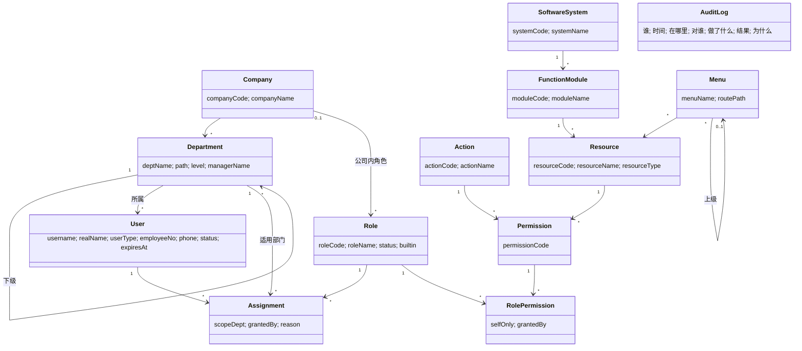

# 权限管理系统需求规格说明书（RBAC0 阶段）

**版本 0.3 · 2026 年 10 月 11 日**

> 本文档格式参照课程提供的范本《支付模块需求规格说明书》(PayReqSPEC)。
>
> **版本说明**：0.1、0.2 版按「RBAC0 → RBAC1 → RBAC2/3、三种范式」写了全部迭代的需求。第一次检查前，课程给出的
> 《RBAC0 需求》明确：本阶段**只实现 RBAC0**，**必须采用面向功能的结构化设计**，不实现 RBAC1/RBAC2，
> 不做针对高并发的专项设计。0.3 版据此重写，正文只保留本阶段要交付的需求。后续检查的内容见附录 B。

---

## 目录

1. [引言](#1-引言)
2. [任务概述](#2-任务概述)
3. [数据描述](#3-数据描述)
4. [功能需求](#4-功能需求)
5. [性能需求](#5-性能需求)
6. [运行需求](#6-运行需求)
7. [其它需求](#7-其它需求)
- [附录 A 需求决策记录](#附录-a-需求决策记录)
- [附录 B 不在本阶段交付范围的内容](#附录-b-不在本阶段交付范围的内容)
- [附录 C 需求数据疑点与导入结果](#附录-c-需求数据疑点与导入结果)
- [附录 D 《RBAC0 需求》逐条对照](#附录-d-rbac0-需求逐条对照)

---

# 1 引言

## 1.1 编写目的

明确权限管理系统在第一次检查（RBAC0、结构化设计）阶段的需求，划清系统边界，作为数据库设计、API 设计、界面设计、详细设计和测试用例的依据。

读者为本课程设计小组成员、任课教师与助教。任何未在本文档中登记编号的功能，不进入本阶段实现范围。

## 1.2 项目背景

a. **委托单位与开发单位**

委托单位：厦门大学信息学院《面向对象分析与设计》课程组。
开发单位：本课程设计小组。
本选题同时用于《软件工程》《JavaEE 平台技术》两门课程的课程设计。

b. **业务背景：市政工程公司**

系统的服务对象是一家市政工程公司。其规模与组织结构由课程提供的三份数据确定：

| 数据文件 | 内容 | 规模 |
|---|---|---|
| 市政公司部门信息表 | 部门名称、部门经理、上级部门 | 111 个部门，三层，单一根节点「总公司」 |
| 市政公司员工信息表 | 姓名、用户名、分公司、部门、岗位、电话号码 | 10000 名员工，用户名形如 `SG000001` |
| 市政公司应用软件功能权限清单 | 软件系统 / 功能模块 / 功能点 / 功能说明 + 五个角色列 | 18 个软件系统、115 个功能模块、359 个功能点 |

组织结构：

```
总公司
├── 职能部门（10 个）：综合办公室、党委工作部、人力资源部、财务部、市场经营部、
│                      工程技术部、安全质量部、物资设备部、审计监察部、工会办公室
├── 公司领导
└── 分公司（9 个）：道路工程、桥梁工程、隧道工程、轨道交通、管网工程、
                    水务工程、园林绿化、照明工程、市政养护
     └── 每个分公司下设：综合办公室、财务部、工程技术部、安全质量部、
                          物资设备部、市场经营部、第一至第四项目经理部
```

c. **与其他系统的关系**

本系统是该公司的**统一权限中心**。清单中的 18 个业务系统不各自维护权限，而是调用本系统的鉴权接口，询问「某用户能否对某部门的数据执行某操作」。

本系统不实现这 18 个业务系统。为验证权限确实在业务系统里生效，另做一个独立进程的**外部模拟业务系统**（`rbac-mock-biz`），从清单中取两个功能点实现（§4.2.15）。

## 1.3 定义

### 1.3.1 需求编号规则

格式为 `RBAC-REQ-<子系统>-NNN`：

| 子系统 | 含义 |
|---|---|
| AUTH | 登录认证 |
| AUTHZ | 鉴权服务（含权限解释、缓存） |
| IDM | 用户管理 |
| ROLE | 角色管理与角色授权 |
| ASGN | 用户角色指派（单个与批量） |
| PERM | 资源、操作、权限 |
| MENU | 菜单管理与动态菜单 |
| ORG | 组织与数据导入 |
| AUDIT | 审计日志 |
| OBSV | Dashboard 与权限使用热力图 |
| BIZ | 外部模拟业务系统 |

示例：`RBAC-REQ-AUTHZ-001` 表示鉴权服务的第 1 号需求。正文中常省略前缀，写作 `AUTHZ-001`。编号一经分配不再变更；需求废弃时标注「已废弃」，不回收。

### 1.3.2 术语表

| 术语 | 英文 | 定义 |
|---|---|---|
| 基于角色的访问控制 | RBAC | 权限授予角色，用户通过被指派角色获得权限。本阶段只实现 RBAC0 |
| 用户 | User | 登录主体。分为正式员工（EMPLOYEE）、临时用户（TEMPORARY）、系统账号（SYSTEM，如内置超级管理员、业务系统账号） |
| 资源 | Resource | 被保护的对象。三类：BUSINESS（权限清单的功能点）、MENU（权限中心自身的管理页面）、API（不对应页面的接口能力） |
| 操作 | Action | 对资源可施加的动作。业务五类：查看 view、新增 create、编辑 edit、审批 approve、导出 export；权限中心另有 delete、assign、revoke、import、invoke、explain |
| 权限 | Permission | 资源 × 操作。权限码为 `资源编码:操作编码`，如 `oa:m01:f02:approve`、`rbac:user:view` |
| 角色 | Role | 一组权限的命名集合。全局角色（不属于任何公司）或公司内角色 |
| 指派 | Assignment | 用户 + 角色 + 适用部门。一条指派表示「该用户在该部门及其下级部门持有该角色」，例如「员工甲在道路工程分公司持有公文审批员」。同一个东西在各处的名字：领域模型 `Assignment`、表 `sys_user_role`、实体 `UserRole`、接口里的 `assignmentId`、权限码 `rbac:assignment:assign / revoke`、界面上的「角色指派」「分配角色」。它是 User 与 Role 多对多关系的关联类，多带了「适用部门」这一属性，所以单独画出来 |
| 适用部门 | Scope Department | 指派上的部门（`scope_dept_id`）。用来表达「属于一个部门，但拥有多个部门的权限」 |
| 目标部门 | Target Department | 鉴权请求中被操作数据所属的部门（`targetDeptId`），可为空 |
| 管理范围 | Management Scope | 管理员持有某项管理权限的那些适用部门及其下级。管理员只能管理范围内的用户 |
| 超级管理员 | Super Admin | 持有内置角色 `SUPER_ADMIN` 的账号。账号有效时越过权限引擎直接放行 |
| 账号三态 | Account Status | 启用 ACTIVE、停用 DISABLED（可恢复）、删除 DELETED（终态，行保留，用户名不可复用） |
| 鉴权 | Authorization Check | 给定（用户，权限码，目标部门），返回允许或拒绝及原因 |
| 权限解释 | Explain | 与鉴权同一个判定过程，另外返回逐步的判定依据 |
| 只限本人 | Self Only | 权限清单中「查看本人」「编辑本人」。RBAC0 判断能否执行该操作，「只限本人记录」随鉴权结果返回，由业务系统按记录归属过滤 |
| 功能点 | Function Point | 权限清单中最细的功能单元，如「发文拟稿与审核」，共 359 个，即 359 个 BUSINESS 资源 |

## 1.4 参考资料

1. 《面向对象分析与设计课程设计成绩计算办法》V1，2026/09/07。
2. 《面向对象分析与设计——课程介绍》，2026 秋季学期。
3. 《支付模块需求规格说明书》V1.0，2023/09/15（本文档格式范本）。
4. 《RBAC0 需求》，2026 秋季学期，第一次检查前下发。
5. 第一次已知问题审查报告，2026/10/11。
6. ANSI/INCITS 359-2012. *Information Technology — Role Based Access Control*.
7. Sandhu R, et al. *Role-Based Access Control Models*. IEEE Computer, 1996, 29(2): 38-47.

---

# 2 任务概述

## 2.1 目标

建设一个统一权限中心，向业务系统和管理员提供：

1. **登录**：账号口令登录、登出、修改口令；
2. **鉴权**：回答「某用户能否对某部门的数据执行某操作」，并能解释判定依据；
3. **权限配置**：管理用户、角色、资源、操作、权限、菜单，人工分配和回收用户角色（单个或按分公司/部门/员工批量）；
4. **审计与统计**：记录登录、鉴权和全部权限变更；Dashboard 与权限使用热力图从真实记录统计。

本阶段只实现 RBAC0。课程后续检查的 RBAC1、RBAC2/3 与面向对象、函数式实现不在本阶段范围（附录 B）。

## 2.2 运行环境

| 项 | 内容 |
|---|---|
| 操作系统 | 华为云服务器 Linux（部署）/ Windows 11（开发） |
| 运行时 | JDK 21，Maven 3.9.9 |
| 后端 | Spring Boot（Spring MVC），Spring Data JPA，Flyway |
| 数据库 | MySQL 8.0 |
| 缓存 | Redis 7 |
| 前端 | Vue 3 + TypeScript |
| 部署 | Docker Swarm，3 台服务器，其中 1 台部署数据库（`13-deployment.md`） |

## 2.3 条件与限制

**C-1 技术栈**：Spring MVC + Vue3/TS；MySQL + Redis + JPA；不使用 MyBatis；Docker Swarm 部署；提供 Jacoco 白盒测试报告。

**C-2 架构**：只使用 Controller + Service + Mapper 三层，不设独立的 DAO 层。Mapper 是 Spring Data JPA 的 Repository 接口（Redis 访问也放在 Mapper 层）。

**C-3 设计方法**：必须采用面向功能的结构化设计（功能分解、数据流、处理规约）。实体只是数据结构，处理逻辑写在无状态的 Service 处理过程里。

**C-4 模型范围**：只实现 RBAC0。不实现角色继承、职责分离、基数/先决/时间约束、会话角色。

**C-5 前端不承担安全职责**：菜单隐藏和按钮禁用只是界面行为。每个后端接口都独立鉴权。

**C-6 口令存储**：口令一律 BCrypt 哈希存储，任何位置不出现明文或可逆加密的口令。

**C-7 性能**：本阶段没有性能指标要求，只提供数据库缓存设计，不做针对高并发、大负载的专项设计。题目名称中的「高负载大并发」在本阶段的落点就是缓存设计（§5）。

---

# 3 数据描述

## 3.1 领域模型



公司、部门是与 RBAC0 配合使用的组织信息，**不构成角色之间的继承关系**。组织树决定人员归属与管理范围；角色只决定权限集合，两者语义不同。

表结构见 `03-database.md`。

## 3.2 核心概念说明

### 3.2.1 权限码

权限码 = `资源编码:操作编码`。

| 资源来源 | 资源编码 | 示例权限码 |
|---|---|---|
| 权限清单（BUSINESS） | `业务系统码:模块码:功能点码`。业务系统码固定（如 oa、hr、pmis），模块、功能点按清单中的顺序编号 | `oa:m01:f02:approve`（OA › 公文管理 › 发文拟稿与审核 › 审批） |
| 权限中心自身（MENU / API） | `rbac:<对象>` | `rbac:user:view`、`rbac:assignment:assign` |

需求原文写作「Permission = Action:Action」，按上下文理解为 Resource:Action。

### 3.2.2 适用部门与目标部门

一个用户只属于一个部门（`department_id`）。他能在哪些部门行使权限，由他的各条指派的**适用部门**决定。一条指派覆盖适用部门本身及其全部下级部门（用部门路径的前缀判断）。

同一用户可以：

- 在不同部门持有不同角色；
- 在多个部门持有同一角色（每个部门一条指派）。

鉴权时，作用域**跟着指派记录走**：必须存在**同一条**指派，既通过其角色拥有该权限，又通过其适用部门覆盖目标部门。不能先把所有角色的权限并成一个集合，再单独检查部门——那会拼出「A 角色的权限 + B 角色的部门」这种实际不存在的组合。

### 3.2.3 判定规则

对一般用户：

```
Allow(u, p, d) = 账号有效(u)
                 ∧ ∃ 指派 a ∈ u：角色(a) 启用 ∧ p ∈ 权限(角色(a)) ∧ (d 为空 ∨ d 在 适用部门(a) 之下)
```

- 账号有效：存在、未删除、未停用、未到期；
- 超级管理员：账号有效即放行（`SUPER_ADMIN_BYPASS`），不检查权限与部门；
- 判定结论附带原因码：放行为 `ROLE_GRANTED` / `SUPER_ADMIN_BYPASS`；拒绝为 `SUBJECT_NOT_FOUND`、`SUBJECT_DISABLED`、`SUBJECT_DELETED`、`SUBJECT_EXPIRED`、`MISSING_PERMISSION`、`OUT_OF_DATA_SCOPE`、`TARGET_DEPT_NOT_FOUND`。

### 3.2.4 管理范围

管理员只能管理自身和以下层级的员工。实现上没有另起一套机制：管理操作本身也是权限（如 `rbac:user:edit`、`rbac:assignment:assign`），管理员能管理的用户，就是他持有该管理权限的指派的适用部门子树里的用户。判断用的是与鉴权相同的判定过程，目标部门取被管理用户的所属部门。

分配角色时还要求**不能授出自己没有的权限**：角色的每一个权限，操作者都必须有一条覆盖适用部门的授权，且范围不窄于角色（操作者只有「查看本人」，就不能分配含完整「查看」的角色）。

### 3.2.5 权限清单矩阵

清单的五个角色列导入为五个全局角色模板：

| 列 | 角色编码 | 角色权限数（导入结果） |
|---|---|---|
| 系统管理员 | SYS_ADMIN | 1795 |
| 公司领导 | COMPANY_LEADER | 466 |
| 部门经理 | DEPT_MANAGER | 582 |
| 项目经理 | PROJECT_MANAGER | 253 |
| 普通员工 | EMPLOYEE | 94 |
| 合计 | | 3190 |

单元格取值解析：「全部」展开为五类操作；「无」不授权；「查看/编辑」等按 `/` 拆分；「查看本人」「编辑本人」授予对应操作并标记只限本人；英文 `view` 按「查看」处理；空白单元格不能当作「无」，列入异常清单。

需要区分两个数字：**1795** 是可配置的权限定义数（359 个资源 × 5 类操作）；**3190** 是五类角色实际得到的角色—权限关联数。

此外系统内置三个角色：

| 角色 | 说明 |
|---|---|
| SUPER_ADMIN 超级管理员 | 越过权限引擎；没有也不接受任何角色授权 |
| RBAC_ADMIN 权限管理员 | 权限中心的全部管理权限（数据导入与新建权限定义除外），管理范围由指派的适用部门决定 |
| AUDITOR 审计员 | 只读：审计日志、Dashboard、热力图 |

### 3.2.6 数据规模

| 对象 | 数量 |
|---|---|
| 用户 | 10000（导入）+ 1（内置超级管理员） |
| 部门 | 111 |
| 业务系统 | 18（另有权限中心自身 1 个） |
| 功能模块 | 115 |
| 业务资源 | 359 |
| 业务权限 | 1795 |
| 角色—权限关联（五类模板） | 3190 |

---

# 4 功能需求

## 4.1 功能划分

### 4.1.1 两个场景

需求把系统分为**登录**和**鉴权**两个场景：

- 登录场景：用户（管理员、员工、临时用户）通过权限中心的管理界面登录，管理组织、用户、角色和权限；
- 鉴权场景：业务系统带着用户的令牌（或以业务系统账号代用户）调用 `/authz/check`。

### 4.1.2 参与者

| 参与者 | 说明 |
|---|---|
| 超级管理员 | 内置账号 `root`。越过权限引擎；负责数据导入、全局角色与权限定义、任命权限管理员 |
| 权限管理员 | 持有 RBAC_ADMIN 的用户。在适用部门子树内管理用户与角色指派 |
| 审计员 | 持有 AUDITOR 的用户。只读审计日志与统计 |
| 普通用户 | 正式员工或临时用户。登录、改口令、查看自己的权限 |
| 业务系统 | 外部系统。调用鉴权接口（本阶段由外部模拟业务系统代表） |

### 4.1.3 功能分解

```
权限中心
├── 1 登录认证（AUTH）        登录 / 登出 / 令牌校验 / 修改口令
├── 2 鉴权（AUTHZ）           鉴权判定 / 权限解释 / 授权数据缓存
├── 3 用户管理（IDM）         列表搜索 / 新增 / 修改 / 启用停用 / 删除 / 批量 / 详情
├── 4 授权管理（ASGN）        分配角色 / 回收角色 / 批量分配 / 批量回收
├── 5 角色管理（ROLE）        增删改 / 启用停用 / 角色授权 / 回收角色权限
├── 6 权限管理（PERM）        业务系统 / 资源 / 操作 / 权限
├── 7 菜单（MENU）            菜单管理 / 动态菜单
├── 8 组织与导入（ORG）       公司 / 部门树 / 导入三份 xlsx
├── 9 审计（AUDIT）           记录 / 查询
└── 10 统计（OBSV）           Dashboard / 权限使用热力图
```

### 4.1.4 需求清单总表

接口均以 `/api/v1` 为前缀，契约见 `rbac-contract/src/main/resources/openapi/rbac-api.yaml`（45 个操作，每个都声明所需权限）。

| 编号 | 需求 | 接口 | 所需权限 |
|---|---|---|---|
| AUTH-001 | 账号口令登录，连续失败 5 次锁定 15 分钟 | `POST /auth/login` | 免登录 |
| AUTH-002 | 登出后原令牌立即失效 | `POST /auth/logout` | 登录即可 |
| AUTH-003 | 查看当前用户的信息、角色、有效权限 | `GET /auth/me` | 登录即可 |
| AUTH-004 | 修改本人口令；首次登录必须先改；改后旧令牌失效 | `POST /auth/password` | 登录即可 |
| AUTH-005 | 每个请求校验令牌与账号当前状态，停用、删除、到期在下一次请求生效 | 全部接口（拦截器） | — |
| AUTHZ-001 | 鉴权：用户能否对目标部门执行某操作 | `POST /authz/check` | 查自己：登录即可；查别人：`rbac:authz:invoke` |
| AUTHZ-002 | 权限解释：返回判定依据；与鉴权结论始终一致 | `POST /authz/explain` | 查自己：登录即可；查别人：`rbac:authz:explain` |
| AUTHZ-003 | 超级管理员越过权限引擎，但账号须有效 | 判定过程 | — |
| AUTHZ-004 | 授权数据缓存；权限修改后下一次访问即生效 | 判定过程 | — |
| AUTHZ-005 | 每个后端接口都受权限控制；未声明权限的接口默认拒绝 | 全部接口（拦截器） | — |
| IDM-001 | 用户列表与搜索（只含管理范围内的用户） | `GET /users` | `rbac:user:view` |
| IDM-002 | 新增用户（正式员工、临时用户、业务系统账号）；用户编号 1–9999 预留给内部账号 | `POST /users` | `rbac:user:create` |
| IDM-003 | 修改用户（姓名、部门、电话、岗位、到期时间） | `PATCH /users/{id}` | `rbac:user:edit` |
| IDM-004 | 启用、停用 | `PATCH /users/{id}/status` | `rbac:user:edit` |
| IDM-005 | 删除（逻辑删除） | `DELETE /users/{id}` | `rbac:user:delete` |
| IDM-006 | 批量启用、停用、删除 | `POST /users/batch-status` | `rbac:user:edit` |
| IDM-007 | 用户详情：基本信息、角色、有效权限 | `GET /users/{id}`、`GET /users/{id}/roles`、`GET /users/{id}/permissions` | 本人或 `rbac:user:view` |
| ASGN-001 | 为用户分配角色（带适用部门） | `POST /users/{id}/roles` | `rbac:assignment:assign` |
| ASGN-002 | 回收一次指派；不级联；管理员可以撤销自己的指派 | `DELETE /users/{id}/roles/{assignmentId}` | `rbac:assignment:revoke` |
| ASGN-003 | 按分公司 / 部门 / 员工批量分配 | `POST /assignments/batch` | `rbac:assignment:assign` |
| ASGN-004 | 按分公司 / 部门 / 员工批量回收 | `POST /assignments/batch-revoke` | `rbac:assignment:revoke` |
| ROLE-001 | 角色列表：名称、编码、用户数、权限数、状态 | `GET /roles` | `rbac:role:view` |
| ROLE-002 | 新增角色（全局或公司内） | `POST /roles` | `rbac:role:create` |
| ROLE-003 | 角色详情：基本信息、权限、用户 | `GET /roles/{id}`、`GET /roles/{id}/users` | `rbac:role:view` |
| ROLE-004 | 修改、启用停用角色 | `PATCH /roles/{id}` | `rbac:role:edit` |
| ROLE-005 | 删除角色（仍有人持有时拒绝） | `DELETE /roles/{id}` | `rbac:role:delete` |
| ROLE-006 | 为角色授予权限（PERMISSION_ASSIGN） | `POST /roles/{id}/permissions` | `rbac:grant:assign` |
| ROLE-007 | 回收角色的权限（PERMISSION_REVOKE） | `DELETE /roles/{id}/permissions/{permissionId}` | `rbac:grant:revoke` |
| PERM-001 | 业务系统与功能模块（多权限域、多业务系统） | `GET /systems` | `rbac:permission:view` |
| PERM-002 | 资源列表、新增资源 | `GET /resources`、`POST /resources` | `rbac:permission:view` / `create` |
| PERM-003 | 操作列表 | `GET /actions` | `rbac:permission:view` |
| PERM-004 | 权限列表、新增权限 | `GET /permissions`、`POST /permissions` | `rbac:permission:view` / `create` |
| MENU-001 | 按当前用户的权限动态生成菜单 | `GET /menus/me` | 登录即可 |
| MENU-002 | 菜单管理（菜单是一种资源） | `GET/POST /menus`、`PATCH/DELETE /menus/{id}` | `rbac:menu:*` |
| ORG-001 | 公司列表（多公司） | `GET /companies` | `rbac:org:view` |
| ORG-002 | 部门树（管理范围内） | `GET /departments/tree` | `rbac:org:view` |
| ORG-003 | 导入部门信息表与员工信息表 | `POST /imports/organization` | `rbac:org:import` |
| ORG-004 | 导入应用软件功能权限清单 | `POST /imports/permissions` | `rbac:permission:create` |
| AUDIT-001 | 记录审计七要素与事件类型 | 各处理过程 | — |
| AUDIT-002 | 审计日志查询 | `GET /audit-logs` | `rbac:audit:view` |
| OBSV-001 | Dashboard 十一项指标 | `GET /dashboard` | `rbac:dashboard:view` |
| OBSV-002 | 权限使用热力图（创新功能） | `GET /permissions/heatmap` | `rbac:heatmap:view` |
| BIZ-001 | 外部模拟业务系统调用鉴权接口 | `rbac-mock-biz` | — |

「登录即可」对应契约中的 `x-required-permission: "@self"`：能操作谁由 Service 判断（本人，或在管理范围内的人）。

## 4.2 功能描述

各用例按「需求 → 前置条件 → 主流程 → 异常 → 后置条件」描述。

### 4.2.1 登录（AUTH-001）

**需求**：用户以用户名和口令登录，得到令牌。

**前置条件**：账号存在。

**主流程**：
1. 用户提交用户名、口令；
2. 系统查找用户；账号已锁定则拒绝；
3. 比对口令哈希；
4. 校验账号有效（未停用、未到期）；
5. 清零登录失败计数，签发令牌（有效期 2 小时，含令牌编号与令牌版本号，**不含权限**）；
6. 记审计 `LOGIN / SUCCESS`。

**异常**：
- 用户不存在、已删除、口令错误：一律返回「用户名或口令错误」（40102），不区分具体原因；用户不存在时仍做一次哈希比对，避免借响应时间枚举用户名；
- 口令错误：失败计数在数据库中原子加一，满 5 次锁定 15 分钟（并发的失败请求不丢计数）；
- 已锁定：40103；
- 已停用或已到期：40104；
- 以上均记审计 `LOGIN / FAILED` 及原因。

**后置条件**：返回令牌与 `mustChangePwd` 标记。

### 4.2.2 修改口令（AUTH-004）

**需求**：用户修改本人口令；首次登录必须先修改。

**前置条件**：已登录。

**主流程**：
1. 用户提交旧口令与新口令；
2. 校验旧口令；
3. 校验新口令策略：至少 8 位，含大写、小写、数字、特殊字符，且不同于旧口令；
4. 保存新哈希，清除「必须改口令」标记，令牌版本号加一；
5. 记审计 `PASSWORD_CHANGE`。

**异常**：旧口令错误或新口令不合策略，400。

**后置条件**：此前签发的令牌全部失效，须重新登录。在改口令之前，只允许调用 `GET /auth/me`、`POST /auth/logout`、`POST /auth/password`，其余接口返回 40304。

### 4.2.3 登出（AUTH-002）

**主流程**：把当前令牌编号登记到 Redis，登记在令牌原本到期时自动删除；记审计 `LOGOUT`。

**后置条件**：该令牌之后的每次请求都返回 401。Redis 查询失败时按「已注销」处理，宁可让用户重新登录。

### 4.2.4 鉴权（AUTHZ-001）

**需求**：回答「用户能否对目标部门的数据执行某操作」。

**前置条件**：调用者已登录（业务系统可以转发用户自己的令牌，也可以用业务系统账号代用户查询）。

**主流程**：
1. 确定被查用户：请求中给 `userId` 或 `username`，都不给表示调用者本人；
2. 查别人时，调用者必须在被查用户的部门持有 `rbac:authz:invoke`，否则 403；
3. 确定权限码：`permission`，或 `resource` + `action`；
4. 执行判定过程（§3.2.3）：校验主体 → 读取授权数据（缓存或数据库）→ 超级管理员旁路 → 找出含该权限的授权 → 逐条检查适用部门是否覆盖目标部门；
5. 记审计 `AUTH_SUCCESS` 或 `AUTH_FAILED`，含权限码、耗时、是否命中缓存；
6. 返回结论。

**异常**：
- 请求缺权限码：400；
- 调用者无权查别人：403，并记审计 `AUTHZ_QUERY / DENIED`。先确认调用者有权查询，再透露被查用户是否存在。

**后置条件**：返回 `allowed`、原因码、所依据的授权（角色 + 适用部门）、`selfOnly`、`cacheHit`、`latencyUs`。**拒绝也返回 HTTP 200 + allowed=false**：那是一次正常完成的判定，不与「调用者无权调用」（403）混淆。

### 4.2.5 权限解释（AUTHZ-002，创新功能）

**需求**：对一次判定展示授权依据，而不是另建一套权限引擎。

**主流程**：同 §4.2.4，调用同一个判定过程，另外逐步记录依据（trace）。查别人需要 `rbac:authz:explain`。

**示例**：

```
请求：oa:m01:f02:approve，目标部门 道路工程分公司-财务部
结果：DENY  MISSING_PERMISSION
依据：用户账号有效
      当前角色：普通员工@道路工程分公司-财务部，均不包含 oa:m01:f02:approve
```

```
结果：DENY  OUT_OF_DATA_SCOPE
依据：角色 部门经理 具有该权限，但只适用于「道路工程分公司」及其下级，目标部门不在其中
```

**约束**：解释与鉴权对任何输入的 `allowed`、`reason` 必须一致；普通用户不能借解释接口枚举他人权限。

### 4.2.6 分配角色（ASGN-001）

**需求**：管理员人工为用户分配角色，并指定适用部门。

**前置条件**：操作者持有 `rbac:assignment:assign`。

**主流程**：
1. 操作者提交用户、角色、适用部门（缺省为用户所属部门）、原因；
2. 校验：
   - 用户存在且未删除，角色存在且启用；
   - 公司内角色只能指派到本公司的部门；适用部门可以在用户所属公司以外（跨公司授权，10/21 组内审查起允许，`12-design-log.md` R-20）；
   - 操作者对用户所属部门、对适用部门都持有 `rbac:assignment:assign`（管理范围）；
   - 超级管理员角色只有超级管理员能分配；
   - 不能授出自己没有的权限：角色的每个权限，操作者在适用部门都必须持有，且不能只限本人（角色本身只限本人的除外）；
3. 同一（用户，角色，适用部门）已存在则 409；
4. 写入指派，`granted_by` 记操作者；
5. 提交后让授权缓存失效；
6. 记审计 `ROLE_ASSIGN`（detail 含角色与适用部门）。

**异常**：超出管理范围 40302；越权授予 40303；角色停用、用户已删除 409；公司内角色指派到别的公司 400。拒绝同样记审计（`DENIED` + 原因）。

**后置条件**：被分配者的下一次请求即拥有新权限。

### 4.2.7 回收角色（ASGN-002）

**主流程**：
1. 操作者指定用户的一条指派；
2. 回收的是操作者自己的指派时，不检查管理范围，直接进入第 3 步。这是 10/15 课堂要求「管理员可以自己撤销自己权限」，放弃权限不会扩大任何人的能力。否则校验操作者对用户所属部门和该指派的适用部门都持有 `rbac:assignment:revoke`，回收超级管理员角色还要求操作者是超级管理员；
3. 删除这一条指派；
4. 若删除后已没有有效的超级管理员，拒绝（409）；
5. 提交后缓存失效；记审计 `ROLE_REVOKE`。

**不级联**：只删这一条。被回收者过去授给别人的指派不受影响——`granted_by` 只是审计属性，不构成授权依赖。这就是需求「移除管理员权限，不会导致分配的权限级联删除」。

**后置条件**：被回收者的下一次请求即失去该角色的权限（管理员被回收后，管理能力立即失效）。管理员撤销了自己的管理员角色，同样从下一次请求起失去管理能力，只能由其他管理员重新分配。唯一的超级管理员不能撤销自己（第 4 步）。

### 4.2.8 批量授权（ASGN-003、ASGN-004）

**需求**：以分公司、部门、员工为单位批量分配或回收角色。

**输入**：`targetType`（COMPANY / DEPARTMENT / USER）、`targetIds`、`includeDescendants`（部门时是否含下级，默认是）、`roleId`、`scopeDepartmentId`（为空表示各自所属部门；回收时为空表示该角色的全部指派）、`reason`、`mode`。

**主流程**：
1. 把目标展开为用户集合并去重：公司 → 根部门子树；部门 → 本部门或子树；员工 → 指定的人。已删除的用户不纳入（指定员工时列为失败）；
2. 对每个人做与单个分配相同的完整校验；
3. 已持有相同指派的人计入 `duplicated`，不算失败；
4. **ATOMIC（默认）**：有任何一人不通过校验，整批不写，返回 `committed=false` 与逐人失败原因；**PARTIAL**：写入通过的，失败逐人给出原因；
5. 写入后缓存失效；记一条批量审计（目标、请求人数、成功、重复、失败）。

默认原子，是为了避免管理员误以为全体都已授权。

**后置条件**：返回 `requested / succeeded / duplicated / failed / failures`。

### 4.2.9 新增用户（IDM-002）

**主流程**：
1. 操作者提交用户名、姓名、部门、用户类型、工号、电话、岗位、到期时间、口令（可空）；
2. 按类型校验：
   - 正式员工必须有工号；
   - 临时用户**不能有工号、电话**，**必须有到期时间**；
3. 目标部门须在操作者 `rbac:user:create` 的管理范围内；
4. 用户名、工号唯一（已删除用户的用户名也不能复用）；
5. 口令为空时使用初始口令并要求首次登录修改；不为空须满足口令策略；
6. 写入；记审计 `USER_CREATE`。用户编号分两段（10/15 课堂要求）：业务系统账号（`SYSTEM`）是内部账号，取 1–9999 段内的下一个编号，用完返回 409；正式员工、临时用户（含 Excel 导入）从 10000 起编号。内置超级管理员 `root` 的编号是 1。

**后置条件**：新用户没有任何角色，权限须另行人工分配。临时用户到期后无法登录，鉴权结论为 `SUBJECT_EXPIRED`。

### 4.2.10 修改、停用、删除用户（IDM-003 ~ IDM-006）

- **修改**：用户须在管理范围内；调到其他部门时，新部门也须在管理范围内，且不能跨公司；临时用户不能补填电话。
- **停用 / 启用**：账号三态之间的切换。停用可恢复、保留全部指派；停用后下一次请求即 401，鉴权结论 `SUBJECT_DISABLED`。
- **删除**：终态。逻辑删除，行与指派保留供审计，用户名不可复用。
- **共同规则**：不能停用或删除自己；持有超级管理员的账号只有超级管理员能改；已删除的用户不能再修改。每次变更记审计（`USER_STATUS` / `USER_DELETE`，含前后状态与原因）。
- **批量**：逐个校验，通过的执行，不通过的逐人列出原因（状态变更互相独立，不做整批原子）。

### 4.2.11 用户详情（IDM-007）

展示三部分：基本信息；角色（每条指派的角色、适用部门、授予人、授予时间、原因）；有效权限（每个权限码带来源角色与适用部门，以及是否只限本人）。本人可看自己的；看别人需要在其部门持有 `rbac:user:view`。

### 4.2.12 角色管理与角色授权（ROLE-001 ~ ROLE-007）

- 角色列表显示：角色名称、角色编码、用户数、权限数、状态。只列全局角色与操作者能管理的公司的公司内角色。
- 角色详情显示：基本信息、权限、用户。
- 角色修改影响所有持有者，因此按公司级管理：**全局角色只有超级管理员能改**；公司内角色要求操作者在该公司根部门持有相应权限。
- 停用角色后，持有者下一次请求即失去该角色的权限；超级管理员角色不能停用。
- 删除角色：内置角色不能删；仍有指派时拒绝（409），须先人工回收——不能借删除角色悄悄收回别人的权限。
- 角色授权：已有的跳过；超级管理员角色不接受授权；操作者必须在公司根部门持有这些权限，且不能只限本人（不能授出自己没有的权限）。授权、回收分别记 `PERMISSION_ASSIGN`、`PERMISSION_REVOKE`。

### 4.2.13 权限管理（PERM-001 ~ PERM-004）

区分 Resource、Action、Permission 三者：

- **Resource**：BUSINESS（清单的 359 个功能点）、MENU（权限中心的管理页面）、API（如鉴权接口能力）；
- **Action**：操作词汇表；
- **Permission**：Resource × Action，权限码 `资源编码:操作编码`。

资源编码必须以所属业务系统编码开头。新建资源时可同时为若干操作建立权限。资源与权限的定义属于全平台配置，新建只允许超级管理员（`rbac:permission:create` 不授给任何内置角色）。

### 4.2.14 菜单（MENU-001、MENU-002）

前端菜单也是一种资源：

```
Dashboard
系统管理
├ 用户管理
├ 角色管理
├ 权限管理
├ 菜单管理
├ 审计日志
└ 组织管理
权限解释
权限使用热力图
```

- 叶子菜单挂一个 MENU 资源，用户持有「该资源:view」才显示；目录节点在至少有一个子菜单可见时显示；
- `GET /menus/me` 由后端按当前用户权限返回菜单树，前端据此生成路由；
- 菜单管理：增删改；只能挂 MENU 类型的资源；不能把菜单移到自己或子菜单下面；有子菜单时不能删除；
- **隐藏菜单不等于禁止访问**：用户直接请求对应接口，后端仍独立拒绝。

### 4.2.15 外部模拟业务系统（BIZ-001）

独立进程 `rbac-mock-biz`，数据只放内存。每个接口先把用户的令牌原样带去 `/authz/check`（查自己），允许才执行。

| 功能点 | 资源编码 | 验证的情形 |
|---|---|---|
| OA › 公文管理 › 发文拟稿与审核 | `oa:m01:f02` | 普通员工可新增、不能审批；部门经理可审批；不能对其他分公司的部门拟稿 |
| 人力资源 › 考勤与休假管理 › 考勤管理 | `hr:m04:f01` | 普通员工是「查看/编辑本人」：只能看、改自己的记录 |

### 4.2.16 导入三份 Excel（ORG-003、ORG-004）

**需求**：把课程提供的三份数据导入系统，结果可复核。

**前置条件**：操作者为超级管理员（持有 `rbac:org:import`、`rbac:permission:create`）。

**主流程（组织与人员）**：
1. 公司不存在则创建；
2. 按「上级部门」列建部门树，计算物化路径；
3. 员工的部门按「分公司 + 部门」两列定位，并校验部门确实在该分公司之下：
   - 分公司 = 总公司：部门是总公司的直接下级；
   - 部门 = 分公司：分公司直属人员，归到分公司节点本身；
   - 否则在该分公司的下级中找「分公司-部门」；
4. 员工写入：工号 = 用户名，使用同一个初始口令哈希（只计算一次），要求首次登录修改；
5. 部门负责人按姓名匹配：先在部门子树内找，找不到再在全公司找，恰好一人才关联；
6. 返回导入报告：各类数量、说明、异常清单。

**主流程（功能权限清单）**：建立业务系统、功能模块、资源；每个资源 × 五类操作建立权限；五个角色列导入为全局角色模板及其角色权限。

**约束**：
- **导入不分配任何角色**。岗位不等于系统角色，部门负责人也不因此获得管理权限。导入后由管理员审核，用批量授权接口正式分配；
- 无法唯一确定的数据进入异常清单、不写入，**绝不取第一个同名的**；
- 可重复执行，已存在的部门、用户名、资源、权限跳过；重复导入功能权限清单时，角色模板的业务权限与最新清单对齐——新增的写入，「只限本人」变化的更新，清单里去掉的回收（权限只增不减会让系统内权限永远大于清单，「查看本人」改「查看」时还会静默放大可见范围）；
- 读不了的文件、找不到表头：400，整个导入回滚。

**后置条件**：真实数据的导入结果见附录 C.3。

### 4.2.17 审计（AUDIT-001、AUDIT-002）

每条记录包含七要素：

| 要素 | 字段 |
|---|---|
| 谁 | 操作者 id 与用户名快照 |
| 什么时候 | 发生时间（毫秒） |
| 在哪里 | 客户端 IP |
| 对谁 | 目标类型、id、名称快照 |
| 做了什么 | 事件类型 + 明细（如角色与适用部门） |
| 结果如何 | SUCCESS / DENIED / FAILED |
| 为什么 | 原因（拒绝或失败原因码、操作理由） |

事件类型至少包括：`LOGIN`、`LOGOUT`、`AUTH_SUCCESS`、`AUTH_FAILED`、`ROLE_ASSIGN`、`ROLE_REVOKE`、`PERMISSION_ASSIGN`、`PERMISSION_REVOKE`；另有 `PASSWORD_CHANGE`、`USER_CREATE`、`USER_UPDATE`、`USER_STATUS`、`USER_DELETE`、`ROLE_CREATE`、`ROLE_UPDATE`、`ROLE_DELETE`、`RESOURCE_CREATE`、`PERMISSION_CREATE`、`MENU_CREATE`、`MENU_UPDATE`、`MENU_DELETE`、`IMPORT_ORG`、`IMPORT_PERMISSIONS`、`AUTHZ_QUERY`、`ACCESS_DENIED`。哪些成功、失败会记录，哪些不记录，见 [06 §5.9](06-detail-structured.md)。

规则：
- 审计用独立事务写入：业务操作因拒绝或失败回滚时，审计记录照样留下；
- 只插入，不更新、不删除；无需回滚、无需版本化；
- 鉴权事件另带权限码、耗时、是否命中缓存，Dashboard 与热力图从这里统计；
- 查询可按事件类型、操作者、目标、结果、时间段过滤，分页，按时间倒序。

示例：

```
2026-10-11 10:21:11
user:   admin01          （某权限管理员）
action: ROLE_ASSIGN
target: 某员工
detail: role=SUPER_ADMIN scope=道路工程分公司
result: DENIED
reason: SUPER_ADMIN_ONLY
```

### 4.2.18 Dashboard（OBSV-001）

十一项指标，全部从真实数据统计，统计口径固定：

| 指标 | 口径 |
|---|---|
| 用户数量 | 未删除的用户（含停用、临时用户） |
| 角色数量 | 全部角色 |
| 权限数量 | 全部权限定义 |
| 今日鉴权次数 | 今日 AUTH_SUCCESS + AUTH_FAILED |
| 鉴权成功率 | 今日成功 / 今日鉴权次数 |
| 鉴权失败率 | 今日拒绝 / 今日鉴权次数 |
| P95 延迟 | 今日鉴权耗时的第 95 百分位（最近秩法） |
| P99 延迟 | 今日鉴权耗时的第 99 百分位 |
| QPS | 最近 60 秒的鉴权次数 / 60 |
| 缓存命中率 | 今日鉴权中授权数据来自 Redis 缓存的比例 |
| 异常访问数量 | 今日登录失败次数 + 已停用、已删除、已到期或不存在的主体发起的鉴权次数 |

鉴权次数包括业务系统调用 `/authz/check` 和管理接口经拦截器的每一次权限判定。

### 4.2.19 权限使用热力图（OBSV-002，创新功能）

横轴为操作，纵轴为业务系统，格子为时间段内**成功鉴权**的次数，默认最近 7 天。从审计日志按（业务系统，操作）分组统计，不另建实时流处理。用途：发现从未被使用的授权（可以回收）和异常集中的使用。

### 4.2.20 组织浏览（ORG-001、ORG-002）

公司列表只含操作者管理范围涉及的公司；部门树只返回操作者持有 `rbac:org:view` 的部门及其下级，以及通往它们的祖先节点（方便在树上定位）。批量授权页面据此选择目标。

## 4.3 业务流程

### 4.3.1 从导入到员工可用

```
超级管理员导入功能权限清单  → 18 系统 / 359 资源 / 1795 权限 / 五个角色模板
超级管理员导入部门表、员工表 → 111 部门 / 10000 人，无任何角色
超级管理员任命各分公司的权限管理员（RBAC_ADMIN，适用部门 = 分公司）
权限管理员审核后批量分配角色（如：分公司全员普通员工，各部门经理部门经理）
员工首次登录 → 修改口令 → 动态菜单 → 业务系统按其指派鉴权
```

### 4.3.2 权限变更与下一次访问生效

```
管理员回收角色 → 同一事务里授权版本号加一（MySQL）→ 事务提交
被回收者（无论请求落在哪个应用副本）下一次请求：按新版本号读缓存，未命中 → 查库 → 已无该角色 → 拒绝
```

### 4.3.3 业务系统鉴权（以发文审批为例）

```
用户 → 业务系统：审批公文 #1（所属部门 D）
业务系统 → 权限中心：POST /authz/check {permission: oa:m01:f02:approve, targetDeptId: D}，带用户令牌
权限中心 → 业务系统：{allowed: false, reason: MISSING_PERMISSION}
业务系统 → 用户：403
```

---

# 5 性能需求

## 5.1 数据精确度

- 鉴权结论必须反映最新的授权数据：权限修改提交后，任何用户在任何应用副本上的**下一次访问**即按新权限判定；
- 账号状态（停用、删除、到期）每次请求都从数据库读取，下一次请求即生效；
- 导入结果与源数据逐条可复核，异常行列入清单。

## 5.2 时间特性

本阶段**没有性能指标要求**，也不针对高并发、大负载做专门设计。系统记录每次鉴权的耗时并在 Dashboard 展示真实观测值（P95、P99、QPS），但不对它们做承诺。

## 5.3 数据库缓存设计

需求要求「提供数据库缓存设计」：

- 缓存对象：每个用户的授权数据（启用中角色的指派，及其展开后的权限码，每条带适用部门路径）；
- 位置：Redis（所有应用副本共享，没有进程内缓存，避免副本之间不一致）；
- 失效：键中带全局版本号；版本号存在 MySQL，任何授权数据变更在同一事务里让它加一，提交后的请求读新版本的键；旧键靠 TTL（10 分钟）清理；失效不经过 Redis；
- 降级：Redis 不可用时视为未命中，直接查库，结论不受影响；
- 不缓存账号状态与令牌校验之外的东西。

设计细节见 `02-architecture.md` §4.2。

## 5.4 适应性

- 数据规模：上万用户、百余部门、多公司、18 个业务系统；
- 部门树用物化路径，判断「目标部门是否在适用部门之下」只需一次前缀比较；
- 批量授权一批写入一条 `INSERT ... SELECT`，10000 人一次分配可在一次请求内完成。

---

# 6 运行需求

## 6.1 软件接口

- 对外接口为 REST/JSON，统一响应 `{code, message, data, timestamp}`；
- 状态码：401 未认证；403 无操作权限或超出管理范围；404 目标不存在；409 重复或状态冲突；400 参数不合法；
- 错误码：40001 参数；40101 未登录或令牌失效；40102 用户名或口令错误；40103 已锁定；40104 已停用或到期；40301 无操作权限；40302 超出管理范围；40303 越权授予；40304 须先改口令；40401 不存在；40901 重复；40902 状态冲突；
- 接口契约是 OpenAPI 文件，启动时与代码双向核对：代码有而契约没声明的路由、契约有而代码没实现的接口，任何一边存在都拒绝启动。

## 6.2 部署

3 台服务器，其中 1 台部署数据库（MySQL、Redis），用 Docker Swarm 管理。本阶段是三节点部署，**不承诺高可用**：数据节点或应用节点故障都会影响服务。数据库口令、JWT 密钥、初始口令通过环境变量注入，不使用开发默认值。

## 6.3 故障处理

| 故障 | 处理 |
|---|---|
| Redis 不可用 | 授权缓存视为未命中，直接查库；令牌注销查询失败时按已注销处理 |
| 修改授权时 Redis 不可用 | 不影响失效：版本号在 MySQL，与修改同一事务提交；版本行缺失则整个修改回滚 |
| 并发提交相同的指派 | 唯一键挡住第二条，返回 409 |
| 导入文件格式错误 | 400，整个导入回滚 |

---

# 7 其它需求

## 7.1 安全需求

| # | 需求 |
|---|---|
| S-1 | 口令 BCrypt 存储；口令策略：至少 8 位，含大写、小写、数字、特殊字符 |
| S-2 | 连续 5 次登录失败锁定 15 分钟，计数原子累加 |
| S-3 | 登录失败不区分用户不存在与口令错误 |
| S-4 | 令牌只证明身份、不携带权限；登出、改口令后旧令牌失效 |
| S-5 | 每个后端接口都受权限控制，未声明权限的接口默认拒绝 |
| S-6 | 管理操作同时校验操作权限和目标对象：拦截器确认「能执行这一类操作」，Service 确认目标在管理范围内 |
| S-7 | 不能授出自己没有的权限；超级管理员角色只有超级管理员能分配、回收；不能回收最后一个有效的超级管理员 |
| S-8 | 普通用户不能借鉴权、解释接口查询他人权限 |
| S-9 | 导入不自动授予任何权限 |
| S-10 | 审计记录只插入，业务回滚不影响审计 |

## 7.2 设计约束

- Controller + Service + Mapper 三层，依赖方向单向，用架构测试（ArchUnit）保证；
- 结构化设计：实体只有数据，Service 无状态、不继承，处理过程按功能分解编号（`06-detail-structured.md`）；
- 持久化只用 JPA，不出现 MyBatis。

## 7.3 文档与交付需求

- 每次检查前提交详细设计文档与 Jacoco 测试报告；
- 测试连真实 MySQL 与 Redis，覆盖每个功能的成功、失败、权限不足、对象不存在、重复等分支（`09-test-plan.md`）。

---

# 附录 A 需求决策记录

| # | 决策 | 理由 |
|---|---|---|
| A-1 | 只实现 RBAC0，不实现角色继承与约束 | 《RBAC0 需求》明确「不应该实现 RBAC1/RBAC2」 |
| A-2 | 「多个部门的权限」用指派上的适用部门表达，不用角色继承 | 组织树决定人员与管理范围，角色决定权限集合，两者语义不同 |
| A-3 | 作用域跟着指派记录判定，不先并集再判部门 | 避免拼出实际不存在的「角色权限 + 其他角色的部门」组合 |
| A-4 | 管理范围复用同一个判定过程 | 不另起一套机制；鉴权、拦截、管理范围结论一致 |
| A-5 | 超级管理员越过权限与部门，但先校验账号状态 | 需求「越过权限引擎」；停用的超级管理员不能放行 |
| A-6 | 公司为独立实体（`sys_company`），角色分全局与公司内 | 两家公司都可能有「财务部」；部门名只在同一上级下唯一；公司内角色只能指派到本公司 |
| A-7 | 允许跨公司授权：用户只属于一家公司，适用部门可以在别的公司；能否授出照常看管理范围（用户所属部门与适用部门都要在范围内）与越权检查 | 一个人可能同时为两家公司工作，账号只能有一个所属公司；原先「另建账号」的做法会让同一个人有两个身份，审计对不上（10/21 组内审查，R-20） |
| A-8 | 导入不分配角色，岗位不映射角色 | 需求「整个系统的权限均采用人工分配和回收」 |
| A-9 | 批量授权默认 ATOMIC，可选 PARTIAL | 避免管理员误以为全体已授权；需要部分成功时显式声明 |
| A-10 | 删除角色时仍有持有者则拒绝 | 权限人工回收，不借删除角色隐式回收 |
| A-11 | 缓存放 Redis、键带版本号，不用进程内缓存 | 多副本下仍满足「下一次访问生效」；见 `12-design-log.md` |
| A-12 | 审计与鉴权事件同一张表 | 需求把 AUTH_SUCCESS/AUTH_FAILED 列为审计事件；本阶段数据量不需要拆表 |
| A-13 | 「只限本人」作为授权上的标记随鉴权结果返回 | RBAC0 不表达记录级范围；由业务系统按记录归属过滤 |
| A-14 | 每个功能点建五类操作的权限（1795 条） | 与权限清单的展开模型一致；它们是可配置集合，角色实际得到哪些由清单决定 |
| A-15 | 鉴权「拒绝」返回 200 + allowed=false | 与「调用者无权调用」（403）区分 |

# 附录 B 不在本阶段交付范围的内容

课程的后续检查要求 RBAC1（角色继承）、RBAC2/3（约束）、面向对象实现与部分函数式设计。按《RBAC0 需求》，本阶段不实现，也不在数据库和接口中预留这些结构：

- 角色继承、继承闭包；
- 静态 / 动态职责分离、基数、先决条件、时间约束，会话角色激活；
- 面向对象、函数式实现及三范式对比；
- 旧版需求中的 HR 同步、以他人身份预览、风险评分、多级缓存与异步日志降级等。

旧版 V2、V3 迁移脚本保留在 `docs/archive/sql/`，不执行。到后续检查时按届时的需求重新设计。

旧版曾按 9/29 组内整理的清单写入「鉴权 > 10000 QPS、P95 < 20 ms」「45 分钟内上万员工登录」「6–8 台服务器」等指标；《RBAC0 需求》改为「目前没有性能要求」「3 台服务器」，以后者为准。

# 附录 C 需求数据疑点与导入结果

## C.1 权限清单

| # | 位置 | 问题 | 处理 |
|---|---|---|---|
| C-1 | 第 117 行：工程项目管理系统 › 签证变更管理 › 项目经理 | 取值 `view/新增`，中英文混用 | `view` 按「查看」处理，导入报告给出说明 |
| C-2 | 第 310 行：合同全生命周期管理系统 › 合同变更管理 › 部门经理 | 取值 `view/编辑/审批` | 同上 |
| C-3 | 第 340 行：成本管控系统 › 报表汇总分析 › 普通员工 | 单元格空白 | 不能默认当作「无」：不授权，列入异常清单，待确认 |
| C-4 | 全表 | 「全部」的语义未定义 | 按当前五类操作展开 |
| C-5 | 人力资源系统 6 个功能点 | 「查看本人」「编辑本人」 | 授予对应操作并标记只限本人，由业务系统过滤记录 |
| C-6 | 全表 | 软件系统、功能模块列是合并单元格 | 按行向下沿用上一个非空值 |

## C.2 组织与人员

| # | 问题 | 处理 |
|---|---|---|
| C-7 | 员工表的「部门」列只写「财务部」这类短名，各分公司都有同名部门 | 按「分公司 + 部门」定位，并校验部门在该分公司之下；只凭部门名查找会错配到总公司或别的分公司 |
| C-8 | 每个分公司有 6 名员工的「部门」列等于分公司名 | 视为分公司直属人员，归到分公司节点本身，不是数据缺失 |
| C-9 | 「公司领导」既是一个部门，又是权限清单中的一个角色列 | 分开建模：部门是部门，角色是角色；导入不按部门派生角色 |
| C-10 | 员工表没有角色列，岗位与五个角色之间没有给出映射 | 不做映射；导入后人工批量分配 |
| C-11 | 部门表的负责人只给姓名，员工中存在同名 | 先在部门子树内匹配、再全公司匹配，恰好一人才关联；否则列入异常清单 |
| C-12 | 有员工同时是两个部门的负责人 | 允许；负责人只是组织信息，不产生管理权限 |
| C-13 | 员工表没有初始口令 | 统一初始口令（环境变量配置），首次登录必须修改 |

## C.3 真实数据导入结果

用三份原始 xlsx 在本机全量导入的结果（原始数据含个人信息，不进仓库）：

| 项 | 结果 |
|---|---|
| 业务系统 / 功能模块 / 资源 | 18 / 115 / 359 |
| 权限 | 1795 |
| 角色权限 | 3190（SYS_ADMIN 1795、COMPANY_LEADER 466、DEPT_MANAGER 582、PROJECT_MANAGER 253、EMPLOYEE 94） |
| 权限清单异常 | 1 个空白单元格（C-3）；1 处英文取值已归一（C-1、C-2 的说明合并为一条） |
| 部门 | 111 行，全部建成 |
| 员工 | 10000 行，全部定位到部门，无异常 |
| 部门负责人 | 109 个唯一关联；2 个因重名无法唯一确定，列入异常清单 |
| 角色指派 | 0（导入不分配） |

## C.4 待向老师确认

| # | 问题 | 当前处理 |
|---|---|---|
| Q1 | 空白单元格（C-3）是漏填还是有意留空？ | 不授权，列入异常 |
| Q2 | 管理员管「直接下级」还是「全部下级」？ | 全部下级（适用部门子树） |
| Q3 | 超级管理员是否也越过部门范围？ | 越过，每次鉴权都记审计 |
| Q4 | 是否允许跨公司授权？由谁批准？ | 允许（10/21 起）；由同时管得到用户所属部门和适用部门的管理员授出，实际是超级管理员或持有两家公司管理指派的管理员 |
| Q5 | 同级管理员能否互改对方权限？ | 只要对方在自己的管理范围内且不越权授予即可；授出的权限不能超过自己持有的 |

# 附录 D 《RBAC0 需求》逐条对照

| # | 需求条目 | 对应 | 状态 |
|---|---|---|---|
| 1 | Spring MVC 后端，Vue3 + TS 前端 | §2.2；`05-ui.md`、`rbac-web/` | 已实现 |
| 2 | MySQL + Redis + JPA | §2.2、§5.3 | 已实现 |
| 3 | Docker Swarm 部署 | §6.2、`13-deployment.md` | 编排已就绪；新版本待重新部署（`14-rbac0-gap.md` §3） |
| 4 | Jacoco 白盒测试 | §7.3、`09-test-plan.md` | 已实现 |
| 5 | 不使用 MyBatis | C-1、§7.2 | 已实现（架构测试检查） |
| 6 | Controller + Service + Mapper，无 DAO 层 | C-2、§7.2 | 已实现（架构测试检查） |
| 7 | 登录和鉴权两个场景 | §4.1.1、AUTH-*、AUTHZ-* | 已实现 |
| 8 | 一个用户属于一个部门，可有多个部门的权限 | §3.2.2、ASGN-001 | 已实现 |
| 9 | 临时用户，没有工号、电话 | IDM-002、§4.2.9 | 已实现 |
| 10 | 按分公司、部门、员工批量权限管理 | ASGN-003、ASGN-004 | 已实现 |
| 11 | 多公司、大量部门、上万员工，多权限域、多业务系统 | A-6、PERM-001、ORG-001 | 已实现 |
| 12 | 账号启用、停用、删除三态 | IDM-004、IDM-005 | 已实现 |
| 13 | 权限人工分配和回收 | A-8、ASGN-* | 已实现 |
| 14 | 超级管理员越过权限引擎 | AUTHZ-003 | 已实现 |
| 15 | 管理员管理自身和以下层级 | §3.2.4 | 已实现 |
| 16 | 移除管理员权限不级联删除 | ASGN-002 | 已实现 |
| 17 | 只实现 RBAC0，不实现 RBAC1/2 | A-1、附录 B | 已遵守 |
| 18 | 面向功能的结构化设计 | C-3、`06-detail-structured.md` | 已遵守 |
| 19 | 无性能要求，提供数据库缓存设计 | §5.2、§5.3 | 已实现 |
| 20 | 不针对高并发专项设计 | C-7 | 已遵守 |
| 21 | 3 台服务器，一台部署数据库 | §6.2 | 编排按节点放置；新版本待重新部署 |
| 22 | 权限修改后下一次访问时更新 | AUTHZ-004、§4.3.2 | 已实现 |
| 23 | 日志无需回滚、无需版本化 | §4.2.17 | 已遵守 |
| 24 | Dashboard 十一项 | OBSV-001 | 已实现（含界面） |
| 25 | 用户管理：列表、新增、修改、禁用、删除、搜索、批量 | IDM-001 ~ IDM-006 | 已实现（含界面） |
| 26 | 用户详情：基本信息、角色、有效权限 | IDM-007 | 已实现（含界面） |
| 27 | 角色列表：名称、编码、用户数、权限数、状态 | ROLE-001 | 已实现（含界面） |
| 28 | 角色详情：基本信息、用户 | ROLE-003 | 已实现（含界面） |
| 29 | 权限管理区分 Resource、Action、Permission | PERM-* | 已实现（含界面） |
| 30 | 菜单也是 Resource，按权限动态生成 | MENU-001、MENU-002 | 已实现（含界面） |
| 31 | 审计：谁、什么时候、在哪里、对谁、做了什么、结果、为什么；8 类事件 | AUDIT-001、AUDIT-002 | 已实现 |
| 32 | 创新功能：权限解释 | AUTHZ-002 | 已实现（含界面） |
| 33 | 创新功能：权限使用热力图 | OBSV-002 | 已实现（含界面） |

「已实现（含界面）」指接口、页面与测试都已完成，页面清单见 `05-ui.md` §5，逐条依据见 `14-rbac0-gap.md` §1.6。
