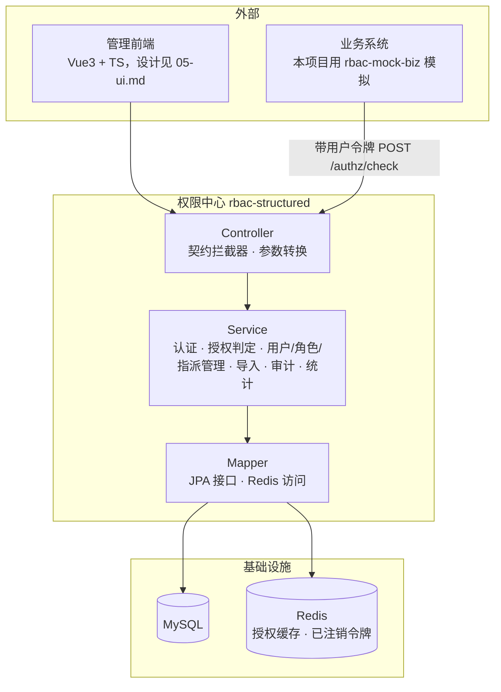
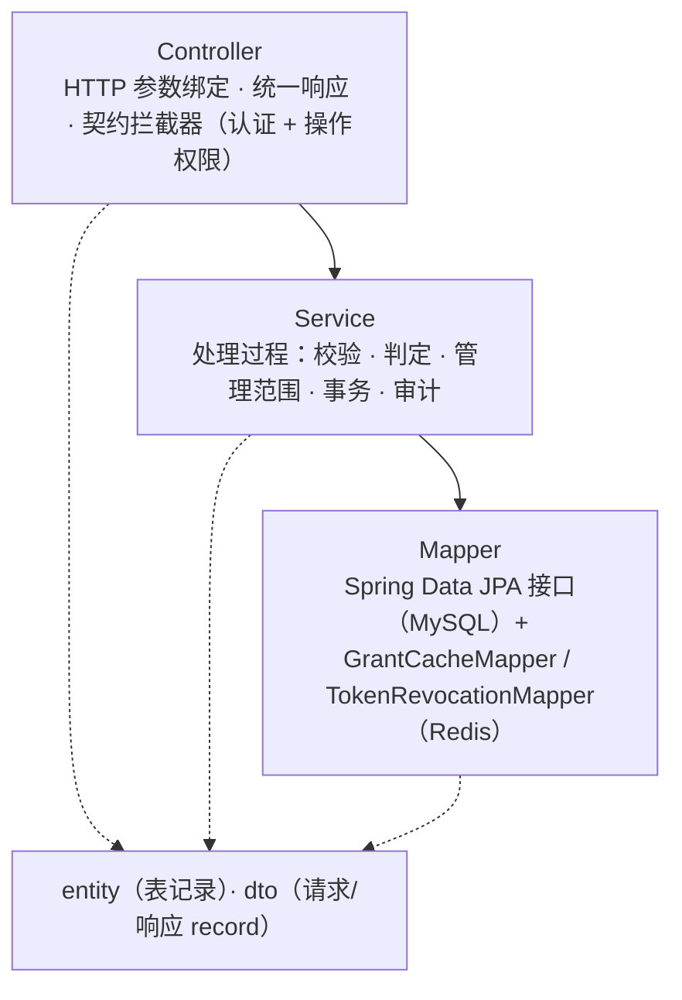
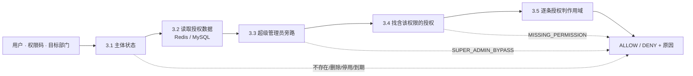
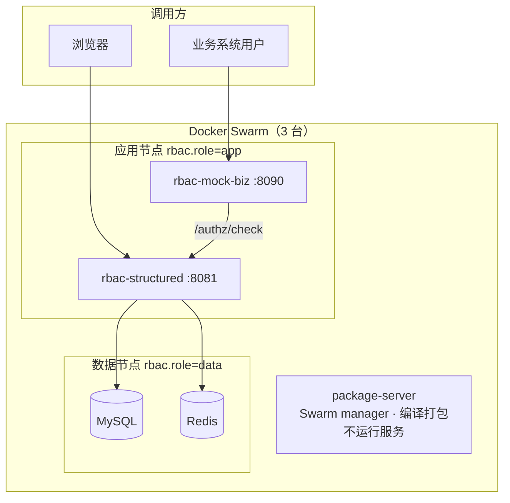

# 概要设计说明书

**版本 0.3 · 2026 年 10 月 11 日**（0.1 · 9 月 20 日；0.2 · 10 月 1 日）

> 本文档描述系统的总体架构、模块划分与关键机制设计。函数级的处理规约、数据流图、数据字典见 `06-detail-structured.md`。
>
> 0.3 按第一次已知问题审查与 RBAC0 需求清单重写：本阶段只实现 **RBAC0**，只用**结构化（面向功能）**设计，持久化用 **JPA**，分层固定为 **Controller + Service + Mapper**。旧版中的三范式并行、角色继承闭包、约束引擎、两级缓存与失效广播、审计哈希链、分区表等内容已删除，原因见 `12-design-log.md`。

---

## 1. 设计目标与约束回顾

| 来源 | 约束 | 对架构的影响 |
|---|---|---|
| RBAC0 需求 · 技术栈 | Spring MVC + MySQL + Redis + **JPA**，不能用 MyBatis；Docker Swarm 部署；Jacoco 白盒测试 | 持久化只用 Spring Data JPA；ArchitectureTest 禁止 MyBatis（§2.4） |
| RBAC0 需求 · 架构 | 只能用 **Controller + Service + Mapper**，没有理由不加 DAO 层 | 三层之外只有 entity / dto / config 三个辅助包（§2.3） |
| RBAC0 需求 · 权限模型 | 只实现 RBAC0；**面向功能的结构化设计**，不用面向对象 / 函数式 | 实体只是数据结构，Service 是无状态处理过程（§5） |
| RBAC0 需求 · 业务 | 一个用户属于一个部门，但可以有多个部门的权限；多公司、上万员工、多业务系统 | 指派记录带「适用部门」，作用域跟着指派走（§4.1）；公司表隔离 |
| RBAC0 需求 · 管理员 | 超级管理员越过权限引擎；管理员管理自身及以下层级；移除管理员不级联 | 判定中的旁路步骤（§4.1）；管理范围检查（§4.4）；`granted_by` 只是审计属性 |
| RBAC0 需求 · 一致性 | 权限修改后，**下一次访问**时更新 | 缓存键带全局版本号，版本号存 MySQL、与变更同一事务加一（§4.2） |
| RBAC0 需求 · 并发负载 | 没有性能要求，但要提供数据库缓存设计；**不应**针对高并发做专项设计 | 只做一层 Redis 授权缓存；不做多级缓存、失效广播、异步日志、分库分表 |
| 9/29 教师强调 | 所有后端 API 都要控制权限 | 契约声明 + 拦截器 + 默认拒绝 + 启动时双向核对（§4.7） |

### 1.1 质量属性与架构战术

| 质量属性 | 本系统的具体要求 | 采用的战术 | 落在哪里 |
|---|---|---|---|
| **安全性** | 最小权限；撤销在下一次访问生效；管理员不能越出管理范围、不能授出自己没有的权限；操作可追溯 | 每次请求都授权；作用域逐条指派判定；默认拒绝；版本号失效；审计记录全部管理操作与鉴权 | §4.1、§4.2、§4.4、§4.5 |
| **可测试性** | 每个功能都有测试；Jacoco 报告是检查必交物 | 集成测试连真实 MySQL + Redis、经 HTTP 调接口；T01–T22 验收用例；Jacoco 门槛进构建 | §2.4、`09-test-plan.md` |
| **正确性（数据）** | 导入数据不串部门；关联不指向不存在的对象 | 组织与授权关系全部建外键；导入按「分公司 + 部门」定位，无法唯一定位的进异常清单 | `03-database.md` |
| **可修改性** | 契约、表结构、实现三者一致 | OpenAPI 契约是接口与权限的唯一来源；Flyway 脚本是表结构的唯一来源 | §4.7、§3 |
| **可部署性** | 一条命令拉起完整环境 | 应用无状态；Flyway 启动时建表；`docker compose up`；配置走环境变量 | §6 |
| **性能** | 需求没有指标 | 只做数据库缓存设计（Redis 授权缓存 + 索引），不做专项优化 | §4.2 |

**优先级**：**安全性 > 可测试性 > 正确性 > 可修改性 > 可部署性 > 性能**。这是权限系统：放行错误的代价（越权）不可逆，拒绝错误的代价（重新授权）可恢复。

**已识别的冲突与取舍**

| # | 冲突 | 场景 | 取舍 | 理由 |
|---|---|---|---|---|
| T-1 | 性能 ↔ 一致性 | 撤销权限后，缓存里还是旧数据 | 缓存键带全局版本号，变更提交后加一；**不靠 TTL 过期** | 需求是「下一次访问生效」，TTL 做不到 |
| T-2 | 简单 ↔ 精确失效 | 一次变更影响哪些用户 | 任何授权变更都让**全部**缓存失效（版本号加一） | 精确计算受影响用户要多一套逻辑；需求没有性能指标，全量失效后按需重建的代价可接受 |
| T-3 | 可用 ↔ 安全 | Redis 不可用 | 授权缓存当作未命中、直接查库；令牌注销查询失败按「已注销」处理 | 前者结论不变、只是变慢；后者宁可让用户重新登录，也不放过注销的令牌 |
| T-4 | 需求 ↔ 可追溯 | 超级管理员越过权限引擎 | 旁路放在账号状态检查之后，放行原因写 `SUPER_ADMIN_BYPASS` 并记审计 | 停用的超级管理员照样被拒；审计能回答「凭什么放行」 |
| T-5 | 原子 ↔ 灵活 | 批量授权里混有越权对象 | 默认 ATOMIC 整批不写；可选 PARTIAL 写通过的、逐人返回失败原因 | 避免操作者误以为「全体已授权」 |

---

## 2. 架构总览

### 2.1 系统上下文



业务系统不缓存权限，每次操作前都问权限中心；缓存只在权限中心内部，省的是中心到数据库的开销。

### 2.2 分层架构



**规则**

- 依赖只能向下：Controller 不能直接用 Mapper；Mapper 不能反过来调 Service。
- entity 是与表一一对应的数据结构，只有公有字段，没有方法，实体之间不建对象关联（只存外键 id）。
- dto 是 Java record，用作 Service 的输入输出。
- config 只做装配：时钟、口令编码器、JWT 密钥、契约路由表、拦截器。

### 2.3 技术架构：三层 × 功能模块

| 层 | 职责 | 技术 |
|---|---|---|
| Controller | 输入、输出：参数绑定、统一响应、异常转换、契约拦截器 | Spring MVC（`@RestController`、`HandlerInterceptor`、`@RestControllerAdvice`） |
| Service | 业务处理过程与事务边界 | Spring `@Service`、`@Transactional`，类内只有注入的依赖与常量 |
| Mapper | 数据访问 | Spring Data JPA（`JpaRepository` + JPQL / 原生 SQL），连 MySQL 8；两个 Redis 访问类用 `StringRedisTemplate` |
| — | 表结构 | Flyway（`rbac-contract` 里的 `V1__rbac0_baseline.sql`） |
| — | 部署 | Docker 镜像 + Docker Swarm（§6） |

**为什么 Mapper 是 JPA 接口**：审查报告指出旧实现用 MyBatis 违反技术栈。「Mapper」是课程规定的逻辑分层名称，不是 MyBatis 的 Mapper。这里的 Mapper 就是继承 `JpaRepository` 的接口，复杂查询写成 JPQL 或原生 SQL；它只取数据，不做任何权限判断。Redis 也是一种数据存储，访问它的两个类同样放在 Mapper 层。

**横向：功能模块**

| 功能模块 | Service | Controller 中的接口 |
|---|---|---|
| 认证 | `AuthenticationService`、`TokenService` | `/auth/*` |
| 授权判定 | `AuthorizationService`、`AuthzQueryService` | `/authz/check`、`/authz/explain`，以及拦截器 |
| 用户管理 | `UserManagementService` | `/users/*` |
| 授权管理 | `AssignmentService`、`RoleManagementService` | `/users/{id}/roles`、`/roles/*`、`/assignments/*` |
| 资源与菜单 | `CatalogService`、`MenuService` | `/systems`、`/resources`、`/actions`、`/permissions`、`/menus/*` |
| 组织与导入 | `OrgService`、`ImportService` | `/companies`、`/departments/tree`、`/imports/*` |
| 审计与统计 | `AuditService`、`DashboardService` | `/audit-logs`、`/dashboard`、`/permissions/heatmap` |

模块之间只允许 Service 调 Service（例如管理类 Service 调 `AuthorizationService` 检查管理范围），不跨模块共享逻辑。

### 2.4 架构风格、视图与适应度函数

**采用的架构风格**

| 风格 | 用在哪里 | 换来什么 | 付出什么 |
|---|---|---|---|
| 分层 | Controller / Service / Mapper | 变更控制在一层之内；依赖单向 | 简单查询也要穿过三层 |
| 客户端—服务器 | 业务系统经 HTTP 调用权限中心 | 业务系统与权限中心独立部署 | 每次判定多一次网络往返 |
| 契约优先 | OpenAPI 契约声明接口与所需权限 | 文档、实现、权限只有一份来源 | 新增接口要同时改契约 |

**多视图**

| 视图 | 在哪里 |
|---|---|
| 逻辑视图 | §2.1–§2.3；`01-srs.md` 领域模型 |
| 开发视图 | §3；`06-detail-structured.md` 包结构 |
| 运行视图 | §4.1 判定过程、§4.2 缓存与失效 |
| 物理视图 | §6；`13-deployment.md` |
| 场景视图 | `09-test-plan.md` 的 T01–T22 验收用例 |

**适应度函数**：架构约束写成会失败的测试，每次构建自动执行。

| 架构约束 | 检查方式 | 违反时 |
|---|---|---|
| 只有三层 + 三个辅助包 | `ArchitectureTest.onlyTheThreeLayersAndHelpers`：类只能在 controller / service / mapper / entity / dto / config 中 | 构建失败 |
| 依赖向下 | `ArchitectureTest.dependenciesPointDownward`：Controller 不依赖 Mapper；Service 不依赖 Controller、config；Mapper 不依赖上层；entity、dto 不依赖任何层 | 构建失败 |
| 不用 MyBatis | `ArchitectureTest.noMyBatis` | 构建失败 |
| 实体只有数据 | `ArchitectureTest.entitiesAreDataOnly`：entity 包里没有公有实例方法 | 构建失败 |
| Service 无状态 | `ArchitectureTest.servicesAreStateless`：`@Service` 类的字段全部 `final` | 构建失败 |
| 不用继承组织逻辑 | `ArchitectureTest.servicesDoNotInherit`：每个 `@Service` 直接继承 `Object` | 构建失败 |
| 每个接口都声明权限、契约里的接口都已实现 | 启动时双向核对（§4.7）；`ContractRoutesTest` 核对 45 个操作，以及契约用到的权限码都在 V1 脚本中建好 | 拒绝启动 / 构建失败 |
| 核心逻辑被测试覆盖 | Jacoco：整体行覆盖 ≥ 70%、分支 ≥ 60%；service 包行覆盖 ≥ 85% | 构建失败 |

**架构决策记录**：`12-design-log.md` 记录每个设计问题的背景、错在哪里、怎么改、为什么。

---

## 3. 模块划分

### 3.1 Maven 多模块结构

```
rbac-parent/              父 POM：JDK 21、依赖版本、Jacoco 门槛
├── rbac-contract/        契约：db/migration/V1__rbac0_baseline.sql（Flyway）与 openapi/rbac-api.yaml
├── rbac-structured/      权限中心 :8081（结构化设计）
│   ├── controller/       REST 接口、契约拦截器、异常转换
│   ├── service/          处理过程
│   ├── mapper/           JPA 接口、Redis 访问
│   ├── entity/           表记录
│   ├── dto/              请求与响应
│   └── config/           装配
├── rbac-mock-biz/        外部模拟业务系统 :8090：OA 发文拟稿审批、HR 考勤；每个操作带用户令牌调 /authz/check
└── rbac-web/             前端（不在 Maven 里）：Vue 3 + TypeScript + Element Plus + Pinia + ECharts，
                          Nginx 提供页面并把 /api 转发到权限中心；界面设计见 05-ui.md
```

前端只是权限中心的一个客户端：菜单由 `GET /menus/me` 下发、路由按菜单动态注册、按钮用 `v-perm` 按权限禁用，这些都只为体验；能否执行由后端每次判定（`05-ui.md` §4）。

### 3.2 为什么这样切分

| 备选方案 | 评价 |
|---|---|
| A. 契约、表结构写在权限中心模块里 | 外部模拟系统和文档无法引用同一份契约 |
| **B. 契约单独成模块 + 权限中心 + 模拟业务系统（采用）** | 契约与表结构只有一份；模拟业务系统独立进程，经网络调用，能证明权限真实生效 |

旧版规划的 `rbac-oo`、`rbac-functional`、`rbac-test-suite` 等模块已取消：本阶段需求明确只用结构化设计，不实现 RBAC1/RBAC2。

### 3.3 功能分解

按功能自顶向下分解（编号与 `06-detail-structured.md` 的处理规约一致）：

```
权限中心
├── 1.0 认证：登录、令牌校验、登出、修改口令
├── 3.0 授权判定：主体状态、读取授权数据、超级管理员旁路、权限匹配、作用域判定
├── 4.0 用户管理：列表搜索、详情、新增、修改、启用停用删除、批量操作
├── 5.0 授权管理：单个分配回收、批量分配回收、角色与角色权限
├── 6.0 审计
├── 7.0 Dashboard 与热力图
└── 8.0 数据导入
```

---

## 4. 核心机制设计

### 4.1 授权判定

所有「能不能」的问题都调用同一个处理过程 `AuthorizationService.decide(用户, 权限码, 目标部门, 是否记录依据)`：



| 步骤 | 做什么 | 拒绝原因 |
|---|---|---|
| 3.1 主体状态 | 用户存在、未删除、启用、未到期（临时用户） | `SUBJECT_NOT_FOUND` / `SUBJECT_DELETED` / `SUBJECT_DISABLED` / `SUBJECT_EXPIRED` |
| 3.2 读取授权数据 | 用户的全部指派（只含启用的角色）及展开后的「权限码 + 来自哪次指派」 | — |
| 3.3 超级管理员旁路 | 持有 `SUPER_ADMIN` 直接放行，原因 `SUPER_ADMIN_BYPASS` | — |
| 3.4 找含该权限的授权 | 从授权数据中挑出权限码相同的行 | `MISSING_PERMISSION` |
| 3.5 作用域判定 | 目标部门为空 → 放行；否则逐条检查该授权的适用部门路径是否是目标部门路径的前缀（物化路径） | `OUT_OF_DATA_SCOPE` / `TARGET_DEPT_NOT_FOUND` |

**为什么作用域必须跟着指派记录走**：用户 A 有两次指派——「审批员 @ 道路分公司」「查阅员 @ 桥梁分公司」。如果先把两个角色的权限并成一个集合，再单独判断「目标部门在不在 A 的部门范围里」，就会拼出「在桥梁分公司审批」这种实际上没有授予过的组合。所以每一行授权数据都带着它的适用部门，3.5 只在含目标权限的那些行里判断（测试 T07b）。

**旁路为什么在 3.1 之后**：放在前面，停用的超级管理员照样能用；需求要求越过的是权限引擎，不是账号状态（测试 T11）。

**一条路径，多处使用**

| 调用者 | 目标部门 | 用途 |
|---|---|---|
| 契约拦截器 | 空 | 「能不能执行这一类操作」 |
| 管理类 Service | 被操作用户所在部门 / 适用部门 | 「这个对象在不在我的管理范围内」（§4.4） |
| `/authz/check` | 业务系统给出 | 业务系统的鉴权 |
| `/authz/explain` | 同上 | 同一判定，另返回逐步依据（测试 T20 验证两者结论始终一致） |

`selfOnly`：权限清单里「查看本人」「编辑本人」这类取值导入为带 `self_only` 标记的角色权限。RBAC0 只判断能否执行该操作，判定结果带上 `selfOnly=true`，由业务系统按记录归属过滤（外部模拟系统的考勤接口就是这样做的）。

### 4.2 缓存与失效

需求要求「提供数据库缓存设计」，同时「权限修改后，在下一次访问时更新权限」，并且「不应针对高并发做专项设计」。因此只有一层缓存：Redis 中的**用户授权数据**（3.2 步的结果）。旧版的 Caffeine 进程内缓存、Pub/Sub 失效广播、版本号轮询都已删除。

**键与值**

| 键 | 值 | TTL |
|---|---|---|
| `rbac:grants:v<版本>:u<用户id>` | 该用户的指派与授权行（JSON） | 10 分钟（只负责清理旧键） |

版本号**不在 Redis**，在 MySQL 的 `sys_grant_version`（只有一行，[03 §3.6](03-database.md)）。

**读**：先从 MySQL 读版本号 V，再读 Redis 中 `v<V>` 下的键；未命中则查库，写回 `v<V>`。在读写事务里（管理操作中途）只读不写回：那时读到的可能含本事务尚未提交的修改。

**写**：任何改变授权数据的操作（指派、回收、角色授权与回收、角色启用停用、权限导入），在**同一个事务里**执行 `UPDATE sys_grant_version SET version = version + 1`，与授权数据一起提交或一起回滚。

**为什么能保证「下一次访问」生效**

- 修改接口返回之前，事务已经提交，新版本号与新授权数据同时可见。之后任何副本的任何请求都读新版本号，旧版本的键再也没人读。
- 版本号在授权数据**之前**读：读到新版本号的请求，随后读到的授权数据一定也是新的；若某个请求在提交前读到旧版本号、之后读到了新数据，它写回的是**旧版本**的键，同样没人再读。
- 提交前别的请求看不到新版本号（未提交），所以不会按新版本号缓存旧数据。
- 失效完全不经过 Redis：Redis 在修改时宕机、超时、写失败，都不影响版本号加一；Redis 只存数据，它的任何故障最多让缓存不命中。

代价：每次判定多一次按主键读一行 MySQL。判定本来就要读 `sys_user`（主体状态不进缓存），缓存省下的一直是授权连表查询，不是「不访问数据库」。版本号这一行在修改事务提交前被锁住，并发的授权修改因此排队；读请求不受影响（[12 #37](12-design-log.md)）。

**为什么不逐个删键**：「删除受影响用户的键」与「另一个请求刚从库里读到旧数据、正要写回缓存」之间有竞争，旧数据可能在删除之后被写回去，一直存活到 TTL 结束。而且角色权限变更影响的用户可能上万，要先算出是谁。版本号方案没有这个竞争，也不用计算受影响用户；代价是一次变更让全部缓存失效，在没有性能指标的前提下可以接受（取舍 T-2）。

多副本部署时，所有副本共享同一个 Redis，因此不需要任何广播（测试 T22 启动第二个应用上下文验证）。

**Redis 故障时**

| 故障 | 行为 | 理由 |
|---|---|---|
| 读或写缓存失败 | 当作未命中，直接查库，不写回 | 结论与正常时相同，只是变慢 |
| 授权修改时 Redis 不可用 | 不受影响：版本号在 MySQL，随修改一起提交 | 没有「库已改、缓存还旧」的窗口（测试 T12b） |
| 查询令牌是否已注销失败 | 按已注销处理，返回 401 | 宁可让用户重新登录，也不让注销过的令牌继续可用 |

### 4.3 认证与令牌

| | 认证 | 授权 |
|---|---|---|
| 回答 | 你是谁 | 你能不能做这件事 |
| 时机 | 登录时一次，签发 JWT（2 小时） | 每次受保护的请求 |

**JWT 只证明身份，不带权限**。令牌里只有用户 id、用户名、令牌编号 `jti` 和令牌版本号 `ver`。权限每次都由 §4.1 重新计算，撤销角色后下一次请求立即拒绝。

**每次请求的令牌校验**（`AuthenticationService.authenticate`）

1. 签名与有效期；
2. `jti` 是否已登记为注销（Redis `rbac:revoked:<jti>`）；
3. 查库取账号当前状态：删除、停用、到期立即生效；
4. 令牌中的 `ver` 是否等于账号的 `token_version`。

| 场景 | 做法 |
|---|---|
| 登出 | 把 `jti` 写进 Redis，TTL 为令牌剩余有效期，到期自动清理（测试 T17） |
| 修改口令 | `token_version` 加一，此前签发的令牌全部作废 |
| 首次登录 | `must_change_pwd=1` 时只允许 `/auth/me`、`/auth/logout`、`/auth/password` |
| 登录失败 | 数据库内原子地加一（一条 `UPDATE ... SET login_fail_count = login_fail_count + 1`），满 5 次锁定 15 分钟；并发的失败请求不会丢失计数 |
| 用户不存在 | 也做一次哈希比对，失败一律返回「用户名或口令错误」，防止枚举用户名 |

### 4.4 管理范围与批量授权

**管理员管理自身及以下层级**不需要第二套机制：管理操作本身也是权限（如 `rbac:assignment:assign`），管理员持有它的那次指派的适用部门，就是他的管理范围。Service 用 §4.1 的同一判定、以被操作对象的部门为目标部门检查。

分配一次角色要通过的检查（单个与批量共用）：

1. 用户存在且未删除；角色存在且启用；
2. 公司内角色只能指派到本公司的部门；适用部门不要求与用户同公司（跨公司授权，`12-design-log.md` R-20）；
3. 操作者对用户所属部门、对适用部门都持有分配权限；
4. 超级管理员角色只有超级管理员能分配、回收；不能回收最后一个有效的超级管理员；
5. **不能授出自己没有的权限**：角色的每个权限，操作者都要有一条覆盖适用部门的授权；角色给的是完整范围时，这条授权不能只限本人。

**移除管理员不级联**：指派表的 `granted_by` 只用于审计，回收只删那一条指派（测试 T14）。

**批量授权**按公司、部门（可含下级）、员工展开成用户集合，逐人做上面的检查。默认 `ATOMIC`：有一人不通过就整批不写，返回失败清单；`PARTIAL`：写入通过的，逐人返回原因。已持有相同指派的人计入 `duplicated`。写入用一条 `INSERT ... SELECT` 每千人一批。真实数据下按公司给一万人分配一个角色一次完成。

### 4.5 审计与可观测

一张审计表记录全部事件：谁（actor）、什么时候、在哪里（客户端 IP）、对谁（target）、做了什么（事件类型 + detail）、结果（SUCCESS / DENIED / FAILED）、为什么（reason）。事件类型包括 `LOGIN`、`LOGOUT`、`AUTH_SUCCESS`、`AUTH_FAILED`、`ROLE_ASSIGN`、`ROLE_REVOKE`、`PERMISSION_ASSIGN`、`PERMISSION_REVOKE` 以及用户、角色、菜单、导入等管理操作。

- 写入用独立事务（`REQUIRES_NEW`）：业务操作因拒绝回滚时，拒绝记录照样留下。
- 同步插入。需求没有吞吐指标，不做异步队列、批量写入、分区或哈希链。
- 鉴权事件另带权限码、耗时（微秒）、是否命中缓存。Dashboard 的十一项指标和权限使用热力图都从这张表统计（口径见 `05-ui.md` §3.1），不展示任何虚构的示例数字。
- 只插入，不更新、不删除；不回滚、不版本化。

### 4.6 授权每次：鉴权发生在哪里

| | A. 登录时把权限写进令牌 | **B. 每次请求问权限中心（采用）** | C. 业务系统本地缓存 + 中心推送 |
|---|---|---|---|
| 撤销生效 | 令牌过期才生效 | 下一次请求 | 取决于推送是否送达 |
| 部门作用域 | 做不到（登录时不知道要访问哪个部门的数据） | 能做 | 业务系统要复制组织架构 |
| 复杂度 | 低 | 低 | 高 |

需求要求「下一次访问时更新」与「多个部门的权限」，只有 B 都满足。外部模拟系统把用户的令牌原样带去调 `/authz/check`（查自己不需要额外权限）。业务系统代用户鉴权时，调用者必须在被查用户所在部门持有 `rbac:authz:invoke`，否则 403，不能拿鉴权接口探测其他公司的人（测试 T20b）。

> 管理前端登录后拉取的权限与菜单只用于显示，**不是安全边界**；后端每个接口独立鉴权（测试 T18）。

### 4.7 所有后端接口都受权限控制

| 类别 | 契约中的声明 | 运行时校验 |
|---|---|---|
| 匿名 | `security: []` | 只有 `POST /auth/login`（健康检查由 actuator 处理，不经过拦截器） |
| 登录即可 | `x-required-permission: "@self"` | 令牌有效、账号可用；能操作谁由 Service 判断（本人，或在管理范围内） |
| 其余全部 | 具体权限码，如 `rbac:user:view` | 调用 §4.1 判定，并记 `AUTH_SUCCESS` / `AUTH_FAILED` |

1. 所需权限的**唯一来源**是 OpenAPI 契约的 `x-required-permission`，启动时加载成「路由 → 权限码」表。
2. 拦截器按表鉴权，接口代码里不写鉴权逻辑。**表里查不到的路由一律 403**。
3. **启动时双向核对**：代码里有、契约没声明权限的路由；契约里有、代码没实现的接口——任何一边不为空，应用拒绝启动。只做单向检查时，「契约里写了」会被误当成「已经实现」。
4. 拦截器只回答「能不能执行这一类操作」，被操作的具体对象是否在管理范围内由 Service 再检查（§4.4）。只靠拦截器，持有 `rbac:assignment:assign` 的分公司管理员就能给别的分公司的人授权。

---

## 5. 结构化（面向功能）实现约定

| # | 要求 | 怎么检查 |
|---|---|---|
| 1 | 数据与处理分离：entity 只有字段，dto 是 record，不含业务方法 | `ArchitectureTest.entitiesAreDataOnly` |
| 2 | 处理逻辑写在无状态的 Service 处理过程中，数据作为参数显式传递（如操作者 `Operator` 由 Controller 传给 Service，不放线程变量） | `ArchitectureTest.servicesAreStateless` |
| 3 | 不用继承与多态组织业务逻辑；分支用 `if` / `switch` | `ArchitectureTest.servicesDoNotInherit`、代码评审 |
| 4 | 模块按功能分解，每个处理过程有编号，与数据流图、处理规约对应 | `06-detail-structured.md` |
| 5 | 允许使用 Spring 做依赖注入与事务，JPA 接口与 Controller 类不是面向对象设计 | — |

课程限制的是设计方法（用数据流图、功能分解和处理规约描述需求，而不是靠继承、多态或领域对象行为完成业务逻辑），不是「Java 里不用类」。

---

## 6. 部署视图



| 节点 | 角色 | 运行 |
|---|---|---|
| package-server | Swarm manager | Maven 构建（临时）；镜像推到华为云 SWR |
| mysql-server | 数据节点 | MySQL、Redis |
| project-server | 应用节点 | `rbac-structured`、`rbac-mock-biz` |

**这是三节点部署，不是高可用**：数据节点、应用节点各只有一个，任何一台故障都会让服务不可用；Swarm 会重启失败的容器，但不等于数据库自动容灾。需求要求使用三台服务器、其中一台部署数据库，不要求高可用，因此不做数据库主从复制、Redis Sentinel、故障转移。应用无状态、缓存在 Redis，将来加应用节点只需打标签、调大副本数。

**一份编排文件，两种用法**

```
docker compose up -d          # 单机：开发、CI、检查演示
bash deploy/stack.sh up       # Swarm 集群（读 .env 后执行 docker stack deploy）
```

- 所有环境差异通过**环境变量**注入：`DB_HOST`、`DB_PASSWORD`、`REDIS_HOST`、`RBAC_JWT_SECRET`、`RBAC_INITIAL_PASSWORD` 等。镜像本身不区分开发与部署。
- 数据库口令、JWT 密钥只写在服务器上的 `.env` 里，`.env` 不入库；`stack.sh` 发现模板值或弱口令拒绝部署。
- 应用启动时 Flyway 自动执行 V1 建表与内置数据。
- 三份 xlsx 的导入是部署之后由超级管理员通过导入接口显式触发，原始文件不进镜像、不进仓库。

### 6.1 课程实际环境：3 台 2 核 2G

华为云北京四，3 台 2 核 2G，与上表一一对应。操作步骤见 [`13-deployment.md`](13-deployment.md)。

| | 能验证 | 不能验证 |
|---|---|---|
| 功能 | 全部：判定、缓存与失效、所有接口受控、外部模拟系统经网络调用 | — |
| 部署 | 编译与运行分离、数据与应用分离、镜像经 SWR 分发、Swarm 按标签放置 | 高可用（本就不承诺） |

内存是最紧的约束：每台可用约 1.6G，编排文件给每个服务设了内存上限、JVM 堆封顶 512M（`13-deployment.md` §3）。

---

## 7. 本文档对应的答辩设计点

| 设计点 | 章节 | 需求是什么 | 存在什么问题 | 采用什么方法与理由 |
|---|---|---|---|---|
| **DP-1 作用域跟着指派走** | §4.1 | 一个用户属于一个部门，但可以有多个部门的权限 | 先并集再判部门会拼出不存在的授权组合 | 指派带适用部门；逐条授权判作用域；物化路径前缀比较 |
| **DP-2 下一次访问生效的缓存** | §4.2、§4.3 | 要有数据库缓存设计；权限修改后下一次访问生效 | 删键有竞争；TTL 做不到「下一次」；令牌里带权限无法撤销 | 带全局版本号的键，提交后加一；令牌只证明身份；登出与改口令让令牌失效 |
| **DP-3 管理范围** | §4.4 | 管理员管理自身及以下层级；移除管理员不级联 | 只靠拦截器会越出管理范围；可以授出自己没有的权限 | 管理权限也走同一判定、以目标部门为作用域；授权上界；`granted_by` 只审计 |
| **DP-4 所有接口受控** | §4.7 | 所有后端 API 都要控制权限 | 逐个写注解会漏；契约与实现会不一致 | 契约集中声明 + 拦截器 + 默认拒绝 + 启动时双向核对 |
