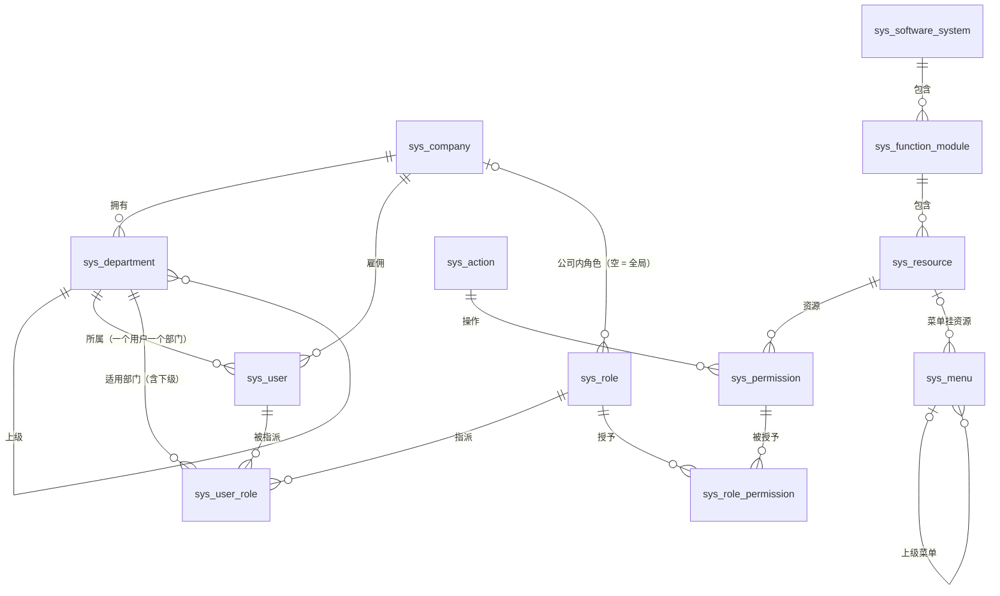

# 数据库设计说明书

> 本阶段只实现 RBAC0：User — Role — Permission（= Resource × Action）。
> 表结构的唯一来源是 [`V1__rbac0_baseline.sql`](../rbac-contract/src/main/resources/db/migration/V1__rbac0_baseline.sql)，本文说明它为什么这样设计。
> 旧版 V1–V3（含角色继承、约束、会话等表）已移到 [`docs/archive/sql/`](archive/sql/)，不再执行。

---

## 1. 设计原则

| 原则 | 做法 | 理由 |
|---|---|---|
| 只建 RBAC0 需要的表 | 13 张业务表，不含角色继承、约束、会话 | 需求明确「只实现 RBAC0，不应该实现 RBAC1/RBAC2」 |
| 组织层级 ≠ 角色层级 | 部门有 `parent_id`，角色没有 | 部门树决定「人在哪、能管到哪」；RBAC0 的角色只决定「有哪些权限」。二者语义不同 |
| 多部门权限挂在指派上 | `sys_user_role.scope_dept_id` | 「一个用户属于一个部门，但可以有多个部门的权限」 |
| 一律代理主键，业务唯一键另建唯一索引 | `id BIGINT AUTO_INCREMENT` + `uk_*` | 用户名、角色编码可能改名或复用规则变化，不能做主键 |
| 组织与授权关系建外键 | 10 个外键 | 万级数据下外键开销可以忽略，却能挡住指向不存在的用户、角色、部门的脏数据（见 [12 #16](12-design-log.md)） |
| 关联表用联合唯一键 | `uk_user_role_scope`、`uk_role_perm` | 重复提交、并发提交不会产生第二条记录 |
| 用户逻辑删除，关联表物理删除 | `status = DELETED` | 删除后审计仍能查到「这个人是谁」，用户名不可复用 |
| 审计只插入 | 代码中审计的 Mapper 没有更新、删除方法 | 需求「无需回滚、无需版本化」：不做哈希链、不做分区，只保证不改不删 |

## 2. ER 图



RBAC0 的四个核心概念对应四张表与两张关联表：

```
User ── sys_user_role（带适用部门）── Role ── sys_role_permission ── Permission = Resource × Action
```

判定规则（对一般用户）：

```
Allow(u, p, 目标部门 t) = ∃ 指派 (u, r, s) ∈ sys_user_role ：
                           r 启用  ∧  (r, p) ∈ sys_role_permission  ∧  t 在 s 的子树内（t 为空时不检查）
```

前提是用户账号有效。超级管理员是需求规定的旁路：账号有效即放行。

## 3. 表结构

只列关键列，完整定义见 V1 脚本。

### 3.1 组织

**`sys_company` 公司**

| 列 | 类型 | 说明 |
|---|---|---|
| `company_code` | VARCHAR(32) UK | 如 `SZ`（导入时指定）、`PLATFORM`（内置：平台运维） |
| `company_name` | VARCHAR(128) | |

**`sys_department` 部门（每家公司一棵树）**

| 列 | 类型 | 说明 |
|---|---|---|
| `company_id` | FK → company | |
| `parent_id` | FK → department，可空 | 根部门为空 |
| `dept_name` | VARCHAR(128) | 原表名称，如「道路工程分公司-财务部」 |
| `path` | VARCHAR(255) | 物化路径 `/3/15/27/`：判断「目标部门是否在某部门之下」只需一次前缀比较 |
| `level` | INT | 根为 1 |
| `manager_name` / `manager_user_id` | | 部门表登记的负责人。**只是组织信息，不产生任何管理权限** |

唯一键 `(company_id, parent_id, dept_name)`：两家公司都可以有「财务部」，同一上级下不能重名。

### 3.2 用户

**`sys_user`**

| 列 | 类型 | 说明 |
|---|---|---|
| `company_id`、`department_id` | FK | 一个用户只属于一个部门 |
| `username` | VARCHAR(64) UK | 正式员工为工号（如 `SG000001`） |
| `password_hash` | BCrypt | 导入员工与未指定口令的新用户用初始口令，`must_change_pwd = 1` |
| `user_type` | `EMPLOYEE` / `TEMPORARY` / `SYSTEM` | 临时用户没有工号、电话，必须有 `expires_at` |
| `employee_no` | UK，可空 | 工号；临时用户为空 |
| `phone`、`position` | 可空 | 岗位只是人事信息，不参与鉴权 |
| `status` | `ACTIVE` / `DISABLED` / `DELETED` | 三态（需求「启用、停用、删除」） |
| `expires_at` | 可空 | 到期后不能登录，鉴权结论为 `SUBJECT_EXPIRED` |
| `login_fail_count`、`locked_until` | | 连续 5 次失败锁 15 分钟；计数在数据库里原子加一 |
| `token_version` | INT | 修改口令时加一；令牌里的版本号与它不等即失效 |

### 3.3 资源与权限

| 表 | 关键列 | 说明 |
|---|---|---|
| `sys_software_system` | `system_code` UK | 业务系统 = 权限域。权限清单的 18 个系统 + 权限中心自身 `rbac` |
| `sys_function_module` | `(system_id, module_code)` UK | 115 个功能模块 |
| `sys_resource` | `resource_code` UK、`resource_type` | `BUSINESS` 业务功能点（359 个，导入）；`MENU` 权限中心的管理页面（菜单挂在它上面）；`API` 不对应页面的接口能力 |
| `sys_action` | `action_code` UK | 11 个操作：业务五类 `view create edit approve export`，平台管理 `delete assign revoke import invoke explain` |
| `sys_permission` | `permission_code` UK、`(resource_id, action_id)` UK | Permission = Resource × Action，`permission_code = resource_code:action_code` |

资源编码：业务资源为「系统码:模块码:功能点码」，如 `oa:m01:f02`（OA › 公文管理 › 发文拟稿与审核）；权限中心自身的资源为 `rbac:user`、`rbac:role` 等。
两类权限用同一套模型——「用户管理」「审计日志」这些管理功能也是资源，不再像旧版那样让平台权限的 `resource_id` 为空、单凭字符串表示（见 [12 #17](12-design-log.md)）。

### 3.4 角色、角色权限、指派

**`sys_role`**

| 列 | 说明 |
|---|---|
| `company_id` | 空 = 全局角色（内置角色与权限清单的五类角色模板），只有超级管理员能修改；非空 = 公司内角色，只能指派到本公司的部门 |
| `role_code` UK | `SUPER_ADMIN`、`RBAC_ADMIN`、`AUDITOR` 内置；`SYS_ADMIN`、`COMPANY_LEADER`、`DEPT_MANAGER`、`PROJECT_MANAGER`、`EMPLOYEE` 由导入建立 |
| `status` | `ENABLED` / `DISABLED`。停用后持有者下一次请求即失去该角色的权限 |
| `builtin` | 内置角色不可删除 |

**`sys_role_permission`**：`(role_id, permission_id)` 唯一；`self_only` 见 §4.3；`granted_by` 只用于审计。

**`sys_user_role` 指派**

| 列 | 说明 |
|---|---|
| `user_id`、`role_id` | |
| `scope_dept_id` | **适用部门**：这次指派在该部门及其全部下级部门生效 |
| `granted_by`、`granted_at`、`reason` | 只是审计属性，不构成授权依赖 |

唯一键 `(user_id, role_id, scope_dept_id)`：同一角色在不同部门是不同的指派（多部门权限），在同一部门只能有一条。

### 3.5 菜单与审计

**`sys_menu`**：`parent_id`、`resource_id`（可空 = 目录）、`menu_name`、`route_path`、`component_key`、`icon`、`sort_order`。叶子菜单挂一个 `MENU` 资源，用户持有「该资源:view」才显示；目录在至少一个子菜单可见时显示。

**`sys_audit_log`**：一张表记录全部事件，覆盖需求的七要素。

| 要素 | 列 |
|---|---|
| 谁 | `actor_id`、`actor_name`（用户名快照） |
| 什么时候 | `occurred_at`（毫秒） |
| 在哪里 | `client_ip` |
| 对谁 | `target_type`、`target_id`、`target_name` |
| 做了什么 | `event_type` + `detail`（如 `role=DOC_APPROVER scope=道路工程分公司`） |
| 结果如何 | `result`：`SUCCESS` / `DENIED` / `FAILED` |
| 为什么 | `reason`（如 `OUT_OF_MANAGE_SCOPE`、`PRIVILEGE_ESCALATION`） |

鉴权事件（`AUTH_SUCCESS` / `AUTH_FAILED`）另带 `permission_code`、`latency_us`、`cache_hit`，Dashboard 与权限使用热力图都从这里统计。旧版把鉴权日志单独建表、按月分区、另建分钟聚合表，是为「每天千万级」准备的；需求明确不做高并发专项设计，因此合并成一张表（见 [12 #19](12-design-log.md)）。

## 4. 关键设计

### 4.1 多公司

- 部门、用户都有 `company_id`；部门名只在同一上级下唯一。
- 指派的适用部门必须与用户在同一家公司（`CROSS_COMPANY`）；公司内角色只能指派到本公司（`ROLE_COMPANY_MISMATCH`）。这两条对超级管理员同样适用：本阶段不支持跨公司授权，一个人需要在另一家公司工作时，在那家公司另建账号。
- 管理范围是部门子树，一家公司的根部门覆盖不到另一家公司的同名部门（验收用例 T19）。

### 4.2 作用域跟着指派记录走

鉴权时取出的是「权限码 + 来自哪次指派 + 那次指派的适用部门路径」的行（`GrantRow`），逐行检查适用部门是否覆盖目标部门。
不能先把所有角色的权限并成一个集合、再把所有适用部门并成一个集合分别判断——那样「A 部门的查看角色 + B 部门的审批角色」会拼出「在 A 部门审批」这种实际不存在的授权（验收用例 T07b）。

### 4.3 「本人」类取值

权限清单里有「查看本人」「编辑本人」（6 个单元格）。RBAC0 只回答「能否执行该操作」，不做行级过滤，因此：

- 导入时把它们当作「查看」「编辑」授予，同时在 `sys_role_permission.self_only` 记下「只限本人记录」；
- 鉴权结果带 `selfOnly = true`，由业务系统按记录归属过滤（外部模拟系统的考勤接口就是这样做的）。

### 4.4 外键与删除

| 删除对象 | 规则 |
|---|---|
| 用户 | 逻辑删除；指派保留供审计，判定时账号无效即拒绝 |
| 角色 | 还有指派时拒绝（409）：权限一律人工回收，不能借删除角色悄悄收回别人的权限；没有指派时物理删除，角色权限随 `ON DELETE CASCADE` 删除 |
| 指派、角色权限 | 物理删除，删除前后各写一条审计 |
| 菜单 | 有子菜单时拒绝 |

### 4.5 索引

| 索引 | 支撑的查询 |
|---|---|
| `sys_user_role.uk_user_role_scope (user_id, role_id, scope_dept_id)` | 鉴权热路径「按用户取指派」走前缀；同时保证不重复 |
| `sys_user_role.idx_role` | 角色详情「用户」、删除角色前计数 |
| `sys_role_permission.uk_role_perm` | 按角色取权限 |
| `sys_department.idx_path` | 部门子树（`path LIKE '/3/15/%'`） |
| `sys_user.idx_dept_status` | 用户列表按部门、状态过滤 |
| `sys_audit_log.idx_event_time (event_type, occurred_at)` | Dashboard 今日统计、热力图、按事件类型查审计 |
| `sys_audit_log.idx_actor_time`、`idx_time` | 按操作人、时间查审计 |

数据库缓存设计不在表里：用户的授权数据缓存在 Redis，见 [02 §4.2](02-architecture.md)。

## 5. 初始化数据与导入

### 5.1 内置数据（V1 脚本）

- 11 个操作；权限中心自身的 12 个资源、26 个权限；
- 3 个内置角色：`SUPER_ADMIN`（不需要授权记录）、`RBAC_ADMIN`（除导入与新建权限定义外的全部 24 个平台权限）、`AUDITOR`（审计、Dashboard、热力图 3 个）；
- 10 个菜单（Dashboard、系统管理 › 用户 / 角色 / 权限 / 菜单 / 审计 / 组织、权限解释、热力图）；
- 平台运维公司与部门，超级管理员 `root`（初始口令 `Admin@123`，首次登录必须修改）。

### 5.2 导入的原则

1. **导入不分配任何角色。** 整个系统的权限都由人工分配和回收；员工岗位不等于系统角色。导入完成后由管理员审核，用批量授权（`POST /assignments/batch`）正式分配——批量授权本身也是需求要求的演示场景（见 [12 #18](12-design-log.md)）。
2. **无法唯一确定的数据进异常清单，不写入。** 绝不「取第一个同名的」。
3. **可重复执行。** 已存在的部门、用户名、资源、权限、角色权限跳过。

### 5.3 各步骤规则

**功能权限清单**（`POST /imports/permissions`）

| 步骤 | 规则 |
|---|---|
| 系统、模块列 | 合并单元格向下延续；系统编码按固定对照表（`oa`、`hr`、`pmis`……），模块与功能点按出现顺序编号 `m01`、`f01` |
| 资源 | 每个功能点一个 `BUSINESS` 资源，编码 `系统码:模块码:功能点码` |
| 权限 | 每个资源 × 五类操作，共 359 × 5 = 1,795。这是**可配置集合**，不表示每个资源都真的有五种操作；角色实际得到哪些由单元格决定 |
| 角色列 | 五列对应五个全局角色模板 |
| 单元格 | 「全部」→ 五类；「无」→ 不授权；「查看/编辑」等按 `/` 拆分；英文 `view` 归一为「查看」并在报告中注明；「本人」见 §4.3；**空白单元格不能默认当作「无」，列入异常清单** |

**部门信息表 + 员工信息表**（`POST /imports/organization`）

| 步骤 | 规则 |
|---|---|
| 公司 | 按 `companyCode` 查找，不存在则创建 |
| 部门 | 按「上级部门」列建树；上级缺失、重名、成环的行进异常清单；路径在拿到 id 后写入 |
| 员工的部门 | 按「分公司 + 部门」两列定位，并校验部门确实在该分公司之下：分公司 = 根部门 → 根部门的直接下级；部门 = 分公司 → 分公司直属人员，归到分公司节点；否则在该分公司下找「分公司-部门」。只凭部门名会把「财务部」错配到总公司或别的分公司 |
| 员工 | 工号即用户名；初始口令只算一次 BCrypt，一万人共用同一个哈希并强制首次改密（逐个计算要好几分钟） |
| 部门负责人 | 先在该部门子树内按姓名找，找不到再在全公司找；恰好一人才关联，重名进异常清单。关联不产生任何权限 |

### 5.4 真实数据的导入结果

在本机用三份原始 xlsx 实际导入（`rbac-structured` 连 MySQL 8.0 + Redis 7），报告如下：

| 项 | 数量 |
|---|---|
| 业务系统 / 功能模块 / 资源 | 18 / 115 / 359 |
| 权限（资源 × 五类操作） | 1,795 |
| 角色权限 | 3,190 |
| 　其中 系统管理员 / 公司领导 / 部门经理 / 项目经理 / 普通员工 | 1,795 / 466 / 582 / 253 / 94 |
| 部门 | 111（全部建成，无异常） |
| 员工 | 10,000（全部唯一定位到部门，无异常） |
| 部门负责人 | 109 个唯一关联；2 个因同名进异常清单 |
| 权限清单异常 | 1 个空白单元格（成本管控系统 › 报表汇总分析 › 普通员工） |
| 标准化说明 | 1 处英文 `view` 按「查看」处理 |

两个容易混淆的数字：**1,795** 是可配置的原子权限种类数（359 × 5），**3,190** 是五类角色实际得到的「角色—权限」关联数。旧版文档把授予记录写成「约 1,800 条」，混淆了二者（见 [12 #20](12-design-log.md)）。

导入后用一次批量授权把全公司 10,000 人设为普通员工（适用部门 = 各自所属部门），`committed = true, succeeded = 10000`。

自动化测试（`ExcelImportIntegrationTest`）用按原表格式造的小样本覆盖上述每条规则；原始 xlsx 含个人信息，不进仓库。

## 6. 迁移与版本管理

- Flyway 管理表结构，脚本在 `rbac-contract` 的 jar 里；Hibernate 设为 `ddl-auto: none`，不建表、不改表。
- V1 在本阶段重写过。此前在测试库执行过旧 V1–V3 的，需要删库重建（`docs/13-deployment.md`）；不要直接删除已执行的 Flyway 记录再假定旧库能用。
- 集成测试每个测试前把库恢复成只含内置数据的状态（首次 clean + migrate 并给每张表拍快照，之后「清空 + 从快照复制」）。

## 7. 本文档对应的答辩设计点

| 设计点 | 需求是什么、有什么问题 | 方法与理由 | 效果 |
|---|---|---|---|
| 多部门权限挂在指派上 | 一个人属于一个部门，却要在多个部门有权限；若把部门挂在用户或角色上都表达不了 | `sys_user_role.scope_dept_id` + 物化路径前缀判断；作用域逐条跟着指派走 | T07、T07b、T19 |
| 员工部门的唯一定位 | 「财务部」在总公司和 9 个分公司都有，只凭名字会错配 | 「分公司 + 部门」两列定位并校验祖先关系，无法唯一确定的进异常清单 | 真实数据 10,000 人全部定位，0 异常 |
| 导入不自动分配角色 | 需求「权限均采用人工分配和回收」；岗位不等于系统角色 | 导入只建组织、人员和角色模板；审核后用批量授权分配 | 导入报告 + 一次批量授权 10,000 人 |
