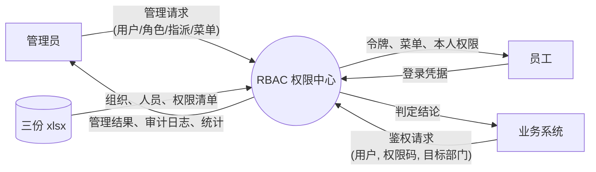
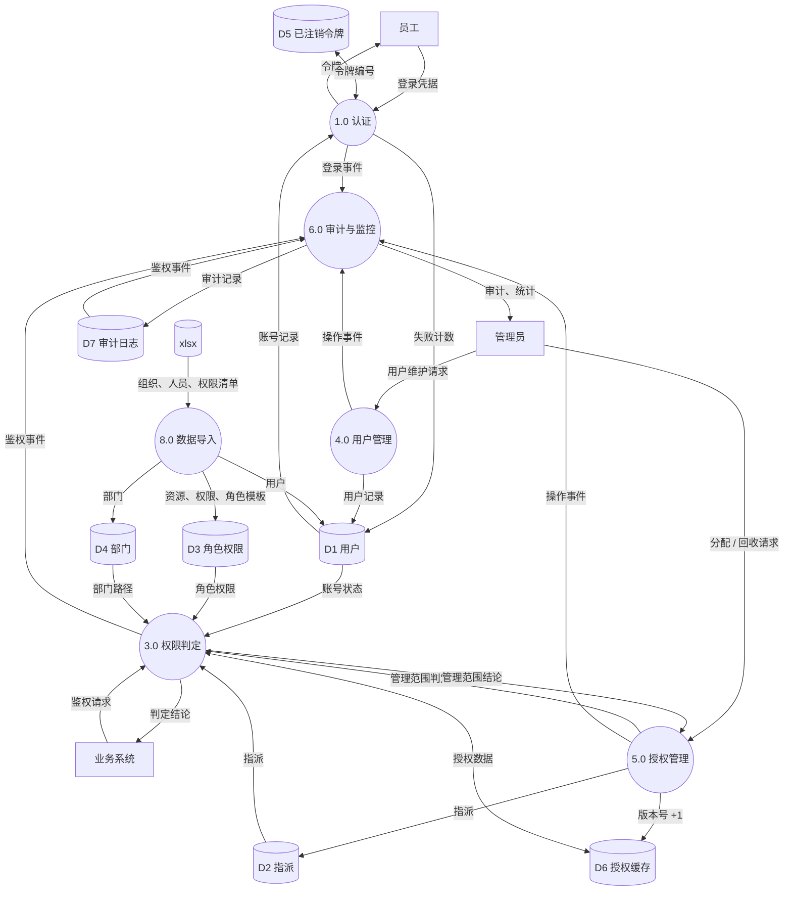
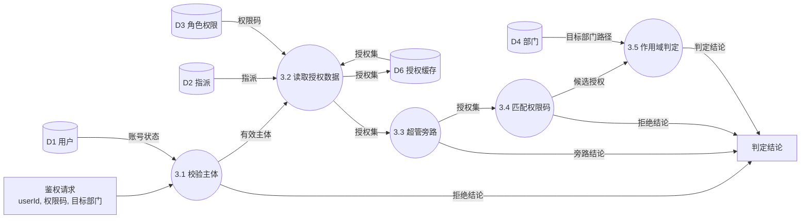

# 详细设计说明书 · 结构化（面向功能）设计

> 对应模块：[`rbac-structured`](../rbac-structured/)。本阶段只做 RBAC0，只用结构化（面向功能）方法设计。
> 写法依照课件 3「结构化软件设计」：先做功能分解与数据流图，再由数据流图导出模块结构，最后给出数据字典与每个加工的处理规约。
> 章节按 GB/T 8567-2006《计算机软件文档编制规范》中「软件设计说明」的要求组织，对照见 §10。每个功能模块对应的 OpenAPI 接口和前端页面见 §11。

---

## 1. 结构化设计在本项目里的含义

结构化设计按**功能**分解系统：系统是一组对数据进行加工的过程，数据在过程之间流动。它与面向对象的区别不在「Java 里有没有类」，而在**用什么组织设计**：

| | 结构化（本项目） | 面向对象（本阶段不采用） |
|---|---|---|
| 分解依据 | 功能：认证、判定、分配、回收…… | 对象：User、Role 各自负责自己的行为 |
| 数据与处理 | 分离：实体只是记录，判断写在处理过程里 | 封装在一起：`user.canDo(p)` |
| 复用方式 | 调用公共过程 | 继承、多态 |
| 设计文档 | 数据流图、功能层次图、数据字典、处理规约 | 类图、顺序图、状态图 |

落到代码上的准入标准（由 [`ArchitectureTest`](../rbac-structured/src/test/java/com/xmu/rbac/structured/ArchitectureTest.java) 自动检查，违反即构建失败）：

1. 只有 Controller、Service、Mapper 三层（外加 entity、dto、config 三个辅助包），依赖只能向下；Controller 不能直接访问 Mapper。
2. **实体是数据结构**：只有公有字段，没有任何方法；实体之间不建对象关联，只存外键 id。
3. **Service 是无状态的处理过程**：字段只能是注入的依赖或常量（final）；不用继承组织业务逻辑。
4. 持久化只用 JPA，不出现 MyBatis。

Spring MVC 与 JPA 仍然要求写 Controller 类、实体类和 Mapper 接口——这是框架的要求，不是设计方法。设计依据是下面的功能分解与数据流。

## 2. 功能分解

### 2.1 功能层次图

```
RBAC 权限中心
├── 1.0 认证管理
│   ├── 1.1 登录（账号校验、口令比对、失败计数与锁定）
│   ├── 1.2 令牌校验（签名与有效期、是否已登出、账号当前状态、令牌版本）
│   ├── 1.3 令牌签发
│   ├── 1.4 登出
│   └── 1.5 修改口令
├── 3.0 权限判定
│   ├── 3.1 校验主体状态
│   ├── 3.2 读取授权数据（缓存 / 数据库）
│   ├── 3.3 超级管理员旁路
│   ├── 3.4 找出含目标权限的授权
│   ├── 3.5 作用域判定（逐条授权）
│   └── 3.6 鉴权与解释接口（确定「谁能查谁」后调用 3.1–3.5）
├── 4.0 用户管理（列表与搜索、详情、新增、修改、启用停用删除、批量状态）
├── 5.0 授权管理
│   ├── 5.1 查询指派
│   ├── 5.2 人工分配
│   ├── 5.3 人工回收
│   ├── 5.4 批量分配（分公司 / 部门 / 员工）
│   └── 5.5 批量回收
├── 角色与资源管理（角色增删改、角色授权与回收、资源 / 操作 / 权限、菜单）
├── 6.0 审计与监控（操作审计、鉴权事件、审计查询、Dashboard、权限热力图）
├── 8.0 数据导入（功能权限清单、部门与员工）
└── 展示支持（动态菜单、权限解释、组织浏览）
```

编号 1.0、3.0…… 与代码中 Service 的注释、下文数据流图的加工编号一致（2.0、7.0 的编号沿用旧版文档，分别对应用户管理并入 4.0、统计并入 6.0 之前的划分，不再单独出现）。

### 2.2 顶层数据流图（上下文图）



外部实体：管理员、员工、业务系统（含外部模拟系统 `rbac-mock-biz`）、数据文件。

### 2.3 一层数据流图



平衡检查：上下文图的五条输入流（登录凭据、鉴权请求、管理请求、xlsx、令牌请求）与输出流（令牌、判定结论、管理结果与审计、统计）在一层图里都有对应。角色、资源、菜单的维护与 4.0、5.0 同构（读写 D3、写审计），图中省略以保持可读。

### 2.4 二层数据流图：3.0 权限判定



按课件的画法规则，图中只画数据怎样被加工，不画「命中 / 未命中」这类控制分支：缓存是数据存储，3.2 既读它也写它；「什么时候跳过查库」由结构图与处理规约表达。

## 3. 模块结构

### 3.1 从数据流图到模块

3.0 是**变换型**：输入流（鉴权请求 → 有效主体）、变换中心（3.2–3.5，得出结论）、输出流（判定结论 → 审计）。按变换分析，顶层模块 `decide` 依次调用输入、变换、输出三部分：

```
                           AuthorizationService.decide
          ┌──────────────┬───────────────┼────────────────┬──────────────────┐
   3.1 subjectDenyReason  3.2 loadGrants  3.3 holdsSuperAdmin  3.4 匹配       3.5 covers
          │                     │                                              │
     UserMapper          GrantCacheMapper                               DepartmentMapper
                         UserRoleMapper
```

拦截器是**事务型**：按请求的路由（事务类型）分派到不同的处理——免登录、`@self`、按权限码判定。

### 3.2 三层与包

| 层 | 包 | 职责 | 不允许 |
|---|---|---|---|
| Controller | `controller` | HTTP 参数转换、调用 Service、包装统一响应；拦截器统一认证与权限检查 | 业务判断；访问 Mapper |
| Service | `service` | 处理过程：认证、判定、管理范围、分配回收、导入、统计 | 依赖 Controller；保存请求间状态 |
| Mapper | `mapper` | 数据存取：Spring Data JPA 接口（`UserMapper` 等 13 个）与两个 Redis 访问类 | 业务规则 |
| — | `entity` | 与表一一对应的记录（只有字段） | 方法、对象关联 |
| — | `dto` | 请求、响应与过程之间传递的数据（record） | 依赖上面三层 |
| — | `config` | 装配：时钟、口令编码器、JWT 密钥、契约路由表、拦截器 | |

数据与处理分离的一个例子：判断账号是否有效不是 `user.isActive()`，而是处理过程 `AuthorizationService.subjectDenyReason(User, now)`——登录（1.1）、令牌校验（1.2）、判定（3.1）三个过程共用它。

### 3.3 模块清单

| Service | 加工 | 主要过程 |
|---|---|---|
| `AuthenticationService` | 1.0 | `login`、`authenticate`、`logout`、`changePassword` |
| `TokenService` | 1.3 | `issue`、`parse` |
| `AuthorizationService` | 3.1–3.5 | `decide`、`loadGrants`、`bumpGrantVersion`、`scopeOf`、`requireInScope` |
| `AuthzQueryService` | 3.6 | `check`（含「谁能查谁」） |
| `UserManagementService` | 4.0 | `list`、`detail`、`create`、`update`、`changeStatus`、`delete`、`batchStatus` |
| `AssignmentService` | 5.0 | `assign`、`revoke`、`batchAssign`、`batchRevoke`、`checkOne` |
| `RoleManagementService` | 角色管理 | `list`、`detail`、`users`、`create`、`update`、`delete`、`grant`、`ungrant` |
| `CatalogService`、`MenuService`、`OrgService` | 资源、菜单、组织 | 查询与维护；`myMenus` 动态菜单 |
| `AuditService`、`DashboardService` | 6.0 | `record`、`recordDecision`、`search`；`metrics`、`heatmap` |
| `ImportService` | 8.0 | `importPermissions`、`importOrganization` |

### 3.4 耦合与内聚

按课件的分类，对照代码如实列出：

| 耦合 | 位置 | 处理 |
|---|---|---|
| 数据耦合（主要形式） | `decide(userId, permissionCode, targetDeptId, explain)` 只传需要的简单数据 | — |
| 标记耦合 | `subjectDenyReason(User, now)` 传整条用户记录，只用 status、expiresAt | 接受：三个调用者手里本来就是整条记录，拆成字段反而让调用点变长 |
| 控制耦合 | `decide(..., explain)` 的布尔参数决定是否收集判定依据 | 接受：只影响输出的附加信息，不改变判定路径；拆成两个函数会复制整个判定流程，正是审查报告要避免的「两套逻辑」 |
| 公共耦合 | 多个过程读写同一张 `sys_user_role`、同一个授权缓存 | 无法避免（共享数据库是系统的本质）。限制手段：缓存只有 `AuthorizationService` 读写；写指派的只有 `AssignmentService` 与导入 |
| 内容耦合 | 无 | — |

| 模块 | 内聚 | 说明 |
|---|---|---|
| `AuthorizationService.decide` | 功能内聚 | 所有步骤都为得出一个判定结论 |
| `AssignmentService` | 顺序内聚 | 校验 → 去重 → 写入 → 失效 → 审计，前一步的输出是后一步的输入 |
| `AuthenticationService` | 通信内聚 | 登录、令牌校验、登出、改口令都围绕同一条用户记录 |
| `DashboardService` | 通信内聚 | 十一项指标都读审计日志 |
| `AppConfig` | 时间内聚 | 启动时一次性装配，属于框架要求的配置，不含业务 |

## 4. 数据字典

### 4.1 数据流

| 名称 | 组成 | 说明 |
|---|---|---|
| 登录凭据 | 用户名 + 口令 | |
| 令牌 | JWT = 令牌编号 + 用户 id + 用户名 + 令牌版本 + 签发时间 + 到期时间 | 不含权限 |
| 鉴权请求 | (用户 id \| 用户名)? + (权限码 \| 资源编码 + 操作编码) + 目标部门 id? | 主体为空 = 调用者本人；目标部门为空 = 不涉及具体部门 |
| 权限码 | 资源编码 + ":" + 操作编码 | 如 `oa:m01:f02:approve` |
| 授权行（GrantRow） | 权限码 + 指派 id + 角色 id + 角色编码 + 角色名 + 适用部门 id + 适用部门名 + 适用部门路径 + 适用部门所属公司 + 只限本人 | 判定的最小依据 |
| 授权集（GrantSet） | {指派}（启用中的角色） + {授权行} | 缓存的单位 |
| 判定结论（Decision） | 允许 + 原因码 + 用户 + 权限码 + 目标部门 + 依据的授权行? + 只限本人 + 是否命中缓存 + 耗时 + 判定依据? | 原因码见 [04 §3.2](04-api.md) |
| 管理范围（Scope） | 全部 \| {适用部门路径} | 某用户持有某权限的部门范围 |
| 批量授权请求 | 目标类型 + {目标 id} + 含下级? + 角色 id + 适用部门 id? + 原因 + 模式 | 目标类型 ∈ {COMPANY, DEPARTMENT, USER}；模式 ∈ {ATOMIC, PARTIAL} |
| 批量结果 | 模式 + 已写入 + 请求人数 + 成功 + 重复 + 失败 + {(用户 id, 原因)} | |
| 审计记录 | 时间 + 操作人 + IP + 事件类型 + 对象类型 + 对象 id + 对象名 + 明细 + 结果 + 原因 (+ 权限码 + 耗时 + 命中缓存) | 七要素 |

### 4.2 数据存储

| 编号 | 名称 | 实现 | 组成 |
|---|---|---|---|
| D1 | 用户 | `sys_user` | 见 [03 §3.2](03-database.md) |
| D2 | 指派 | `sys_user_role` | 用户 + 角色 + 适用部门 + 授权人 + 时间 + 原因 |
| D3 | 角色权限 | `sys_role`、`sys_role_permission`、`sys_permission`、`sys_resource`、`sys_action` | |
| D4 | 部门 | `sys_company`、`sys_department` | 部门 + 物化路径 |
| D5 | 已注销令牌 | Redis `rbac:revoked:<令牌编号>`，到原有效期自动删除 | |
| D6 | 授权缓存 | 版本号：MySQL `sys_grant_version`；数据：Redis `rbac:grants:v<版本>:u<用户 id>` → 授权集 JSON，TTL 10 分钟 | 版本号与授权数据同一事务修改 |
| D7 | 审计日志 | `sys_audit_log` | 审计记录 |

### 4.3 数据元素

| 名称 | 取值 |
|---|---|
| 账号状态 | ACTIVE 启用 \| DISABLED 停用 \| DELETED 删除 |
| 用户类型 | EMPLOYEE 正式员工 \| TEMPORARY 临时用户（无工号电话，必须有到期时间）\| SYSTEM 系统账号 |
| 角色状态 | ENABLED \| DISABLED |
| 资源类型 | BUSINESS \| MENU \| API |
| 部门路径 | "/" + {祖先 id + "/"} + 本部门 id + "/"；A 覆盖 B ⇔ B 的路径以 A 的路径开头 |

## 5. 处理规约

用结构化伪代码描述。每个加工都写明输入、处理、输出、异常与事务边界。

### 5.1 认证（1.0）

**1.1 登录** `login(用户名, 口令, IP) → 令牌`

```
1. 按用户名取用户；不存在或已删除 → 仍做一次哈希比对（使响应时间相近），记 LOGIN FAILED，返回 40102
2. 锁定期内 → 记 LOGIN FAILED，返回 40103（不比对口令、不加计数）
3. 口令不符 → 在数据库里原子地「失败计数 + 1，满 5 次同时写锁定时间、计数清零」；记 LOGIN FAILED；返回 40102
4. 口令正确但账号停用或到期 → 记 LOGIN FAILED，返回 40104
5. 失败计数非零 → 清零
6. 签发令牌（含用户当前的令牌版本）；记 LOGIN SUCCESS
```

失败计数用一条 `UPDATE … SET login_fail_count = login_fail_count + 1` 完成：先读再写会让并发的失败请求读到同一个旧值，计数少算（[12 #27](12-design-log.md)）。

**1.2 令牌校验**（每个请求，在拦截器中）

```
1. 校验签名与有效期 → 失败 40101
2. 令牌编号在 D5 中（已登出）→ 40101；查询 D5 失败 → 按已注销处理
3. 取用户；账号无效（3.1）→ 40101       （停用、删除、到期在下一次请求生效）
4. 令牌版本 ≠ 用户当前令牌版本（改过口令）→ 40101
5. 用户须改口令，且路由不是「查看本人 / 登出 / 改口令」→ 40304
```

**1.4 登出**：把令牌编号写入 D5，存活时间 = 令牌剩余有效期；记 LOGOUT。

**1.5 修改口令**：校验旧口令与口令策略（≥ 8 位，含大写、小写、数字、特殊字符，不同于旧口令）→ 写新哈希，清除「须改口令」，**令牌版本 + 1**（此前签发的令牌全部作废）→ 记审计。

### 5.2 权限判定（3.0）

#### 5.2.1 主流程 `decide(用户 id, 权限码, 目标部门?, 是否解释) → 判定结论`

```
3.1 取用户；不存在 → SUBJECT_NOT_FOUND；已删除 → SUBJECT_DELETED；
    非启用 → SUBJECT_DISABLED；到期 → SUBJECT_EXPIRED                          （拒绝，结束）
3.2 授权集 ← loadGrants(用户 id)                                              （见 5.2.2）
3.3 IF 授权集的指派中有 SUPER_ADMIN → 允许，SUPER_ADMIN_BYPASS               （结束）
3.4 候选 ← 授权集中权限码 = 目标权限码 的授权行
    IF 候选为空 → 拒绝，MISSING_PERMISSION                                      （结束）
3.5 IF 目标部门为空 → 允许，ROLE_GRANTED，依据 = 候选中优先不限本人的一条      （结束）
    目标路径 ← D4 中目标部门的路径；不存在 → 拒绝，TARGET_DEPT_NOT_FOUND
    覆盖 ← 候选中 目标路径以「适用部门路径」开头 的授权行
    IF 覆盖为空 → 拒绝，OUT_OF_DATA_SCOPE
    ELSE 允许，ROLE_GRANTED；只限本人 ← 覆盖中每一条都只限本人
解释模式下，每一步把依据追加到判定依据列表。
```

作用域必须**逐条**跟着授权行判断（3.5），不能先把权限码并成一个集合、再把适用部门并成另一个集合分别判断：用户在 B 部门有「审批」（经角色 X）、在 A 部门有「查看」（经角色 Y），分别判断会得出「在 A 部门审批」——这样的授权实际不存在（T07b，[12 #23](12-design-log.md)）。

超级管理员旁路排在主体校验之后：停用的超级管理员同样被拒绝（T11）。

#### 5.2.2 授权数据与缓存 `loadGrants(用户 id) → (授权集, 是否命中)`

```
1. 版本 ← sys_grant_version（MySQL，按主键读一行）；版本行缺失 → 版本 = 空（本次不用缓存）
2. IF 版本非空 AND Redis 有 (版本, 用户) → 返回（命中）；Redis 读失败当作未命中
3. 指派 ← D2 中该用户的指派，只留启用中的角色
   授权行 ← D2 ⋈ 角色(启用) ⋈ D3 ⋈ D4（一条查询）
4. IF 版本非空 AND 不在读写事务中 → 写 Redis (版本, 用户)，TTL 10 分钟
5. 返回（未命中）
```

**失效** `bumpGrantVersion`：任何改变授权数据的事务（分配、回收、批量、角色权限增删、角色启用停用、导入权限清单）在**同一个事务里**把 `sys_grant_version` 加一，随修改一起提交或回滚；更新到的行数不是 1 就抛异常，整个修改回滚。

为什么版本号能保证「下一次访问生效」：版本号与授权数据同一事务提交，且在查授权数据**之前**读取。读到新版本号的请求随后读到的一定是新数据；读到旧版本号的请求即使读到了新数据，写回的也是旧版本的键，之后没人再读。失效不经过 Redis，Redis 的任何故障都不会让回收的权限继续生效。逐个删键做不到这一点——删除之后，那个正在查旧数据的请求还会把旧数据写回去。验证：T12（单实例撤销）、T12b（回收后旧键仍在 Redis，下一次判定照样拒绝且不命中）、T13（改角色权限影响多个用户）、T22（另起一个副本，撤销后它的下一次请求即被拒绝）。

用户状态（停用、删除、到期）不进缓存，每次都查 D1。

#### 5.2.3 鉴权与解释接口：谁能查谁 `check(调用者, 请求, 是否解释)`

```
1. 权限码 ← 请求的 permission，或 resource + ":" + action；都没有 → 40001
2. IF 未指定主体，或主体就是调用者 → 主体 = 调用者
   ELSE
     需要 ← 解释 ? rbac:authz:explain : rbac:authz:invoke
     IF 调用者在任何部门都没有「需要」→ 记 DENIED，403          （先拒绝，再透露主体是否存在）
     IF 主体不存在 → 判定（结论为 SUBJECT_NOT_FOUND）
     IF decide(调用者, 需要, 主体所在部门) 拒绝 → 记 DENIED，403
3. 结论 ← decide(主体, 权限码, 目标部门, 是否解释)
4. 记 AUTH_SUCCESS / AUTH_FAILED（操作人 = 主体；调用者不是本人时写进明细）
5. 返回结论（拒绝也是 200）
```

check 与 explain 调用同一个 `decide`，不存在两套判定逻辑（T20：七组输入的结论逐一相同）。

### 5.3 用户管理（4.0）

管理范围的统一规则：**操作者对目标用户所在部门持有相应权限**（`requireInScope`，即 `decide(操作者, 权限, 目标部门)`）。

| 过程 | 处理 |
|---|---|
| 列表 `list` | 范围 ← `scopeOf(操作者, rbac:user:view)`；查询条件加「部门 ∈ 范围内的部门」（子查询 `path LIKE '<适用部门路径>%'`）；默认不含已删除 |
| 详情 `detail` | 本人直接可看；看别人 → `requireInScope(rbac:user:view, 其部门)`。返回基本信息、指派、有效权限（每条带来源角色与适用部门） |
| 新增 `create` | 类型校验（临时用户无工号电话、必须有到期时间；正式员工必须有工号）→ `requireInScope(rbac:user:create, 目标部门)` → 用户名、工号查重 → 口令为空则用初始口令并要求首次修改 → 写入、审计。写入时按类型取编号：业务系统账号（`SYSTEM`）在内部段 1–9999 内取「最大编号 + 1」，用原生 SQL 显式写入（`insertInternal`），取到 10000 即 409；其余类型走自增，从 10000 开始（[03 §3.2](03-database.md)） |
| 修改 `update` | 未删除 → `requireInScope(rbac:user:edit, 当前部门)`；目标是超级管理员而操作者不是 → 403；调部门：同公司、调入部门也须在范围内 |
| 状态 `applyStatus` | 返回失败原因而不抛异常，供单个与批量共用：已删除 → ALREADY_DELETED；对象是自己 → CANNOT_CHANGE_SELF；不在范围 → OUT_OF_MANAGE_SCOPE；对象是超级管理员而操作者不是 → TARGET_IS_SUPER_ADMIN；否则写状态、审计 |
| 批量状态 `batchStatus` | 逐个 `applyStatus`，通过的执行，失败逐人列出（状态变更彼此独立，不做整批原子） |

删除是逻辑删除：行保留，用户名不可复用；指派保留供审计，但账号无效使判定一律拒绝。

### 5.4 分配与回收（5.2、5.3）

**5.2 分配** `assign(操作者, 用户, 角色, 适用部门?, 原因)`，校验由 `checkOne` 完成（批量共用）：

```
1. 用户已删除 → SUBJECT_DELETED；角色停用 → ROLE_DISABLED
2. 适用部门 ← 给定值，或用户所属部门；不存在 → SCOPE_DEPT_NOT_FOUND
3. 适用部门与用户不同公司 → CROSS_COMPANY
4. 角色是公司内角色且不属于适用部门的公司 → ROLE_COMPANY_MISMATCH
5. 操作者是超级管理员 → 通过
6. 角色是 SUPER_ADMIN → SUPER_ADMIN_ONLY
7. 用户所在部门或适用部门不在 scopeOf(操作者, rbac:assignment:assign) 内 → OUT_OF_MANAGE_SCOPE
8. 角色的权限中有任何一个，操作者没有覆盖适用部门的授权行，或角色给的是完整范围而操作者覆盖该部门的授权行全都只限本人 → PRIVILEGE_ESCALATION
   （同一适用部门只算一次）
9. 已有相同（用户, 角色, 适用部门）→ 409
10. 写指派（授权人、时间、原因）；提交后缓存版本 + 1；记 ROLE_ASSIGN SUCCESS
失败时记 ROLE_ASSIGN DENIED 与原因码，返回对应的 403 / 409 / 400。
```

第 8 条是「授权上界」：管理员只能授出自己在该部门拥有的权限，防止给下属（或自己）授予超出自己的权限、再借那个账号越过管理边界（T10）。范围也要比：只有「查看本人」的管理员授不出完整的「查看」；角色本身只限本人时，操作者持有哪种范围都可以（T10b，[12 #36](12-design-log.md)）。

**5.3 回收** `revoke(操作者, 用户, 指派 id, 原因)`

```
1. 指派存在且属于该用户
   指派属于操作者本人 → 跳过 2、3（放弃自己的权限不受管理范围限制）
2. 角色是 SUPER_ADMIN 而操作者不是超级管理员 → SUPER_ADMIN_ONLY
3. 用户所在部门或指派的适用部门不在操作者的 rbac:assignment:revoke 范围 → OUT_OF_MANAGE_SCOPE
4. 删除这一条指派
5. 若回收的是 SUPER_ADMIN 且已没有有效的超级管理员 → 409，事务回滚
6. 提交后缓存版本 + 1；记 ROLE_REVOKE
```

只删这一条：被回收者过去授给别人的指派不受影响。`granted_by` 只是审计属性，不是授权依赖——这就是需求「移除管理员权限，不会导致分配的权限级联删除」（T14）。

回收自己的指派不过管理范围检查，这是 10/15 课堂要求「管理员可以自己撤销自己权限」。回收只会让权限变少，授权上界针对的是授出，不需要检查。第 5 步对本人同样有效，唯一的超级管理员撤不掉自己（T14b，[12 R-16](12-design-log.md)）。批量回收逐人调用同一个 `checkRevoke`，规则相同。

### 5.5 批量分配与回收（5.4、5.5）

```
batchAssign(操作者, 请求):
1. 校验模式、角色、适用部门
2. 展开目标为用户集合：
     COMPANY    → 公司根部门子树内未删除的用户
     DEPARTMENT → 本部门，或（含下级时）子树内未删除的用户
     USER       → 指定的用户；不存在 → NOT_FOUND，已删除 → SUBJECT_DELETED，列入失败
3. 准备一次：操作者的授权集、管理范围、角色的权限码
4. FOR 每个用户：checkOne（与单个分配同一个过程）→ 通过或列入失败
5. 已持有相同指派的 → 计入 duplicated，跳过
6. IF 模式 = ATOMIC 且有失败 → 不写入，记 DENIED，返回 committed = false 与失败清单
7. 每 1,000 人一条 INSERT … SELECT 写入；提交后缓存版本 + 1；记一条批量审计
```

一个关键设计问题：一千人里有三人不合规，应该全部失败还是部分成功？默认 ATOMIC（完整预校验后执行），避免管理员误以为全体已授权；需要部分成功时显式选 PARTIAL，逐人返回原因（T16）。批量回收的展开与校验相同；适用部门为空时回收该角色的全部指派。

### 5.6 角色管理

角色修改影响所有持有者，因此按**公司级**管理（`requireCompanyLevel`）：全局角色只有超级管理员能改；公司内角色要求操作者在该公司根部门持有相应权限。

| 过程 | 规则 |
|---|---|
| 新增 | 编码格式与查重；全局角色仅超级管理员 |
| 修改 | 超级管理员角色不能停用；启用停用变化时缓存版本 + 1 |
| 删除 | 内置角色不能删；还有指派 → 409（不能借删除角色悄悄回收别人的权限）；角色权限随外键级联删除 |
| 授权 `grant` | 超级管理员角色不接受授权；每个权限操作者都必须在公司根部门持有且不只限本人（授权上界；这里授出的都是完整范围）；已有的跳过；每条记 PERMISSION_ASSIGN |
| 回收 `ungrant` | 删除后缓存版本 + 1，持有该角色的所有用户下一次请求即失去该权限；记 PERMISSION_REVOKE |
| 列表 | 全局角色 + 操作者有 `rbac:role:view` 的公司的公司内角色，附用户数（去重）与权限数 |

### 5.7 菜单与组织

- 动态菜单 `myMenus`：自下而上组装菜单树，叶子菜单显示当且仅当 `decide(用户, 菜单资源:view)` 允许；目录在至少有一个可见子菜单时显示。同一资源只判定一次。
- 菜单维护：只能挂 `MENU` 类型资源；移动菜单前检查不会成环；有子菜单不能删。
- 组织树：只返回 `rbac:org:view` 范围内的部门，以及通往它们的祖先节点。

### 5.8 数据导入（8.0）

规则见 [03 §5](03-database.md)。处理要点：整个导入在一个事务内；任何一行无法唯一确定就列入异常清单、不写入，不做「取第一个同名」的猜测；不分配任何角色；初始口令只算一次哈希。

### 5.9 审计与统计（6.0）

- `record` 与 `recordDecision` 使用**独立事务**（`REQUIRES_NEW`）：业务操作因拒绝或失败回滚时，审计记录照样留下。

**记录口径**（10/15 组内审查后逐条核对，[12 #39](12-design-log.md)）：凡是改变权限、账号、组织数据的操作，成功要记；被权限规则拦下（越界、越权授予、保护对象）要记；身份核验失败（登录、改口令）要记。输入格式错误（400）、对象不存在（404）、重复提交（409 重复）不记，它们不是安全事件，记下来只会淹没真正的拒绝。

| 操作 | 成功 | 被拒绝 / 失败 | 记在哪里 |
|---|---|---|---|
| 登录 | `LOGIN SUCCESS` | `LOGIN FAILED`：口令错、已锁、已停用、不存在 | `AuthenticationService.login` |
| 登出、修改口令 | `LOGOUT`、`PASSWORD_CHANGE SUCCESS` | `PASSWORD_CHANGE FAILED`：旧口令错 `CREDENTIAL_INVALID`、新口令不合策略 `PASSWORD_POLICY` | `AuthenticationService` |
| 调用需要权限码的接口 | `AUTH_SUCCESS` | `AUTH_FAILED`（`MISSING_PERMISSION`、`SUBJECT_*`） | 拦截器 `recordDecision` |
| 业务系统鉴权、权限解释 | `AUTH_SUCCESS` | `AUTH_FAILED`；无权查他人 `AUTHZ_QUERY DENIED` | `AuthzQueryService` |
| 管理操作的目标超出管理范围 | — | `ACCESS_DENIED`（`OUT_OF_MANAGE_SCOPE`，detail 带所需权限码和判定原因） | `AuthorizationService.requireInScope`，一处覆盖用户修改 / 新增 / 详情、角色的公司级操作 |
| 修改全局角色、修改超级管理员账号（非超级管理员） | — | `ACCESS_DENIED`（`GLOBAL_ROLE_SUPER_ADMIN_ONLY`、`TARGET_IS_SUPER_ADMIN`） | `RoleManagementService.requireCompanyLevel`、`UserManagementService.requireManageable` |
| 新增、修改用户 | `USER_CREATE`、`USER_UPDATE` | 越界见上 | `UserManagementService` |
| 启用、停用、删除用户（含批量） | `USER_STATUS`、`USER_DELETE` 逐人 | 同事件 `DENIED`：越界、操作自己、目标是超级管理员、已删除 | `applyStatus` |
| 分配、回收角色（含批量） | `ROLE_ASSIGN`、`ROLE_REVOKE` | 同事件 `DENIED`：越界、越权授予、跨公司、最后一个超级管理员；批量 `BATCH_REJECTED` | `AssignmentService` |
| 新增、修改、删除角色 | `ROLE_CREATE`、`ROLE_UPDATE`、`ROLE_DELETE` | `DENIED`：停用超级管理员角色、删除内置角色、仍有指派 | `RoleManagementService` |
| 角色授权、回收权限 | `PERMISSION_ASSIGN`、`PERMISSION_REVOKE` 逐条 | `PERMISSION_ASSIGN DENIED`：越权授予、给超级管理员角色授权 | `RoleManagementService`；导入时的回收与「只限本人」变化同样逐条记 |
| 资源、权限、菜单维护，导入 | `RESOURCE_CREATE`、`PERMISSION_CREATE`、`MENU_*`、`IMPORT_*` | 接口级拒绝由拦截器记 `AUTH_FAILED`；这些操作没有对象级的范围规则 | `CatalogService`、`MenuService`、`ImportService` |

**有意不记的**：

| 情况 | 理由 |
|---|---|
| `@self` 接口（`/auth/me`、`/menus/me`、看本人详情） | 只读自己的数据，没有发生权限判定；能看谁由 Service 判断，看别人越界时照样记 `ACCESS_DENIED` |
| 没带令牌或令牌无效（401）、契约里没有的路由（403） | 还不知道是谁，审计的「谁」无从填写；运行日志里有请求记录 |
| 首次登录未改口令就调用其他接口（40304） | 身份已知，但只是流程提醒，不是越权 |
| 查询类接口返回了什么数据 | 审计记的是「能不能做」的判定，不是数据访问明细；RBAC0 需求要求的是七要素与列出的事件类型 |

**不分级**：审计表没有「严重级别」列。`event_type` + `result` + `reason` 已经能筛出要看的记录，Dashboard 的「异常访问」就是按这三列定义的一个级别（登录失败 + 无效主体的鉴权）。代码里 INFO / WARN / ERROR 是运行日志的级别，与审计无关。需要分级时再加，见 [12 R-19](12-design-log.md)。
- Dashboard 十一项指标、热力图的统计口径见 [05 §3.1](05-ui.md)，全部从审计日志中的真实事件统计。

## 6. 模块接口规约

| 层 | 接收 | 校验 | 输出 |
|---|---|---|---|
| 拦截器 | 路由、令牌 | 契约是否声明（否 → 403）；令牌（1.2）；接口的权限码（`decide(用户, 权限码, 空)`） | 把操作者（用户 id、用户名、IP）放进请求 |
| Controller | 路径参数、查询参数、JSON 请求体、操作者 | 只做类型转换 | `ApiResponse{code, message, data}`；`BizException` 由全局处理器转成状态码与错误码 |
| Service | 操作者 + 请求 DTO | 业务规则：管理范围、授权上界、状态、重复 | DTO；失败抛 `BizException(HTTP 状态, 错误码, 说明)` |
| Mapper | 简单参数（id、编码、路径前缀、集合） | 无 | 实体、投影 record（`GrantRow`、`AssignmentRow`）、计数 |

操作者作为参数显式传入每个 Service 过程（「谁、在哪里」随数据流一路传到审计），不放在线程变量里。

## 7. 事务与异常

| 情况 | 处理 |
|---|---|
| 写操作 | Service 过程上 `@Transactional`；任何 `BizException` 回滚整个过程 |
| 审计 | 独立事务，回滚不影响已写的审计 |
| 缓存失效 | 版本号在同一事务里加一，随修改提交或回滚；提交前其他请求读不到新版本号 |
| 并发提交相同指派 | 唯一键挡住第二条，`DataIntegrityViolationException` 转成 409 |
| Redis 不可用 | 授权缓存当作未命中，直接查库（结论不变）；令牌注销查询失败按已注销处理（宁可重新登录） |
| 未知异常 | 不向外暴露细节 |

## 8. 需求 — 处理 — 测试追溯

| 需求 | 处理规约 | 测试 |
|---|---|---|
| 登录；账号三态 | 5.1 | T01、T02、`firstLoginMustChangePassword…`、`fiveFailuresLock…` |
| 临时用户 | 5.3 新增 | T03、`temporaryUserCannotGetAPhoneLater` |
| 多部门权限 | 5.2.1 第 3.5 步 | T07、T07b、T19 |
| 超级管理员越过权限引擎 | 5.2.1 第 3.3 步 | T11 |
| 管理员管理自身及以下层级 | 5.3、5.4 第 7 步 | T08、T09、`userCrudWithinManagementScope` |
| 不能越权授予 | 5.4 第 8 步、5.6 授权 | T10、`companyAdminManagesOnlyCompanyRoles` |
| 移除管理员不级联 | 5.4 回收 | T14 |
| 管理员可以撤销自己的权限 | 5.4 回收第 1 步 | T14b |
| 用户编号预留内部账号段 | 5.3 新增 | `internalAccountsUseTheReservedIdRange`、T21（导入员工编号 ≥ 10000） |
| 批量权限管理 | 5.5 | T16、`batchAssignByCompanyAndDepartmentThenRevoke` |
| 下一次访问生效 | 5.2.2 | T12、T13、T22 |
| 动态菜单 | 5.7 | T18、`menuManagementAndDynamicMenus` |
| 审计 | 5.9 | T09、`auditDashboardAndHeatmapComeFromRealEvents`、`deniedAndFailedManagementOperationsAreAudited` |
| 权限解释 | 5.2.3 | T20、T20b |
| 导入 | 5.8 | T21 ×2 |

完整的测试说明与覆盖率见 [09-test-plan.md](09-test-plan.md)。

## 9. 本文档对应的答辩设计点

| 设计点 | 需求是什么、存在什么问题 | 设计方法与理由 | 实现效果 |
|---|---|---|---|
| 判定过程的功能分解 | 鉴权、解释、管理接口拦截、管理范围检查都要判定权限；若各写一套会结论不一 | 变换分析得出 `decide` 一个顶层模块，四处调用同一个过程 | T20：check 与 explain 七组输入结论全同 |
| 作用域跟着指派走 | 多部门权限；先并集再判部门会拼出不存在的授权 | 授权行 = 权限码 + 适用部门路径，逐行判断 | T07b |
| 带版本号的缓存键 | 「下一次访问生效」；删键有竞争，本地缓存跨副本不一致；Redis 写失败留下旧授权 | 版本号存 MySQL，在查库前读、与修改同一事务加一 | T12、T12b、T13、T22 |
| 授权上界 | 管理员给下属授予超出自己的权限，再借账号越权 | 角色的每个权限，操作者在适用部门都必须持有，且范围不窄于角色（只限本人授不出完整权限） | T10、T10b |
| 批量授权的原子性 | 部分人不合规时的语义 | 默认 ATOMIC 预校验，显式 PARTIAL；同一个 `checkOne` | T16 |

## 10. 与 GB/T 8567-2006 的章节对照

GB/T 8567-2006《计算机软件文档编制规范》把设计文档分成三份：软件设计说明（SDD）、数据库设计说明（DBDD）、接口设计说明（IDD）。本项目按功能组织设计，没有为了套格式把内容搬成 Word。SDD 的每一章都能在下表找到对应位置：

| GB/T 8567 软件设计说明（SDD） | 本项目的对应位置 |
|---|---|
| 1 范围（标识、系统概述、文档概述、基线） | 本文开头；系统概述见 [01 §2](01-srs.md)；基线是 Git 提交，测试结果见 [09](09-test-plan.md) |
| 2 引用文件 | [01 §1.4](01-srs.md) 参考资料；课件 3「结构化软件设计」 |
| 3 CSCI 级设计决策 | [02 概要设计](02-architecture.md) 的架构决策；设计变更与理由见 [12](12-design-log.md) |
| 4 CSCI 体系结构设计：模块划分与层次、全局数据结构、执行概念、接口 | 本文 §2 功能分解与数据流图，§3 模块结构，§4 数据字典，§6 模块接口规约，§7 事务与异常 |
| 5 CSCI 详细设计（逐个模块） | 本文 §5 处理规约，按加工（功能模块）逐个给出输入、处理步骤、拒绝条件、输出 |
| 6 需求的可追踪性 | 本文 §8 需求 — 处理 — 测试追溯；需求编号见 [01 §4.1.4](01-srs.md) |
| 7 注解 | 本文 §9 答辩设计点；术语见 [01 §1.3](01-srs.md) |
| 数据库设计说明（DBDD） | [03 数据库设计](03-database.md)，表结构以迁移脚本为准 |
| 接口设计说明（IDD） | [`rbac-api.yaml`](../rbac-contract/src/main/resources/openapi/rbac-api.yaml)（OpenAPI 3.0，可直接导入 Apifox）+ [04 说明](04-api.md) |

## 11. 功能模块 — 接口 — 界面对照

每个功能模块对应的处理规约、接口和页面如下。接口按 `rbac-api.yaml` 中的 tag 分组；页面在 `rbac-web/src/views/`，交互规则见 [05](05-ui.md)。

| 加工（功能模块） | Service | 处理规约 | OpenAPI 接口（tag） | 前端页面与组件 |
|---|---|---|---|---|
| 1.0 认证 | `AuthenticationService`、`TokenService` | §5.1 | `POST /auth/login`、`POST /auth/logout`、`GET /auth/me`、`POST /auth/password`（auth） | `LoginView`、`PasswordView`、`MeView` |
| 3.0 权限判定 | `AuthorizationService`、`AuthzQueryService` | §5.2 | `POST /authz/check`、`POST /authz/explain`（authz） | `ExplainView`；所有页面经拦截器间接调用判定 |
| 4.0 用户管理 | `UserManagementService` | §5.3 | `GET/POST /users`、`GET/PATCH/DELETE /users/{id}`、`PATCH /users/{id}/status`、`POST /users/batch-status`、`GET /users/{id}/permissions`（user） | `UserListView`、`UserDetailView`、`UserFormDialog`、`UserDetailPanel` |
| 5.0 分配与回收 | `AssignmentService` | §5.4、§5.5 | `GET/POST /users/{id}/roles`、`DELETE /users/{id}/roles/{assignmentId}`（user）；`POST /assignments/batch`、`POST /assignments/batch-revoke`（role） | `AssignRoleDialog`、`UserDetailPanel`（回收，含个人中心撤销自己）、`BatchAssignDialog`、`BatchResultView` |
| 角色管理 | `RoleManagementService` | §5.6 | `GET/POST /roles`、`GET/PATCH/DELETE /roles/{id}`、`GET /roles/{id}/users`、`POST /roles/{id}/permissions`、`DELETE /roles/{id}/permissions/{permissionId}`（role） | `RoleListView`、`RoleDetailView`、`GrantPermissionDialog` |
| 资源与权限 | `CatalogService` | 查询与维护，规则见 [01 §4.2.13](01-srs.md) | `GET /systems`、`GET/POST /resources`、`GET /actions`、`GET/POST /permissions`（permission） | `PermissionView` |
| 菜单 | `MenuService` | §5.7 | `GET /menus/me`、`GET/POST /menus`、`PATCH/DELETE /menus/{id}`（menu） | `MenuListView`；`AppLayout` 按 `/menus/me` 生成侧栏 |
| 组织 | `OrgService` | §5.7 | `GET /companies`、`GET /departments/tree`（org） | `OrgView`、`DeptTreeSelect` |
| 8.0 数据导入 | `ImportService` | §5.8 | `POST /imports/organization`、`POST /imports/permissions`（org） | `OrgView`、`ImportReportView` |
| 6.0 审计与统计 | `AuditService`、`DashboardService` | §5.9 | `GET /audit-logs`、`GET /dashboard`、`GET /permissions/heatmap`（stats） | `AuditLogView`、`DashboardView`、`HeatmapView` |

三处对照有自动检查：接口与代码路由由启动时的双向核对保证（[04 §1.4](04-api.md)），接口与权限码由 `ContractRoutesTest` 保证，页面只通过菜单的 `componentKey` 注册（[05 §6.1](05-ui.md)）。