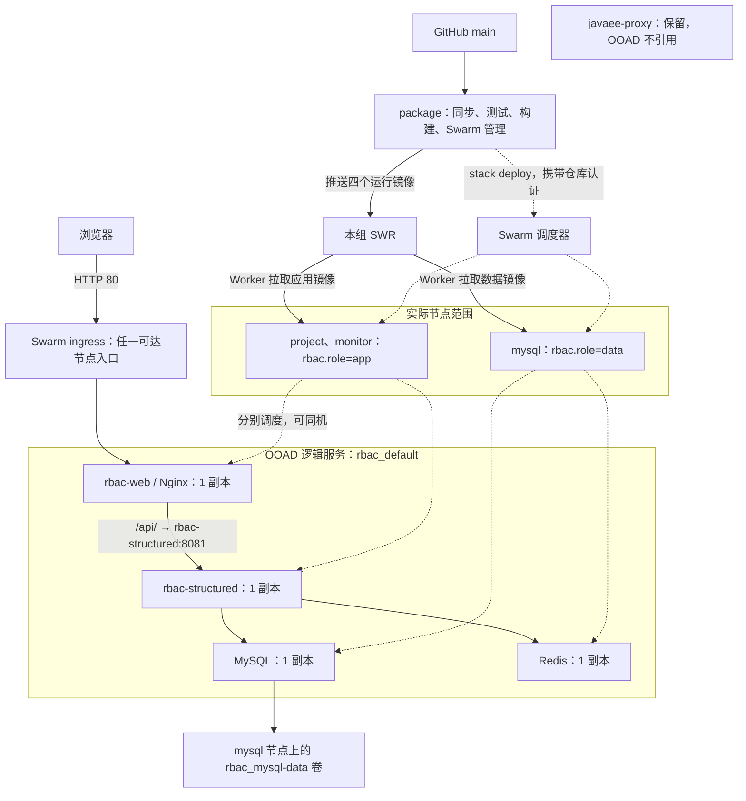

# 四节点 Swarm 部署交接

本文是当前 OOAD 四节点部署和日常重新发布的操作依据。命令未特别注明时，均在 package 的 `/root/OOAD` 执行。主要入口为 http://1.94.223.65/，备用入口为 http://120.46.82.206/。

日常更新的顺序是：本地提交源码 → package 同步 → 测试 → 构建 → 推送 SWR → Swarm 更新 → HTTP 检查。已有课程数据、管理员口令和真实授权不随发布重置。本文不要求重新导入、清库或重新运行首次初始化验收。

## 1. 部署图与调度边界

图中的服务是逻辑对象，project、monitor 是可调度节点范围，连线不表示永久绑定某台节点。



package 不承载业务任务。前端与权限中心分别按资源预留调度，可同机；没有强制分离或按实时内存自动迁移的规则。MySQL、Redis 使用数据节点标签。默认 stack 名为 `rbac`，自动创建 `rbac_default`，不修改现有 `javaee-proxy`。

## 2. 本地修改并提交源码

执行位置：本地独立工作树。

```powershell
Set-Location "<本地工作区>"
git status --short
git fetch origin main
git merge --ff-only origin/main
# 修改源码，审阅差异；只暂存本次明确修改的文件
git diff --check
git add -- "<本次修改的文件路径>"
git commit -m "<说明本次变更>"
git fetch origin main
# 若 main 前进，只在这个独立工作树整合更新、解决冲突后再推送
git rebase origin/main
git push origin HEAD:main
```

预期：新提交到达 GitHub main。遇到未提交改动或冲突先处理，不强推、不重置旧工作区。遇到 Git 所有权检查时，对每条 Git 命令添加 `-c safe.directory=E:/IDEA/OOAD-worktrees/deployment-handoff`，不修改全局信任配置。

## 3. package 首次同步本次回传配置

仅第一次需要本节。云端的七个配置文件尚有现场改动，不能直接覆盖或把整个工作区暂存。以下操作应在本次 GitHub 提交到达 main 后执行；本次回传工作本身不执行云端同步。

先核对内容：

```bash
cd /root/OOAD
git status --short
git fetch origin main
files=(docker-compose.yml rbac-web/Dockerfile deploy/build.sh deploy/stack.sh deploy/env.example deploy/env-build.sh deploy/acceptance.py)
python3 - "${files[@]}" <<'PY'
import hashlib, pathlib, subprocess, sys
for name in sys.argv[1:]:
    incoming = subprocess.check_output(['git', 'show', 'origin/main:' + name])
    current = pathlib.Path(name).read_bytes()
    if incoming != current:
        raise SystemExit('内容不同，停止同步并人工核对: ' + name)
    print(name, hashlib.sha256(current).hexdigest())
PY
```

预期：七个文件均逐字节一致。任何文件不同都先人工比较 `git diff` 与 `git show origin/main:路径`，不继续下面的步骤。

检查其他已跟踪文件没有会被快进覆盖的修改后，仅把这七个路径的现场改动保存到 stash（包括其中原本未跟踪的新增脚本）：

```bash
git stash push -u -m "OOAD deployment config before main sync" -- "${files[@]}"
git merge --ff-only origin/main
git stash list
git status --short
```

预期：HEAD 快进到 main，七个文件由版本库管理，stash 留作恢复记录。不要 `stash pop`：相同配置已经进入 main。其他现场说明文件可以继续保持未跟踪状态。`.env` 和 `/root/ooad-prep` 不参与暂存或恢复；不使用 `stash -a`、`git clean` 或强制重置。

## 4. package 后续常规同步

```bash
cd /root/OOAD
git status --short
git fetch origin main
git log --oneline HEAD..origin/main
git merge --ff-only origin/main
```

预期：从已核对的工作区快进到要部署的源码。发现未提交源码或配置改动时先比较、保存并处理，不能靠覆盖来消除。首次同步遗留的现场说明需单独识别，不自动删除。若无法快进，先调查云端独有提交；不在服务器上盲目 rebase 或 reset。

发布前确认 `.env` 中 `TAG=` 为空，以采用构建记录；检查 SWR 登录仍有效。需要登录时，使用 SWR 控制台提供的当前登录命令在 package 执行，凭据不写进源码、文档或聊天。

## 5. 启动或复用测试专用依赖

执行位置：package。测试只连 `rbac_test` 和测试 Redis；先检查当前 shell 的 `TEST_DB_*`、`TEST_REDIS_*` 等覆盖值，不能指向生产数据服务。

```bash
docker ps -a --filter name=rbac-test-
docker inspect rbac-test-mysql rbac-test-redis
```

如果已有同名容器，核对镜像、端口、数据库和资源配置后复用：

```bash
docker start rbac-test-mysql rbac-test-redis
```

仅在确认对应容器不存在时创建，不能直接删除已有同名容器：

```bash
docker run -d --name rbac-test-mysql \
  --memory=650m -p 127.0.0.1:13306:3306 \
  -e MYSQL_ROOT_PASSWORD=root -e MYSQL_DATABASE=rbac_test \
  mysql:8.0 --character-set-server=utf8mb4 \
  --innodb-buffer-pool-size=128M --max-connections=100

docker run -d --name rbac-test-redis \
  --memory=96m -p 127.0.0.1:16379:6379 \
  redis:7-alpine redis-server --maxmemory 64mb --maxmemory-policy allkeys-lru
```

就绪检查，初始化期间可重复查询：

```bash
docker exec rbac-test-mysql mysqladmin ping -h localhost -uroot -proot
docker exec rbac-test-redis redis-cli ping
```

预期分别为 `mysqld is alive`、`PONG`。这里的固定口令仅属于绑定回环地址的测试数据库，不是部署数据库或 root 管理员口令。

## 6. 串行测试、构建和推送

```bash
cd /root/OOAD
STOP_TEST_DEPS_AFTER_VERIFY=1 bash deploy/build.sh push
```

脚本失败立即退出，顺序如下：

1. 加载 `deploy/env-build.sh` 和独立的 `.env`，确认五类基础镜像已在 package 本地。
2. 默认标签使用当前提交短哈希；发现部署相关源码或配置未提交时追加 UTC 时间和进程号，避免不同产物复用同一标签。正常以干净、已提交源码发布；需要显式标签时应使用新的唯一值。
3. 使用 Maven Wrapper 执行权限中心及依赖模块的 `clean verify`，不构建 mock。测试子进程移除生产口令变量，保留 JaCoCo 插桩；低内存下测试 fork 不复用。
4. 后端验证成功后，按入口参数停止测试 MySQL、Redis，释放前端构建所需内存。若此前失败，排查后自行停止不再使用的测试容器。
5. 用验证过的 JAR 构建权限中心镜像；前端 Node 阶段执行单测、覆盖率、类型检查和生产构建，导出报告，再复用缓存构建 Nginx 最终镜像。
6. 使用本地基础镜像且 `--pull=false`；不在本地电脑构建应用。
7. 将 MySQL、Redis 本地基础镜像标记为本组 SWR 地址，连同两个应用镜像依次推送。全部成功并有 digest 后，才写入 `PUSHED=true`。

后端实际命令由脚本运行，无需再单独重复：

```bash
env -u RBAC_INITIAL_PASSWORD -u RBAC_JWT_SECRET -u DB_PASSWORD -u MYSQL_ROOT_PASSWORD \
  ./mvnw -B -s deploy/maven-settings-huawei.xml \
  -pl rbac-structured -am -DreuseForks=false -DforkCount=1 clean verify
```

预期产物：

- `rbac-structured/target/` 下 JAR、测试报告和 `site/jacoco/`。
- `target/frontend-coverage/` 下前端覆盖率报告。
- `target/deploy-release.env` 下 TAG、REGISTRY、PUSHED。
- `target/built-images.json`、`target/published-images.json` 下本地镜像标识与发布 digest。

四个运行镜像地址：

```text
swr.cn-north-4.myhuaweicloud.com/egret-hill/rbac-structured:<TAG>
swr.cn-north-4.myhuaweicloud.com/egret-hill/rbac-web:<TAG>
swr.cn-north-4.myhuaweicloud.com/egret-hill/ooad-mysql:8.0
swr.cn-north-4.myhuaweicloud.com/egret-hill/ooad-redis:7-alpine
```

如果测试或构建失败，先定位并重跑受影响检查，不跳过门槛。若仅推送失败，保留本地镜像与发布记录，修复网络或 SWR 认证后执行：

```bash
bash deploy/build.sh push-only
```

预期：复用同一 TAG 和已完成构建的应用镜像，不重新编译。镜像 ID 与构建记录不符时会拒绝；源码变化后须重新走正常构建，不能用此命令冒充新发布。

## 7. 提交 Swarm 更新并检查

```bash
bash deploy/stack.sh check
bash deploy/stack.sh up
bash deploy/stack.sh ps
docker stack services rbac
docker stack ps rbac --no-trunc
docker service logs --tail 100 rbac_rbac-structured
docker service logs --tail 100 rbac_rbac-web
```

预期：预检查确认一台 Ready/Active 数据节点、至少两台 Ready/Active 应用节点和必需配置。`up` 读取已推送发布记录并携带 `--with-registry-auth`，Worker 从 SWR 拉取镜像，四服务最终均为 `1/1`，任务不持续重启。命令提交成功不等于服务就绪；MySQL 初始化或镜像下载期间需观察任务和日志。

核对服务镜像版本与 `target/published-images.json`：

```bash
docker service inspect rbac_rbac-structured rbac_rbac-web rbac_mysql rbac_redis \
  --format '{{.Spec.Name}} {{.Spec.TaskTemplate.ContainerSpec.Image}}'
docker network inspect rbac_default
docker network inspect javaee-proxy
```

预期：应用 TAG 对应本次发布，镜像 digest 对应记录。若镜像引用未解析为 digest，继续排查管理节点的 SWR 认证与解析，不能直接宣称版本核对完成。不要通过重新部署、删除卷反复试错。

package 上检查入口与 API：

```bash
curl --fail http://127.0.0.1/
curl --fail http://127.0.0.1/api/v1/actuator/health
```

本地 PowerShell 检查公网与页面引用的真实静态资源路径：

```powershell
$page = Invoke-WebRequest http://1.94.223.65/ -UseBasicParsing
$page.StatusCode
$page.Content
Invoke-RestMethod http://1.94.223.65/api/v1/actuator/health
# 从本次 HTML 的 script/link 标签读取资源路径，再请求该地址
Invoke-WebRequest "http://1.94.223.65/assets/<本次页面实际引用的文件名>" -UseBasicParsing
```

预期：首页、真实 JS/CSS 路径 HTTP 200，健康响应包含 `status=UP`。也可对备用入口作同样检查。

查看持续日志、停止与恢复：

```bash
bash deploy/stack.sh logs rbac-structured
bash deploy/stack.sh logs rbac-web
# 仅在确需停服时执行，Ctrl+C 可退出上述日志跟随
bash deploy/stack.sh down
# 停止后恢复使用原发布记录，不清库
bash deploy/stack.sh up
```

`down` 异步移除服务和 stack 网络，保留数据库卷；删除数据库卷是另一种会丢失数据的操作，不属于停止或重新部署步骤。需要回退时，先确认历史镜像和数据库兼容性，再用 `TAG=<已推送的历史标签> bash deploy/stack.sh up`；回退应用镜像不会回退数据库迁移。

## 8. 源码之外的文件和对象

下表仅记录位置和用途，实际口令、密钥及人员内容不进入 Git。含敏感内容的目录应为 `700`、文件为 `600`，只通过获授权的 SSH 会话读取。

| 路径或对象 | 用途和维护方式 | 是否可删除 |
|---|---|---|
| `/root/OOAD/.env` | SWR 地址、部署参数、数据库口令、员工初始口令和 JWT 密钥。由服务器独立维护，脚本读取；不覆盖已有有效值。 | 运行维护必需；先安全备份，不随源码清理。 |
| `/root/ooad-prep/credentials.json` | root 管理员凭据。SSH 登录 package 后可用 `sudo cat /root/ooad-prep/credentials.json` 在受控终端读取，禁止复制进仓库、报告或聊天。要求 `600`。 | 不随发布删除；改密后同步维护，不能靠删除文件重置线上口令。 |
| `/root/ooad-prep/imports/` | `permissions.xlsx` 对应 `POST /imports/permissions` 的 `file` 字段；`departments.xlsx`、`employees.xlsx` 对应 `POST /imports/organization?companyCode=SZ&companyName=市政公司` 的 `departments`、`employees` 字段。 | 含人员信息，应保留受控原始副本；非日常构建输入，不进入镜像。 |
| `/root/ooad-prep/ooad-base-images.tar` | 五类基础镜像离线包。缓存缺失时执行 `docker load -i /root/ooad-prep/ooad-base-images.tar`，再 inspect 镜像。包丢失时本机只 pull/save `linux/amd64` 基础镜像并上传，不构建应用。 | 有可靠备份且已导入后可按空间需要清理；不可把包当作应用发布镜像。 |
| `/root/ooad-prep/acceptance/` | 导入报告、验收摘要、检查点 `state.json`；用于识别已导入或结果未明的请求。报告限服务器读取。 | 排错和受控重验前保留；不能删除检查点来强制重复导入。 |
| `/root/ooad-prep/backups/` 及该目录下日志 | 原配置恢复和故障排查依据；恢复前比较内容，避免覆盖后续修复。 | 确认不再需要且有备份后可按需归档，不提交。 |
| `/root/OOAD/target/deploy-release.env`、`built-images.json`、`published-images.json` | 本轮标签、推送状态、镜像 ID/digest；`push-only` 和默认 `up` 依赖它们。 | 不提交；当前推送/部署未完成前不要清理，完成后按发布留档策略保留。 |
| 模块 `target/`、根 `target/frontend-coverage/` | JAR、后端测试/JaCoCo 和前端报告等构建产物。 | 不提交；排错与交付留档后可重建。 |
| mysql 节点 `rbac_mysql-data` 命名卷 | 真实数据库数据；在 mysql 上用 `docker volume inspect rbac_mysql-data` 查看实际 Mountpoint，挂载到容器 `/var/lib/mysql`。 | 不随停服删除；备份应使用数据库一致性备份方法。 |
| package 的 Docker 镜像缓存和测试容器 | 基础镜像、应用镜像及前端中间阶段；测试容器保留停止状态和测试数据。 | 不做无差别 prune；`push-only` 依赖本轮镜像，测试容器删除前先确认用途。 |
| 本组 SWR 仓库 | Worker 获取发布镜像的位置；与 package 本地缓存独立。认证保存在 package Docker 客户端配置中，不能回传凭据文件。 | 仍被运行服务或回退版本使用的镜像不能清理。 |

基础镜像清单为 `mysql:8.0`、`redis:7-alpine`、`eclipse-temurin:21-jre`、`node:20-alpine`、`nginx:1.27-alpine`。导入后使用 `docker image inspect <镜像名>` 确认存在及架构。这里的“Docker wheel”指离线镜像 TAR，不是 Python wheel。

## 9. 测试范围与首次验收边界

| 触发方式 | 行为 |
|---|---|
| `build.sh build` 或 `build.sh push` | Maven 执行后端架构、契约、单元和真实 MySQL/Redis 集成测试，通过 JaCoCo 配置的整体行/分支及 Service 行覆盖率门槛后生成 JAR。 |
| 前端 Docker 构建阶段 | `npm ci` 后执行 `npm run test:coverage -- --maxWorkers=1 --minWorkers=1`，检查 Vitest 覆盖率门槛，再执行 `npm run build`（含 Vue/TypeScript 类型检查与 Vite 生产构建）。 |
| `build.sh push-only` | 只核对已构建镜像并重试发布，不重新运行应用测试。 |
| 部署后人工检查 | HTTP 首页、实际静态资源、健康 API、Swarm 副本、任务错误、日志和镜像版本。 |
| 受控首次验收 | 使用下述 `acceptance.py` 执行有状态的初始化与权限场景。 |

当前发布流程不包含 Playwright；API 验收不等同于浏览器端到端测试。此处说明测试行为，不记录某一次测试数量、结果或覆盖率成绩。

`acceptance.py` 不是日常发布必须执行的步骤。只有首次初始化或明确批准的受控验收，才使用：

```bash
python3 deploy/acceptance.py \
  --base-url http://127.0.0.1/api/v1 \
  --imports-dir /root/ooad-prep/imports \
  --credentials /root/ooad-prep/credentials.json \
  --report-dir /root/ooad-prep/acceptance
```

脚本会使用保存的 root 凭据；首次运行会改为随机口令并保存，验证旧 Token 失效，导入权限和组织人员，再创建专用管理员、普通用户与测试角色。它检查匿名拒绝、普通用户禁止访问管理接口、原 Token 下授权立即生效、回收立即拒绝、登出失效及审计记录，最后回收专用指派并删除测试账号和角色，保留审计。

其严格断言依赖课程初始数据状态，包括人员数量和课程员工没有新角色指派。已有真实用户或授权变化后，不能无条件重跑，更不能清库、回收真实授权来满足断言。请求超时先核对检查点和服务端结果；不立即重复提交导入，不猜测负责人关联，不自动修补数据异常。凭据文件或检查点丢失时先恢复受控备份并核对当前状态，不重新初始化。
