= 当前源码图索引

2026-11-17：C 的7张图现行局部核验见 link:../oral-review/C-iterations.adoc[C迭代记录] 和 link:../oral-review/C-diagrams-verification.json[编译符号/源码调用顺序/图摘要]。其中4张顺序图已重生成；原全量 source-index.json 保留历史基线，不代表本轮全工程核验。

2026-11-22：S03 两版顺序图、S04 两版主顺序图及 DDD SIM 类图和顺序图已按当前源码局部更新。Swarm 当前六服务静态图与旧七服务验收归档分列。

S04 的 `current-class` 类图和主顺序图对应 Compose 默认的内嵌课程代理。两张独立网关类图保留在各自的历史条目下。

旧全量生成归档见 link:source-index.json[源码和图哈希]、link:generation-status.json[生成状态] 和 link:visual-review.json[目视摘要]。本次局部复核见 link:visual-review.adoc[图稿复核记录]。文本 SHA-256 仅归一化 CRLF→LF，class/jar/png 等二进制逐字节计算。STRICT_COMPILED_CHECKED / SIGNATURE_CHECKED 仅表示当次编译产物、符号及受检查源码调用顺序对齐。

== LOGIN-ddd-class

image::LOGIN-ddd-class.svg[LOGIN-ddd-class]

link:LOGIN-ddd-class.png[PNG] / link:LOGIN-ddd-class.dot[DOT]

== LOGIN-ddd-sequence

image::LOGIN-ddd-sequence.svg[LOGIN-ddd-sequence]

link:LOGIN-ddd-sequence.png[PNG] / link:LOGIN-ddd-sequence.puml[PlantUML]

== S01-ddd-class

image::S01-ddd-class.svg[S01-ddd-class]

link:S01-ddd-class.png[PNG] / link:S01-ddd-class.dot[DOT]

== S01-ddd-sequence

image::S01-ddd-sequence.svg[S01-ddd-sequence]

link:S01-ddd-sequence.png[PNG] / link:S01-ddd-sequence.puml[PlantUML]

== S01-structured-class

image::S01-structured-class.svg[S01-structured-class]

link:S01-structured-class.png[PNG] / link:S01-structured-class.dot[DOT]

== S01-structured-sequence

image::S01-structured-sequence.svg[S01-structured-sequence]

link:S01-structured-sequence.png[PNG] / link:S01-structured-sequence.puml[PlantUML]

== S02-ddd-class

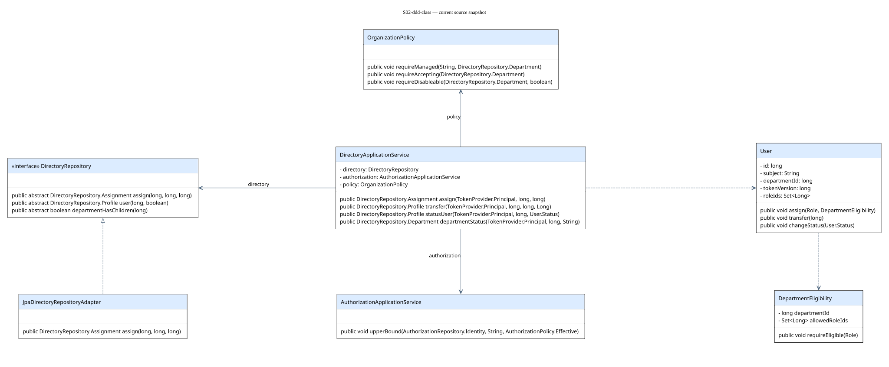

link:S02-ddd-class.png[PNG] / link:S02-ddd-class.dot[DOT]

== S02-ddd-sequence

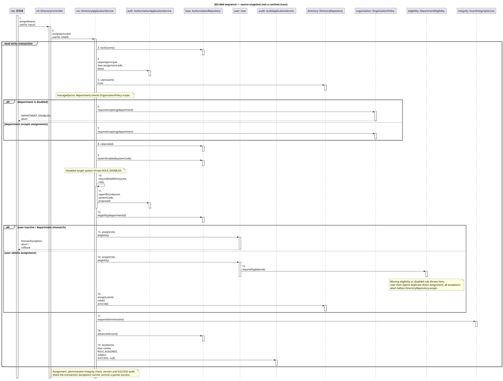

link:S02-ddd-sequence.png[PNG] / link:S02-ddd-sequence.puml[PlantUML]

== S02-structured-class

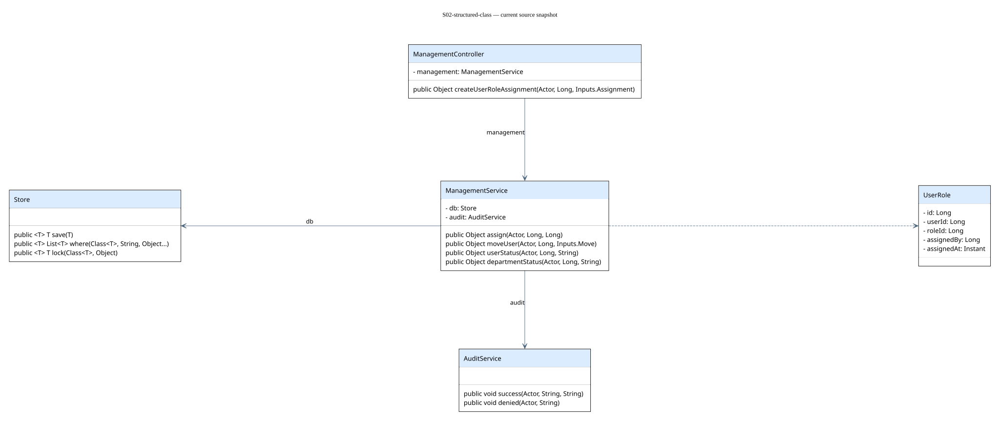

link:S02-structured-class.png[PNG] / link:S02-structured-class.dot[DOT]

== S02-structured-sequence

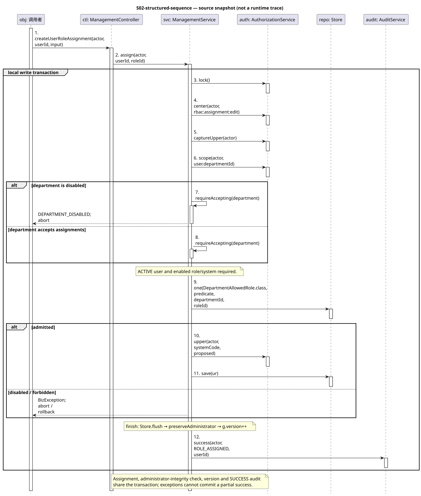

link:S02-structured-sequence.png[PNG] / link:S02-structured-sequence.puml[PlantUML]

== S03-ddd-class

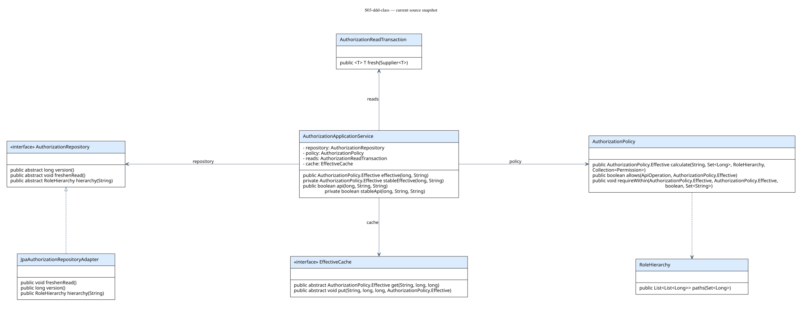

link:S03-ddd-class.png[PNG] / link:S03-ddd-class.dot[DOT]

== S03-ddd-sequence

image::S03-ddd-sequence.svg[S03-ddd-sequence]

link:S03-ddd-sequence.png[PNG] / link:S03-ddd-sequence.puml[PlantUML]

== S03-structured-class

image::S03-structured-class.svg[S03-structured-class]

link:S03-structured-class.png[PNG] / link:S03-structured-class.dot[DOT]

== S03-structured-sequence

image::S03-structured-sequence.svg[S03-structured-sequence]

link:S03-structured-sequence.png[PNG] / link:S03-structured-sequence.puml[PlantUML]

== S04-ddd-class

独立网关历史类图。当前默认部署见 link:S04-ddd-current-class.svg[DDD 当前类图]。

image::S04-ddd-class.svg[S04-ddd-class]

link:S04-ddd-class.png[PNG] / link:S04-ddd-class.dot[DOT]

== S04-ddd-current-class

过滤器持有 `Authorize`，并调用它的 `require()`。`CourseProxyConfiguration` 创建过滤器时传入实现，调用 `TokenProvider` 和 `AuthorizationApplicationService`。普通课程 API 的访问要求由 `AuthorizationPolicy` 判断。

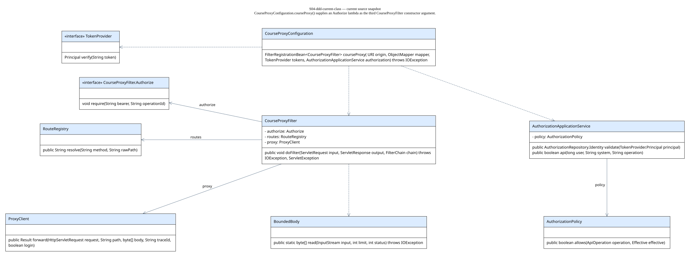

link:S04-ddd-current-class.png[PNG] / link:S04-ddd-current-class.dot[DOT]

== S04-ddd-policy-sequence

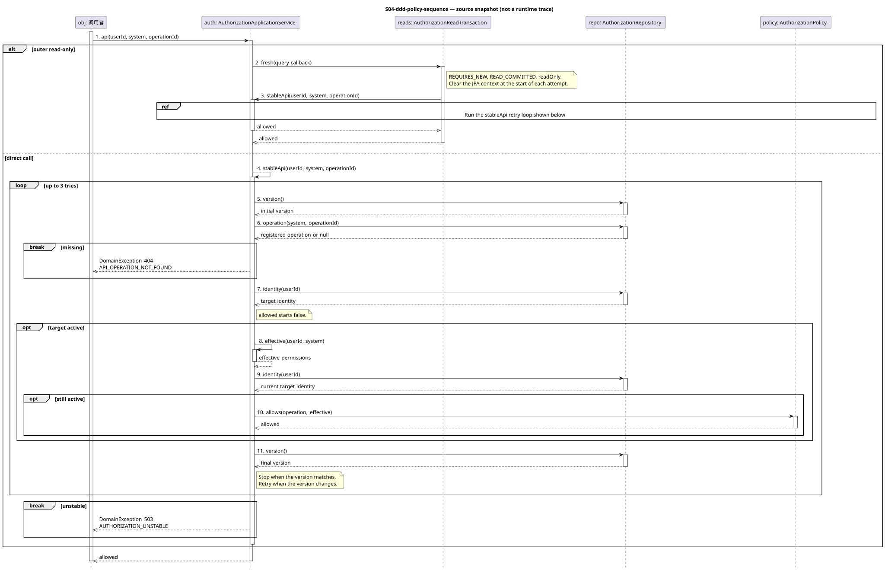

link:S04-ddd-policy-sequence.png[PNG] / link:S04-ddd-policy-sequence.puml[PlantUML]

== S04-ddd-sequence

image::S04-ddd-sequence.svg[S04-ddd-sequence]

link:S04-ddd-sequence.png[PNG] / link:S04-ddd-sequence.puml[PlantUML]

== S04-structured-class

独立网关历史类图。当前默认部署见 link:S04-structured-current-class.svg[Structured 当前类图]。

image::S04-structured-class.svg[S04-structured-class]

link:S04-structured-class.png[PNG] / link:S04-structured-class.dot[DOT]

== S04-structured-current-class

过滤器持有 `Authorize`，并调用它的 `require()`。`CourseProxyConfiguration` 创建过滤器时传入实现，调用 `TokenService` 和 `AuthorizationService`。

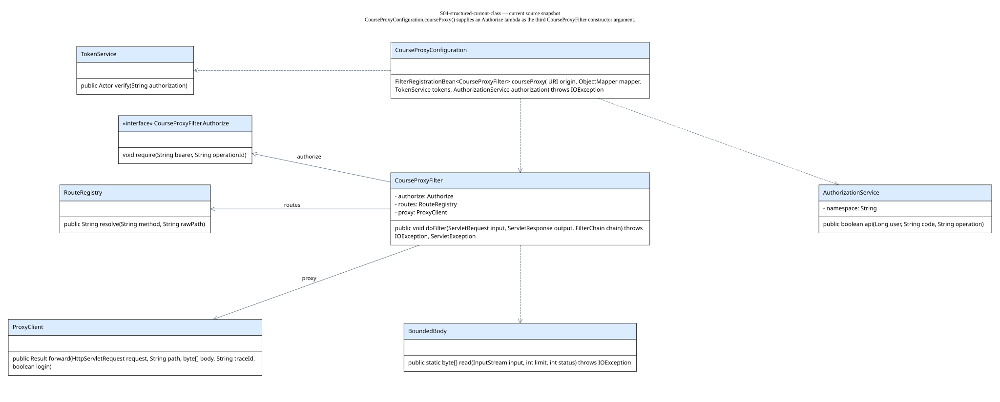

link:S04-structured-current-class.png[PNG] / link:S04-structured-current-class.dot[DOT]

== S04-structured-sequence

image::S04-structured-sequence.svg[S04-structured-sequence]

link:S04-structured-sequence.png[PNG] / link:S04-structured-sequence.puml[PlantUML]

== S05-ddd-class

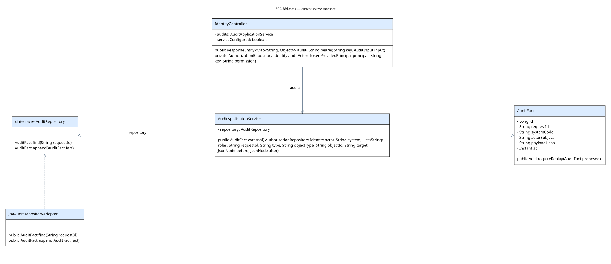

link:S05-ddd-class.png[PNG] / link:S05-ddd-class.dot[DOT]

== S05-ddd-sequence

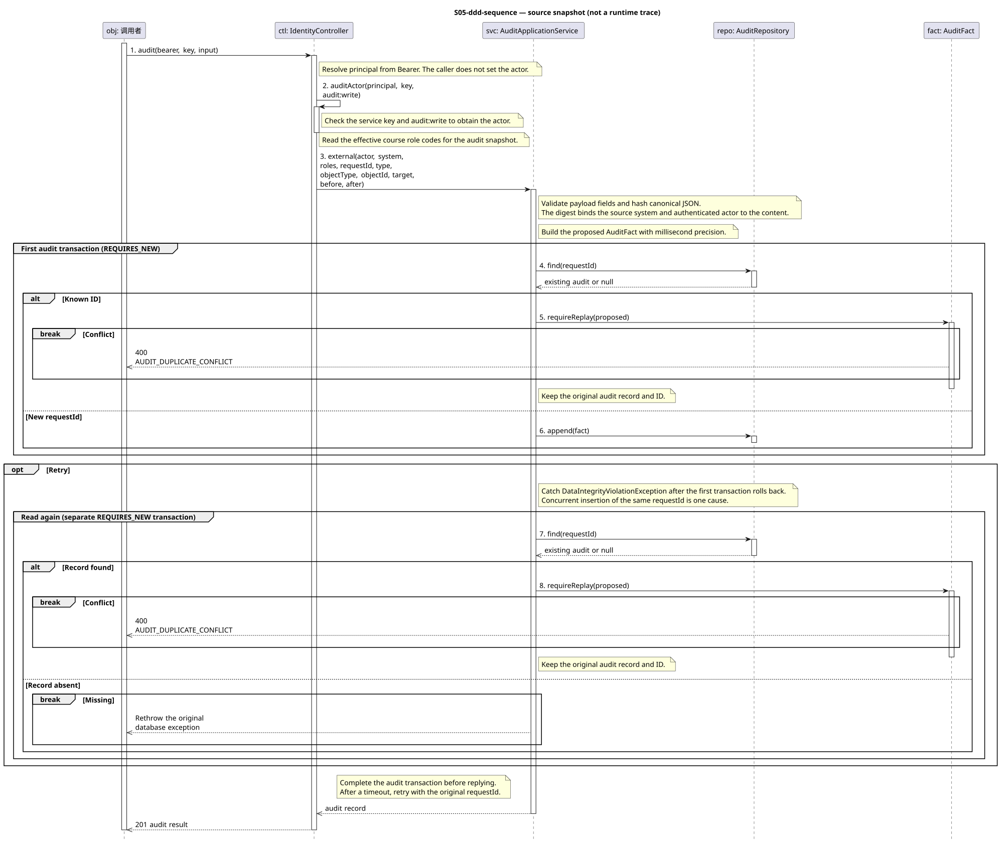

link:S05-ddd-sequence.png[PNG] / link:S05-ddd-sequence.puml[PlantUML]

== S05-structured-class

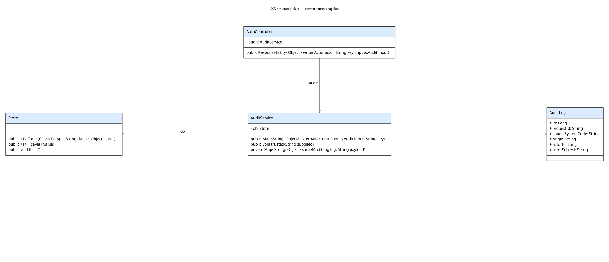

link:S05-structured-class.png[PNG] / link:S05-structured-class.dot[DOT]

== S05-structured-sequence

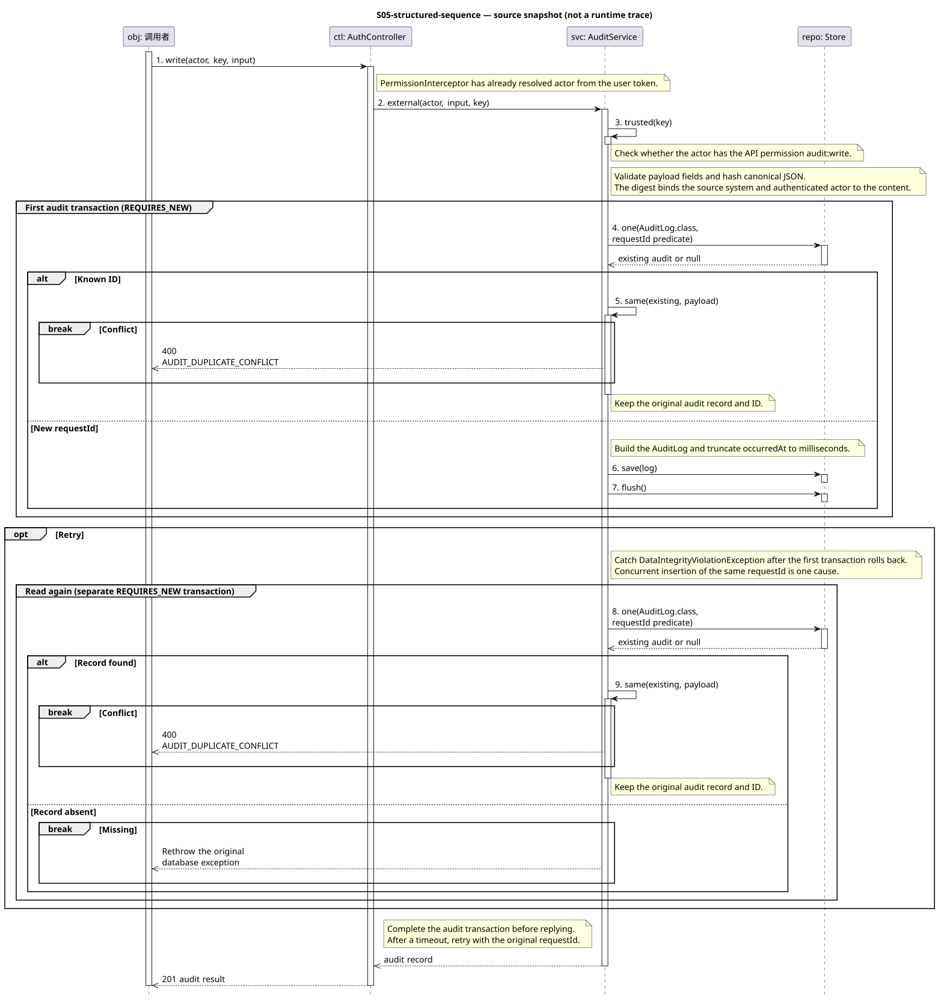

link:S05-structured-sequence.png[PNG] / link:S05-structured-sequence.puml[PlantUML]

== S06-ddd-class

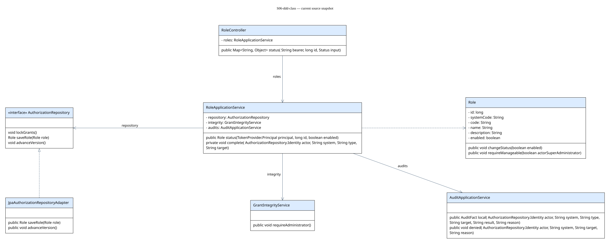

link:S06-ddd-class.png[PNG] / link:S06-ddd-class.dot[DOT]

== S06-ddd-sequence

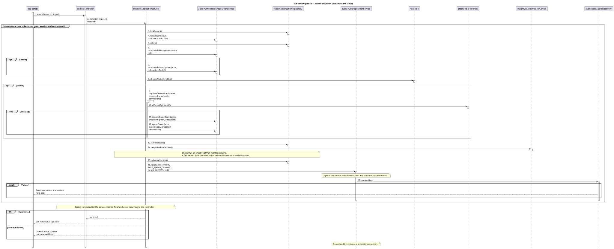

link:S06-ddd-sequence.png[PNG] / link:S06-ddd-sequence.puml[PlantUML]

== S06-structured-class

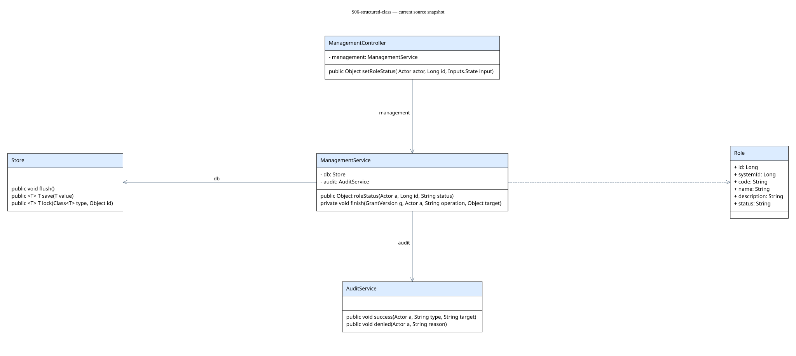

link:S06-structured-class.png[PNG] / link:S06-structured-class.dot[DOT]

== S06-structured-sequence

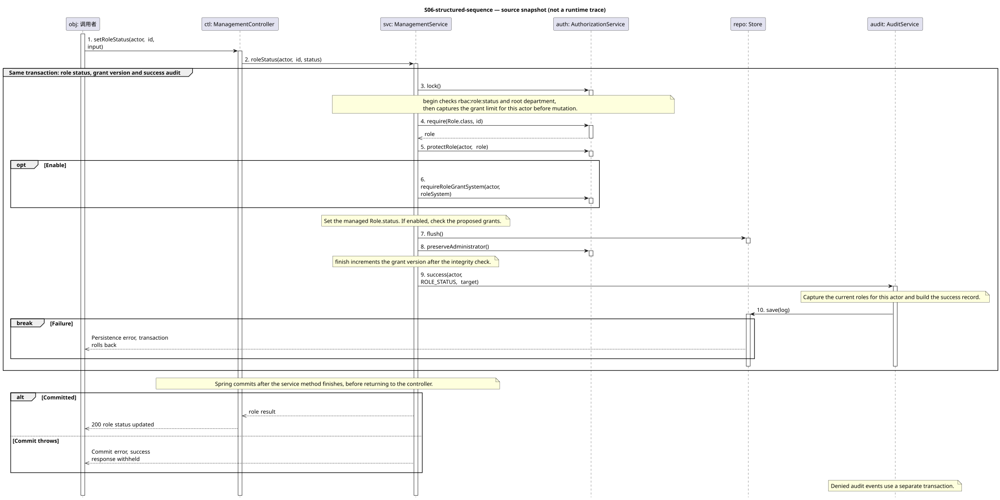

link:S06-structured-sequence.png[PNG] / link:S06-structured-sequence.puml[PlantUML]

== SIM-ddd-class

image::SIM-ddd-class.svg[SIM-ddd-class]

link:SIM-ddd-class.png[PNG] / link:SIM-ddd-class.dot[DOT]

== SIM-ddd-sequence

image::SIM-ddd-sequence.svg[SIM-ddd-sequence]

link:SIM-ddd-sequence.png[PNG] / link:SIM-ddd-sequence.puml[PlantUML]

== ddd-packages

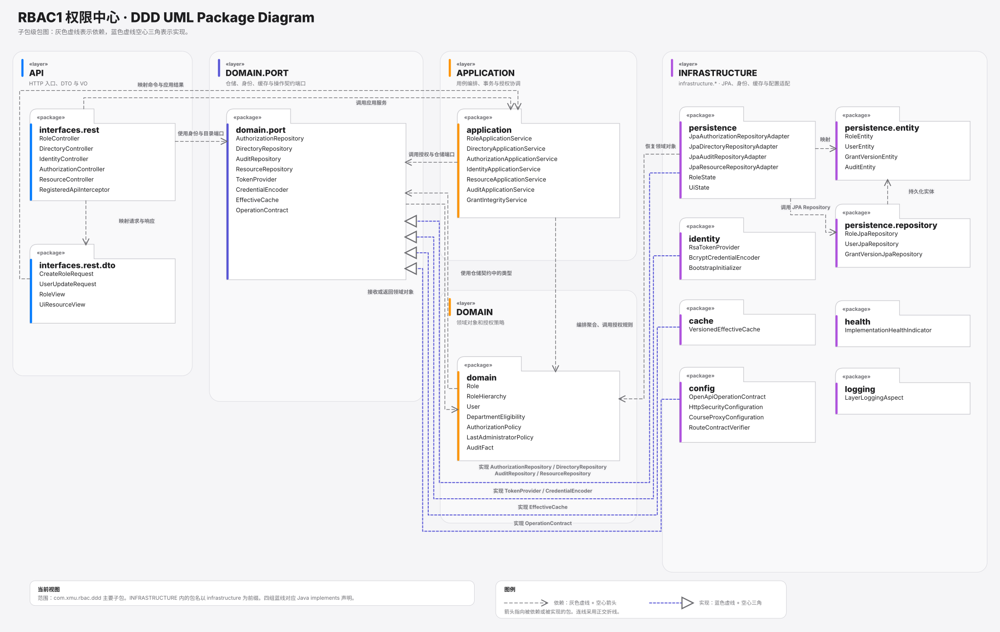

link:ddd-packages.png[PNG] / link:ddd-packages.dot[DOT]

== role-senior-junior-dag

image::role-senior-junior-dag.svg[role-senior-junior-dag]

link:role-senior-junior-dag.png[PNG] / link:role-senior-junior-dag.dot[DOT]

== role-state

image::role-state.svg[role-state]

link:role-state.png[PNG] / link:role-state.puml[PlantUML]

== schema-15-er

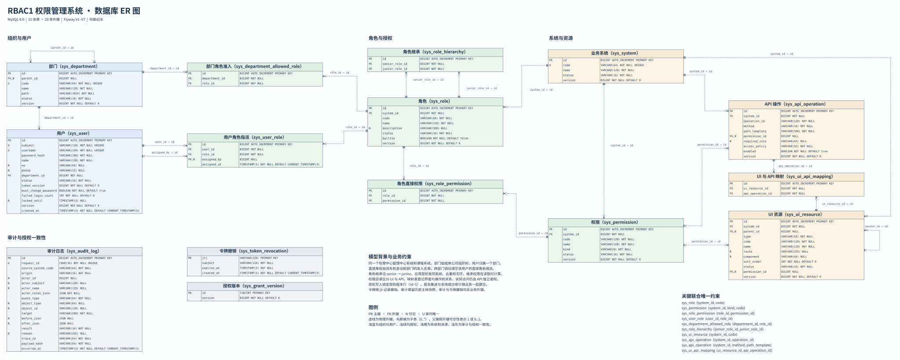

link:schema-15-er.png[PNG] / link:schema-15-er.dot[DOT]

== structured-packages

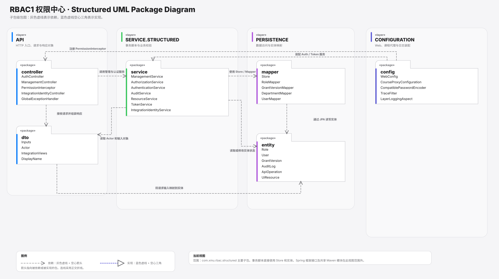

link:structured-packages.png[PNG] / link:structured-packages.dot[DOT]

== swarm-deployment

旧七服务本地验收归档。当前六服务部署见下方静态配置图。

image::swarm-deployment.svg[旧七服务 Swarm 验收归档]

link:swarm-deployment.png[PNG] / link:swarm-deployment.puml[PlantUML]

== swarm-deployment-current

根据当前 Compose 和 Nginx 配置绘制的六服务部署图。

image::swarm-deployment-current.svg[当前六服务 Swarm 部署]

link:swarm-deployment-current.png[PNG] / link:swarm-deployment-current.puml[PlantUML]
