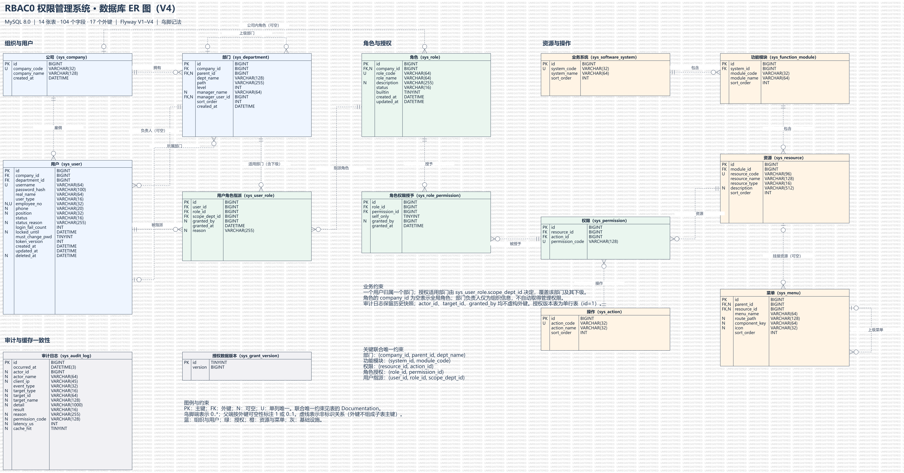

= RBAC0 权限中心数据库设计说明书
:lang: zh-CN
:project-root: ../../OOAD
:toc: left
:toc-title: 目录
:sectnums:

版本：1.2；日期：2026-10-26；数据库结构由当前迁移脚本建立。

== 引言

数据库保存组织、账号、角色、权限、指派、菜单和审计数据，为统一认证、授权管理及业务系统鉴权提供支持。当前使用 MySQL 8.0、InnoDB、utf8mb4；Redis 保存授权缓存和令牌注销标记。

模型采用 RBAC0。用户只归属一个部门，通过多条角色指派获得不同部门的工作权限。用户所属部门与指派适用部门分别保存；部门负责人、岗位和内部账号类型不自动产生权限。

=== 设计依据

[cols="2,3",options="header"]
|===
|文件 |作用
|link:{project-root}/rbac-contract/src/main/resources/db/migration/[数据库迁移 SQL 目录] |建立当前数据库的表、字段、索引、约束和初始数据。
|link:{project-root}/rbac-contract/src/main/resources/openapi/rbac-api.yaml[rbac-api.yaml（接口契约）] |定义账号状态、接口字段和请求约束。
|xref:detailed-design.adoc[detailed-design.adoc（详细设计说明书）] |说明数据读写、权限判断和事务处理。
|===

当前数据库共 14 张项目表、104 个字段、17 个外键。Flyway 使用 `flyway_schema_history` 记录数据库迁移的执行情况，该表单独管理。

== 数据库 ER 图

下图展示当前数据库的实体、字段、关系及关键联合唯一约束，字段含义见后文数据字典。

.数据库 ER 图

矢量图：link:images/er-v4.svg[查看 ER 图 SVG]。图件格式见 link:images/README.adoc[ER 图说明]。

=== 账号状态管理

账号状态为 ACTIVE（启用）、DISABLED（停用）、DELETED（删除）。管理员通过状态管理控制账号的使用，临时用户使用结束后由管理员手工停用。删除采用逻辑删除，并记录 deleted_at。

JWT 有效期限制令牌的使用时间，Redis TTL 控制缓存和注销标记的保留时间，locked_until 控制连续登录失败后的锁定时间。

账号状态和临时用户处理的验证入口见 link:{project-root}/rbac-structured/src/test/java/com/xmu/rbac/structured/integration/AcceptanceTest.java[AcceptanceTest.java]。

== 逻辑结构

=== 表与关系

[cols="2,3,3",options="header"]
|===
|表 |职责 |主要约束或关系
|sys_company |公司目录 |公司编码唯一。
|sys_department |部门树、路径和负责人 |公司、上级、负责人外键；同级名称联合唯一。
|sys_user |登录账号及人员资料 |用户名、非空工号唯一；公司和部门外键。
|sys_software_system |业务系统目录 |系统编码唯一。
|sys_function_module |系统内功能模块 |系统与模块编码联合唯一。
|sys_resource |业务、菜单、API 资源 |资源编码唯一；所属模块外键。
|sys_action |查看、编辑、审批等操作 |操作编码唯一。
|sys_permission |资源与操作的组合 |权限码唯一；资源与操作联合唯一。
|sys_role |权限集合及角色状态 |角色编码唯一；company_id 空为全局角色，否则为公司内角色。
|sys_role_permission |角色权限及本人限制 |角色与权限联合唯一；删除角色时级联清理关联。
|sys_user_role |用户、角色、适用部门三元指派 |三元组联合唯一；用户、角色、部门外键。
|sys_menu |页面路由和菜单树 |上级菜单、可选资源外键。
|sys_audit_log |操作和判定记录 |保留对象快照，不与业务对象建立外键。
|sys_grant_version |全局授权缓存版本 |应用约定保留 id=1 的单行记录。
|===

用户与角色、角色与权限分别通过关联表表达多对多关系。指派的 scope_dept_id 覆盖该部门及其下级。角色没有部门字段，同一权限集合可在多个部门复用；公司内角色受 company_id 限制。

一般业务表采用代理主键，业务编码另设唯一键。审计和授权人字段保留历史身份信息，不因业务对象变化而级联删除。

=== 完整性规则

数据库负责引用存在性和唯一性；服务层负责管理范围、状态转换、可授予权限上界及字段间的业务一致性。

[cols="2,3",options="header"]
|===
|规则 |实现位置
|用户公司与所属部门公司一致 |UserManagementService 从部门确定公司；外键分别保证引用存在。
|部门路径正确 |ImportService 在取得部门 ID 后写入完整路径。
|每家公司根部门的组织约定 |组织导入维护。parent_id 可空；公司根部门由导入流程定位和维护。
|权限码等于资源编码＋操作编码 |目录和导入服务拼接；字段不是数据库生成列。
|账号 ACTIVE / DISABLED / DELETED |服务校验和转换；VARCHAR 注释未形成 SQL CHECK。
|角色 ENABLED / DISABLED |服务校验；内置角色不可删除，有指派的角色不可直接删除。
|self_only 只限制本人记录 |权限中心返回限制，业务系统执行所有者过滤。
|临时账号和内部账号规则 |临时用户不存工号、电话；内部 ID 由服务分配，数据库不按 user_type 自动切换序列。
|回收不传播 |granted_by 记录授予者；回收其角色不删除他已授出的其他指派。
|===

=== 授权查询

UserRoleMapper 按 user_id 读取指派，联结启用角色、RolePermission、Permission 和适用 Department，返回保留指派来源的 GrantRow。

[source,text]
----
用户 → 指派 → 启用角色 → 角色权限 → 权限码
          └→ 适用部门.path → 与目标部门.path 比较
----

路径格式为 `/祖先id/.../本id/`，用前缀判断覆盖。权限与范围必须来自同一候选记录：道路审批权不能与桥梁查看权的范围组合成桥梁审批权。目标部门为空时只判断操作能力。有效超级管理员走旁路，但账号状态先行检查。

跨公司分配时，普通管理员须同时管理用户归属部门和指派适用部门，公司内角色须与适用部门公司匹配，授出的能力不得超过操作者在该范围内的能力。回收他人指派按适用部门检查范围。公司隔离通过这些共享库中的业务规则实现。

== 物理结构与访问设计

[cols="2,3,3",options="header"]
|===
|索引 |主要访问 |限制和维护成本
|sys_user.uk_username、uk_employee_no |登录精确定位、导入去重 |逻辑删除继续占用唯一值；工号可空。
|sys_user.idx_dept_status、idx_company |管理范围内人员分页、公司筛选 |联合索引以 department_id 为最左列；模糊关键词查询另有扫描成本。
|sys_department.idx_parent、idx_path |直接子部门、子树查询 |path 冗余需随组织结构维护；移动节点时要更新后代。
|sys_user_role.uk_user_role_scope、idx_role、idx_scope |按用户取授权、按角色或适用部门查指派 |唯一键防止重复，并为并发写入兜底。
|sys_role_permission.uk_role_perm、idx_permission |角色权限查询、反查权限 |维护多对多关系；角色删除只级联此表。
|sys_audit_log.idx_time、idx_event_time、idx_actor_time |时间、事件、操作人筛选 |每次写日志需维护索引；P95/P99 排序和热力图聚合仍有额外开销。
|===

用户列表将管理范围转为部门筛选条件，在数据库过滤后分页，避免先取一页再剔除越界人员造成总数错误。子树查询使用 path 前缀；`findActiveInSubtree` 的实际条件排除 DELETED，仍可选中 DISABLED。批量指派按 1000 个 ID 分段执行 INSERT … SELECT，写入前完成业务校验和重复检查。

path、permission_code、user.company_id 是有意保留的冗余。它们分别由组织导入、权限定义、用户创建流程维护。热力图还从权限码首段取系统、末段取操作，因此修改编码规则时须同步统计查询。

上述说明给出索引用途；实际选择的索引和查询代价需以 EXPLAIN、数据量及压测结果确认。当前没有历史日志分区或归档实现。

== 缓存与事务

[cols="2,3,2",options="header"]
|===
|数据 |键与内容 |失效方式
|授权缓存 |rbac:grants:v<version>:u<userId>；启用角色的指派与授权行 |默认 TTL 10 分钟；授权变更切换版本。
|注销标记 |rbac:revoked:<jti>；令牌已注销 |TTL 为令牌剩余有效期。
|===

授权关系写入与全局版本递增同事务提交。读取时先查版本，再查对应缓存；未命中读取数据库。读写事务内不回填，防止未提交数据进入缓存。版本行缺失时读操作回源且不回填，写操作失败回滚。

AssignmentService 的分配、回收，RoleManagementService 的角色状态和权限变更，以及 ImportService 的权限同步负责推进版本。新增授权写入口也须执行该步骤。账号停用、删除由实时读取 status 生效；改口令通过 token_version 使旧令牌失效。

版本切换使提交后的新请求避开变更前的缓存，不终止已经开始的请求。成本是每次授权读取仍查版本、一次修改使所有用户变更前的缓存失去复用、写操作竞争同一版本行。

Redis 授权缓存故障时回源 MySQL；注销查询故障重试后仍失败时拒绝令牌，因为注销状态没有其他数据来源。审计使用独立事务保留失败尝试，成功审计与业务最终提交不保证原子一致。

== 迁移与数据维护

Flyway 按顺序执行 V1–V4。已应用的迁移保留原内容，后续变更新增迁移。升级前保存备份，并在专用环境验证迁移和回收生效场景。

口令保存 BCrypt 哈希，部署凭据和真实人员数据不随设计材料分发。验收检查包括：14 张表、104 个字段和授权版本行存在、重复指派被唯一键拒绝、权限与范围不错误组合、回收后新请求拒绝、审计可查到主体与目标。测试操作见 xref:jacoco-guide.adoc[JaCoCo 测试操作说明]。

== 字段数据字典

下表列出 V1–V4 后的 104 个字段。NULL 表示允许为空；默认值按活动 SQL 记录。FK 标记表示数据库实际外键，“无外键”字段仅保存业务标识或快照。TINYINT 标志在应用中按 0/1 映射，不附带 SQL CHECK 约束。

字段备注说明当前迁移脚本及导入、用户、认证、菜单、审计实现中的字段含义和用途。

=== sys_company

[cols="2,2,1,2,4",options="header"]
|===
|字段 |类型 |可空 |默认值/生成方式 |备注
|`id` |BIGINT |否 |AUTO_INCREMENT |公司主键；供部门、用户及公司内角色引用，与公司根部门的 ID 是不同标识。
|`company_code` |VARCHAR(32) |否 |无显式默认值 |公司业务编码，全库唯一；组织导入以此识别公司，PLATFORM 为内置平台公司编码。
|`company_name` |VARCHAR(128) |否 |无显式默认值 |公司展示名称，供组织浏览与管理界面使用；数据库未对名称建立唯一约束。
|`created_at` |DATETIME |否 |CURRENT_TIMESTAMP |公司记录创建时间，由数据库默认填写，用于记录组织数据建立时间。
|===

=== sys_department

[cols="2,2,1,2,4",options="header"]
|===
|字段 |类型 |可空 |默认值/生成方式 |备注
|`id` |BIGINT |否 |AUTO_INCREMENT |部门主键；被用户所属部门、指派适用部门及子部门引用，并写入本部门的物化路径。
|`company_id` |BIGINT |否 |无显式默认值 |FK → sys_company.id，部门所属公司；也是同级部门联合唯一键的一部分。
|`parent_id` |BIGINT |是 |无显式默认值 |FK → sys_department.id，自关联上级部门；NULL 表示公司根部门。部门层级不表示角色继承。
|`dept_name` |VARCHAR(128) |否 |无显式默认值 |部门展示名称，保留导入表中的部门名称；与 company_id、parent_id 联合唯一，不同公司或不同上级下可重名。
|`path` |VARCHAR(255) |否 |无显式默认值 |由导入流程维护的物化路径，如 /3/15/27/，含祖先与本部门 ID；用于子树查询和授权范围前缀判定，不是名称路径。
|`level` |INT |否 |无显式默认值 |部门深度，根为 1、下级逐层加 1；供树结构组织与查询排序使用，不是管理员权限等级。
|`manager_name` |VARCHAR(64) |是 |无显式默认值 |导入表登记的负责人姓名原文；用于与员工姓名匹配，即使无法唯一关联到账号，也可保留该组织信息。
|`manager_user_id` |BIGINT |是 |无显式默认值 |FK → sys_user.id，可空；导入按同名员工及部门子树优先定位负责人，无法唯一确定时报告异常，不任取一人；不自动授予角色。
|`sort_order` |INT |否 |0 |部门展示顺序；导入时取来源行序，查询结合 level、sort_order、id 排序；不参与权限判断。
|`created_at` |DATETIME |否 |CURRENT_TIMESTAMP |部门记录创建时间，由数据库默认填写；不是该部门业务上的成立日期。
|===

=== sys_user

[cols="2,2,1,2,4",options="header"]
|===
|字段 |类型 |可空 |默认值/生成方式 |备注
|`id` |BIGINT |否 |AUTO_INCREMENT |用户主键；1–9999 为内部账号预留段，服务显式取号；员工与临时用户自增起点为 10000。编号本身不赋予权限。
|`company_id` |BIGINT |否 |无显式默认值 |FK → sys_company.id，用户组织归属公司；创建时由所属部门确定，普通修改不允许跨公司调动。跨公司工作用角色指派表达。
|`department_id` |BIGINT |否 |无显式默认值 |FK → sys_department.id，一个用户只归属一个部门；用于人员管理范围判断，不等于该用户全部授权范围。
|`username` |VARCHAR(64) |否 |无显式默认值 |全库唯一登录名，逻辑删除后仍占用；Excel 导入员工以工号作为登录名，手工创建时由请求单独填写，代码不强制其与 employee_no 相等。
|`password_hash` |VARCHAR(100) |否 |无显式默认值 |BCrypt 单向哈希，由认证过程比对口令；用户查询响应省略口令哈希。
|`real_name` |VARCHAR(64) |否 |无显式默认值 |人员姓名，用于展示、搜索及导入时匹配部门负责人；允许重名，不作为用户唯一标识。
|`user_type` |VARCHAR(16) |否 |'EMPLOYEE' |EMPLOYEE 正式员工、TEMPORARY 临时用户、SYSTEM 内部/业务系统账号；影响工号电话校验及编号分配，不直接决定角色权限。
|`employee_no` |VARCHAR(32) |是 |无显式默认值 |工号，全库唯一且允许 NULL；服务要求 EMPLOYEE 必填、TEMPORARY 不得填写，SYSTEM 可空。
|`phone` |VARCHAR(20) |是 |无显式默认值 |联系号码，可空；TEMPORARY 不得填写。属于人员资料，不参与认证或授权判定。
|`position` |VARCHAR(32) |是 |无显式默认值 |岗位描述，可空；只作人事信息，导入不会按岗位自动授予同名角色。
|`status` |VARCHAR(16) |否 |'ACTIVE' |ACTIVE 启用、DISABLED 停用、DELETED 逻辑删除；认证和鉴权读取当前状态。删除保留账号行和已有指派，已删除账号不再可用。
|`status_reason` |VARCHAR(255) |是 |无显式默认值 |最近一次账号状态操作的原因，由管理请求写入；完整变更历史记录在审计表，本字段不是历史列表。
|`login_fail_count` |INT |否 |0 |当前一轮登录失败计数，由数据库原子递增；达到 5 次时设置锁定截止时间并将计数归零，成功登录也清零，不是累计失败总数。
|`locked_until` |DATETIME |是 |无显式默认值 |登录锁定截止时间；当前时间早于该值时拒绝登录，达到失败阈值后锁 15 分钟。可空，不是账号到期时间，也不等同于 DISABLED。
|`must_change_pwd` |TINYINT |否 |0 |0 表示无需强制改口令，1 表示须先修改口令；导入或使用默认初始口令的新账号置 1，改口令成功后清零，期间仅开放限定接口。
|`token_version` |INT |否 |0 |账号级令牌版本，改口令成功时加 1；每次认证比较 JWT 中版本与本值，不一致即失效。与全局授权缓存版本不是同一机制。
|`created_at` |DATETIME |否 |CURRENT_TIMESTAMP |账号记录创建时间，由数据库默认维护，用于用户详情展示。
|`updated_at` |DATETIME |否 |CURRENT_TIMESTAMP |账号行最近更新时间，数据库 ON UPDATE CURRENT_TIMESTAMP 自动维护；登录计数等字段更新也可能改变它，不只是人工编辑时间。
|`deleted_at` |DATETIME |是 |无显式默认值 |逻辑删除时间，由服务在状态改为 DELETED 时写入；普通停用不写入该时间，也不据此物理清理账号。
|===

=== sys_software_system

[cols="2,2,1,2,4",options="header"]
|===
|字段 |类型 |可空 |默认值/生成方式 |备注
|`id` |BIGINT |否 |AUTO_INCREMENT |业务系统主键，供 sys_function_module.system_id 引用；表示权限所属系统，不是公司编号。
|`system_code` |VARCHAR(32) |否 |无显式默认值 |系统业务编码，全库唯一，如 oa、hr、rbac；业务资源完整编码的第一段，导入按系统名称与编码对照建立。
|`system_name` |VARCHAR(64) |否 |无显式默认值 |业务系统展示名称，用于权限目录分组和选择；不作为鉴权时比较的权限字符串。
|`sort_order` |INT |否 |0 |系统目录展示顺序，查询按 sort_order、id 升序；导入新系统时按现有数量追加。
|===

=== sys_function_module

[cols="2,2,1,2,4",options="header"]
|===
|字段 |类型 |可空 |默认值/生成方式 |备注
|`id` |BIGINT |否 |AUTO_INCREMENT |功能模块主键，供资源引用；一个模块属于一个业务系统。
|`system_id` |BIGINT |否 |无显式默认值 |FK → sys_software_system.id，所属业务系统；与 module_code 构成联合唯一键。
|`module_code` |VARCHAR(32) |否 |无显式默认值 |系统内模块编码，导入新增模块使用 m01、m02 等序号；在所属系统内唯一，参与业务资源完整编码，不要求跨系统唯一。
|`module_name` |VARCHAR(64) |否 |无显式默认值 |模块展示名称；导入在所属系统内按名称查找已有模块。该匹配规则由应用执行，不是数据库名称唯一约束。
|`sort_order` |INT |否 |0 |系统内模块展示顺序；导入新模块时按已有模块数量追加，目录查询按系统和此序号组织。
|===

=== sys_resource

[cols="2,2,1,2,4",options="header"]
|===
|字段 |类型 |可空 |默认值/生成方式 |备注
|`id` |BIGINT |否 |AUTO_INCREMENT |资源主键，供权限及菜单引用；资源定义与具体用户是否获得访问权分离。
|`module_id` |BIGINT |否 |无显式默认值 |FK → sys_function_module.id，所属功能模块；经模块可定位资源所属业务系统。
|`resource_code` |VARCHAR(96) |否 |无显式默认值 |资源完整编码，全库唯一，如 oa:m01:f02 或 rbac:user；新导入功能点取模块内已用最大 f 序号加 1，已有功能点认领后沿用编码，避免删行造成权限错位。
|`resource_name` |VARCHAR(128) |否 |无显式默认值 |资源/功能点展示名称；导入按所属模块、名称及同名出现次序认领已有资源，名称本身没有唯一约束。
|`resource_type` |VARCHAR(16) |否 |'BUSINESS' |BUSINESS 业务功能点、MENU 管理页面资源、API 无独立页面的接口能力；菜单维护只允许挂 MENU 类型，由服务校验。
|`description` |VARCHAR(512) |是 |无显式默认值 |资源用途或功能描述，可空；导入或资源创建时写入说明，不作为权限判定条件。
|`sort_order` |INT |否 |0 |资源展示序号；新导入功能点记录清单中的顺序，属于展示元数据，不决定资源编码或权限大小。
|===

=== sys_action

[cols="2,2,1,2,4",options="header"]
|===
|字段 |类型 |可空 |默认值/生成方式 |备注
|`id` |BIGINT |否 |AUTO_INCREMENT |操作主键，供权限引用；同一种操作可以与多个资源组合。
|`action_code` |VARCHAR(32) |否 |无显式默认值 |操作业务编码，全库唯一，如 view、create、edit、approve、export；平台另含 delete、assign、revoke、import、invoke、explain，作为权限码末段。
|`action_name` |VARCHAR(32) |否 |无显式默认值 |操作展示名称，如查看、审批；面向管理界面和权限目录，鉴权使用编码而非中文名称。
|`sort_order` |INT |否 |0 |操作目录展示顺序，查询按此值升序；数值大小不表示操作权限强弱。
|===

=== sys_permission

[cols="2,2,1,2,4",options="header"]
|===
|字段 |类型 |可空 |默认值/生成方式 |备注
|`id` |BIGINT |否 |AUTO_INCREMENT |权限主键，供 sys_role_permission 引用；一条记录表示资源上的一个具体操作。
|`resource_id` |BIGINT |否 |无显式默认值 |FK → sys_resource.id，权限对应资源；与 action_id 联合唯一，同一资源操作不能重复定义。
|`action_id` |BIGINT |否 |无显式默认值 |FK → sys_action.id，权限对应操作；同一操作可用于不同资源，不代表对全部资源自动授权。
|`permission_code` |VARCHAR(128) |否 |无显式默认值 |全库唯一的资源编码:操作编码，如 rbac:user:view；服务和导入过程拼接保存，供接口契约与鉴权精确匹配，不是数据库自动生成列。
|===

=== sys_role

[cols="2,2,1,2,4",options="header"]
|===
|字段 |类型 |可空 |默认值/生成方式 |备注
|`id` |BIGINT |否 |AUTO_INCREMENT |角色主键，供用户指派及角色权限关联引用；角色负责组织权限集合，不保存部门层级。
|`company_id` |BIGINT |是 |无显式默认值 |FK → sys_company.id；NULL 为全局角色，仅超级管理员可修改；非空为公司内角色，其指派适用部门必须属于该公司，不要求被指派用户也归属该公司。
|`role_code` |VARCHAR(64) |否 |无显式默认值 |角色业务编码，全库唯一；内置 SUPER_ADMIN、RBAC_ADMIN、AUDITOR，SUPER_ADMIN 由判定过程识别为旁路角色，普通角色仍按关联权限判断。
|`role_name` |VARCHAR(64) |否 |无显式默认值 |角色展示名称，用于角色列表、指派与权限解释；名称不唯一，也不直接参与权限匹配。
|`description` |VARCHAR(255) |是 |无显式默认值 |角色职责与用途说明，可空；便于管理员判断适用场景，不承载可执行的授权规则。
|`status` |VARCHAR(16) |否 |'ENABLED' |ENABLED 启用、DISABLED 停用；停用保留指派及权限关联，但新鉴权不使用该角色。服务禁止停用 SUPER_ADMIN 角色。
|`builtin` |TINYINT |否 |0 |0 普通角色、1 内置角色；服务拒绝删除内置角色。标志本身不使用户获得特权，也不是数据库删除触发器。
|`created_at` |DATETIME |否 |CURRENT_TIMESTAMP |角色记录创建时间，由数据库默认填写，用于生命周期记录。
|`updated_at` |DATETIME |否 |CURRENT_TIMESTAMP |角色行最近更新时间，由数据库 ON UPDATE 维护；角色权限变更单独记录在关联表中。
|===

=== sys_role_permission

[cols="2,2,1,2,4",options="header"]
|===
|字段 |类型 |可空 |默认值/生成方式 |备注
|`id` |BIGINT |否 |AUTO_INCREMENT |角色权限关联主键，标识一次角色对权限的持有关系；业务去重使用 role_id、permission_id 联合唯一键。
|`role_id` |BIGINT |否 |无显式默认值 |FK → sys_role.id，持有权限的角色；数据库设置 ON DELETE CASCADE，角色实际删除后清理其权限关联。
|`permission_id` |BIGINT |否 |无显式默认值 |FK → sys_permission.id，被授予角色的具体资源操作权限；权限定义和授权关系相互独立。
|`self_only` |TINYINT |否 |0 |0 不限本人记录、1 仅本人记录；清单中的“查看本人/编辑本人”写入此标志，判定结果交由业务系统过滤记录。不能用仅本人权限向外授出不限本人权限。
|`granted_by` |BIGINT |是 |无显式默认值 |本次角色授权的操作人用户 ID，可空且无外键；用于来源追溯，不作为授权有效性的依赖，不随授权人失权而回收。
|`granted_at` |DATETIME |否 |CURRENT_TIMESTAMP |建立角色权限关联的时间，当前服务写入应用时钟时间，SQL 同时提供默认值；不是授权有效期或自动失效时间。
|===

=== sys_user_role

[cols="2,2,1,2,4",options="header"]
|===
|字段 |类型 |可空 |默认值/生成方式 |备注
|`id` |BIGINT |否 |AUTO_INCREMENT |用户角色指派主键，用于精确查询或撤销某一条指派；同一用户的同一角色可在不同适用部门各有一条记录。
|`user_id` |BIGINT |否 |无显式默认值 |FK → sys_user.id，被授予角色的用户；逻辑删除用户时该引用仍可保留，鉴权会先拒绝无效账号。
|`role_id` |BIGINT |否 |无显式默认值 |FK → sys_role.id，被指派的角色；有指派时服务拒绝删除角色，需先人工回收，不经该外键级联删指派。
|`scope_dept_id` |BIGINT |否 |无显式默认值 |FK → sys_department.id，本条指派适用部门，覆盖本部门及全部下级；与 user_id、role_id 联合唯一，允许按管理范围规则跨用户所属公司授权。
|`granted_by` |BIGINT |是 |无显式默认值 |授出该指派的用户 ID，可空、无外键；只是审计来源，撤销此人的管理员角色不会级联撤销他已授出的指派。
|`granted_at` |DATETIME |否 |CURRENT_TIMESTAMP |指派建立时间，服务写入应用时钟时间，SQL 同时提供默认值；不参与授权期限判定，RBAC0 当前不设置指派到期。
|`reason` |VARCHAR(255) |是 |无显式默认值 |授予该指派的业务理由，可空，供追溯查看；不是权限表达式。回收理由另写审计，不保存在已删除的指派行中。
|===

=== sys_menu

[cols="2,2,1,2,4",options="header"]
|===
|字段 |类型 |可空 |默认值/生成方式 |备注
|`id` |BIGINT |否 |AUTO_INCREMENT |菜单节点主键，供子菜单引用及管理操作定位；独立于资源 ID，同一资源是否可访问仍由权限判定。
|`parent_id` |BIGINT |是 |无显式默认值 |FK → sys_menu.id，上级菜单；NULL 表示顶层。服务防止移动到自身或后代，有子菜单时拒绝删除。
|`resource_id` |BIGINT |是 |无显式默认值 |FK → sys_resource.id；非空时服务要求 MENU 类型，以资源的 view 权限判断可见性；NULL 为目录节点，动态菜单中至少有可见子节点才保留。
|`menu_name` |VARCHAR(64) |否 |无显式默认值 |导航展示文字，创建或修改时必填并去除首尾空白；不是权限码或路由组件名称。
|`route_path` |VARCHAR(128) |是 |无显式默认值 |前端页面 URL 路径，如 /users，可空；与可识别的 component_key 配合注册动态路由，不是后端 API 地址。
|`component_key` |VARCHAR(64) |是 |无显式默认值 |前端 routes.ts 中 COMPONENTS 的映射键，如 UserList、RoleList；不是文件路径或任意加载代码。未知键不会注册对应页面路由，目录可空。
|`icon` |VARCHAR(32) |是 |无显式默认值 |菜单图标标识，可空；前端映射到预定义 Element Plus 图标，未知或空值使用默认图标，不参与鉴权。
|`sort_order` |INT |否 |0 |同层菜单展示顺序，服务按 sort_order、id 升序取出再组树；越小越靠前，未填写时为 0。
|===

=== sys_audit_log

[cols="2,2,1,2,4",options="header"]
|===
|字段 |类型 |可空 |默认值/生成方式 |备注
|`id` |BIGINT |否 |AUTO_INCREMENT |审计记录主键，应用按追加方式写入；不是业务对象编号，保留记录用于追溯与统计。
|`occurred_at` |DATETIME(3) |否 |无显式默认值 |事件发生时间，AuditService 以应用 Clock 写入，数据库保留毫秒精度；用于时间筛选和每日统计，DATETIME 本身不携带时区。
|`actor_id` |BIGINT |是 |无显式默认值 |管理事件为操作者 ID；AUTH_SUCCESS/AUTH_FAILED 为被判定主体 ID，代查调用者记入 detail。可空、无外键，未知登录账号也能记录失败尝试。
|`actor_name` |VARCHAR(64) |是 |无显式默认值 |对应主体的用户名快照；未识别账号的登录失败可保存尝试的用户名。不是 real_name，也不随用户资料修改而更新历史值。
|`client_ip` |VARCHAR(45) |是 |无显式默认值 |请求来源地址，可空，VARCHAR(45) 兼容 IPv4/IPv6 文本；鉴权代查记录调用请求的来源，不等同于被查用户的地址。
|`event_type` |VARCHAR(32) |否 |无显式默认值 |事件类别，如 LOGIN、LOGOUT、AUTH_SUCCESS、AUTH_FAILED、ROLE_ASSIGN、ROLE_REVOKE；还包括管理与导入事件，用于筛选和分类统计，并非仅列出的几种。
|`target_type` |VARCHAR(16) |是 |无显式默认值 |操作对象类别，如 USER、ROLE、MENU、RESOURCE、DEPARTMENT，批量事件也可用 BATCH；可空，不是固定单表外键类型。
|`target_id` |VARCHAR(64) |是 |无显式默认值 |操作对象标识，以字符串保存以兼容不同对象；无外键。鉴权有目标部门时保存部门 ID，无目标部门时可空；含义需结合 target_type 解读。
|`target_name` |VARCHAR(128) |是 |无显式默认值 |对象名称或编码快照，可空，按调用方传入值保存并截断至 128 字符；不依赖对象当前是否存在。
|`detail` |VARCHAR(1000) |是 |无显式默认值 |事件补充信息，如角色、适用部门、批次结果或鉴权入口；代查可记录 caller，最多 1000 字符；写入内容排除口令、完整令牌和请求凭据。
|`result` |VARCHAR(16) |否 |无显式默认值 |SUCCESS 成功、DENIED 拒绝、FAILED 失败；鉴权拒绝为 AUTH_FAILED + DENIED，事件名称与结果字段不是同一分类维度。
|`reason` |VARCHAR(255) |是 |无显式默认值 |业务理由或机器可判读原因码，如 OUT_OF_MANAGE_SCOPE、PRIVILEGE_ESCALATION；鉴权记录 Decision.reason，管理记录可空，最多 255 字符。
|`permission_code` |VARCHAR(128) |是 |无显式默认值 |鉴权事件实际检查的权限码；普通管理/登录事件可空。没有外键，避免权限目录变动破坏历史记录。
|`latency_us` |INT |是 |无显式默认值 |一次 decide 判定的耗时，单位微秒，写入时限制在 INT 最大值；不是完整 HTTP 请求或外部业务操作耗时，非鉴权事件可空。
|`cache_hit` |TINYINT |是 |无显式默认值 |鉴权结果是否命中授权缓存，1 命中、0 未命中，非鉴权事件可空；主体校验提前拒绝时也可能为 0，不能把所有 0 都理解为 Redis 查询未命中。
|===

=== sys_grant_version

[cols="2,2,1,2,4",options="header"]
|===
|字段 |类型 |可空 |默认值/生成方式 |备注
|`id` |TINYINT |否 |无显式默认值 |主键，初始化固定写入 1；Mapper 只读取和递增这一行。单行是应用约定，数据库主键本身并不禁止插入其他 ID。
|`version` |BIGINT |否 |0 |全局授权数据版本，从 0 开始；与授权变更同事务递增，用于 Redis 键 rbac:grants:v<version>:u<userId>，不是某用户的 JWT 版本或审计序号。
|===

